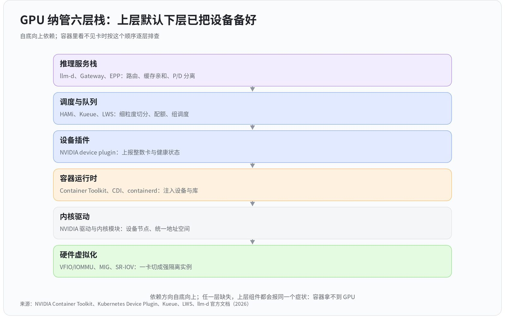
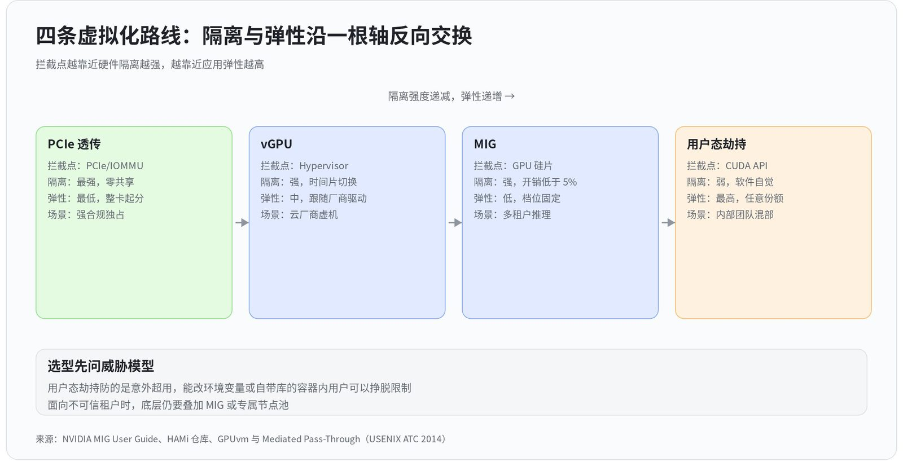
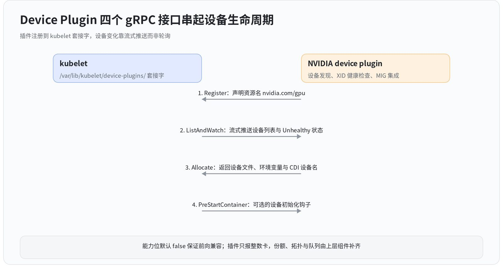
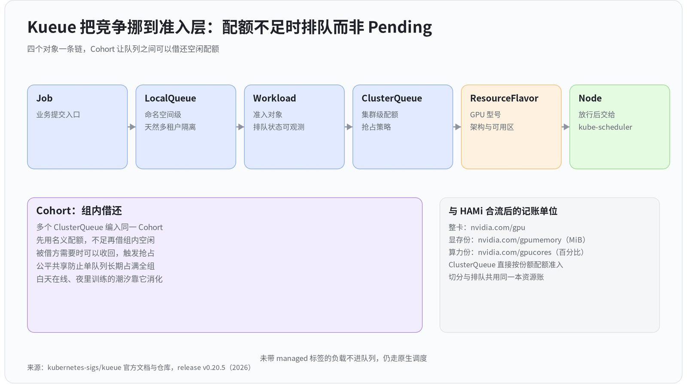
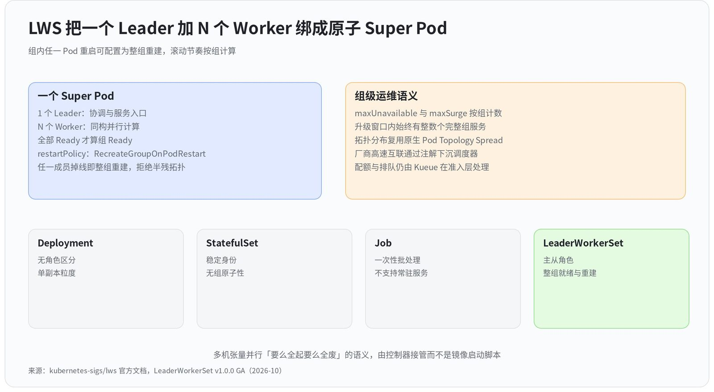
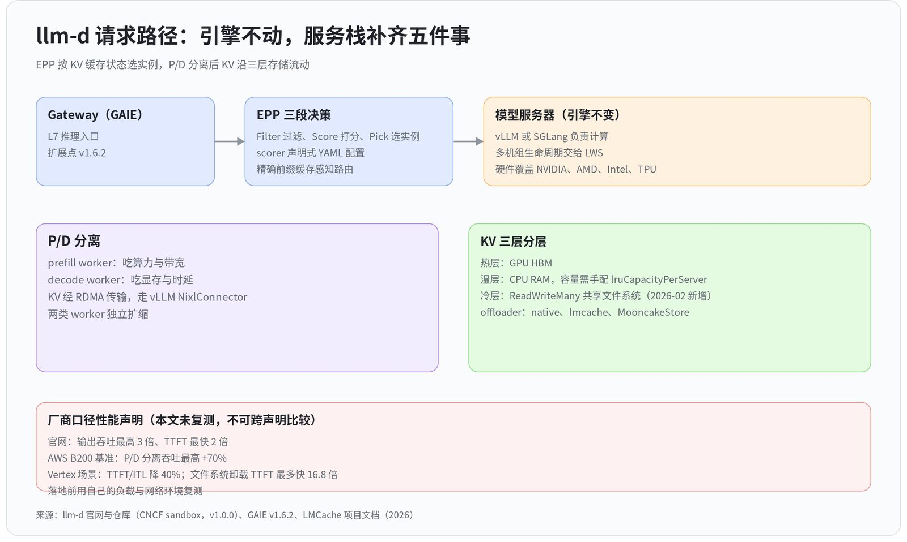
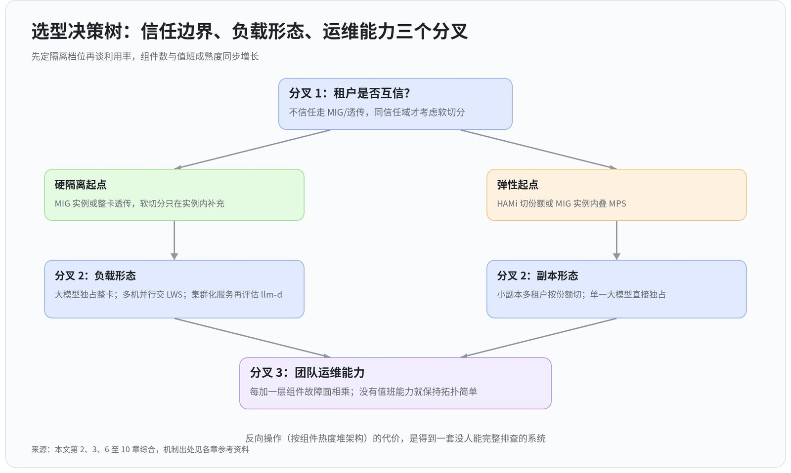
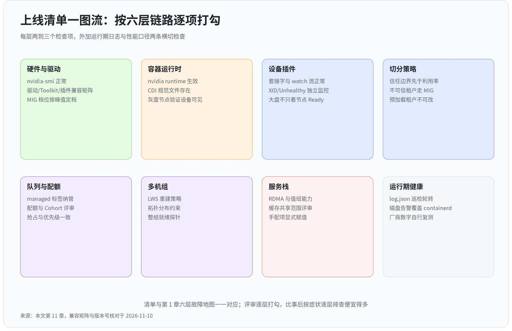

# LLM-69｜系统｜K8s 上的 GPU 与推理负载：从设备插件到队列调度

> 🎯 **这篇文档解决什么问题**：一张 GPU 从插在服务器上到被推理容器真正用起来，中间隔着驱动、容器运行时、设备插件、调度器和服务栈五层，每一层都有自己的资源模型和故障面。K8s 为无状态 Web 服务而生，GPU 不能超分、不能换出、训练作业要整组同时就绪，这些特性把原生调度器的短板全部放大。本文把这条链路从硬件虚拟化一直讲到集群化推理服务，回答三个问题：一张卡怎样被切成多份、队列怎样记账和抢占、多机推理服务怎样组成原子单元。
>
> 使用方式：做平台与 SRE 的读全文，按第 11 章清单上线；做推理引擎的读第 8 至 10 章，看 LWS 与 llm-d 怎样承接多机编排；做容量规划的读第 3、4、7 章，按隔离强度选切分路线。文中版本号与项目状态核对于 2026 年 11 月 10 日，性能声明凡来自厂商口径均显式标注，本文未做独立复测。

## 导读 · 先给结论

- **GPU 纳管是一条六层链路，断点通常不在 K8s 本身**。硬件、内核驱动、容器运行时、Device Plugin、调度器、推理服务栈各管一段，容器里看不见卡时要自底向上逐层排查，第 1 章给了完整地图。
- **切卡的四条路线按隔离强度排开，没有通吃版**。硬件透传与 MIG 隔离最强、开销最低但粒度僵，vGPU 居中，用户态劫持（HAMi、MPS）弹性最高但防不住容器内特权用户，选型先问威胁模型再问利用率[[1]](https://docs.nvidia.com/datacenter/tesla/mig-user-guide/)[[2]](https://github.com/Project-HAMi/HAMi)。
- <b>Device Plugin 只解决「看得见」，不解决「分得细、排得队」</b>。它靠 gRPC 流式接口向 kubelet 上报整数卡与健康状态，显存份额、拓扑亲和、队列配额分别由 HAMi、调度扩展和 Kueue 补齐[[3]](https://kubernetes.io/docs/concepts/extend-kubernetes/compute-storage-net/device-plugins/)。
- **Kueue 把资源竞争从调度器挪到准入层**。配额不足时作业在队列里等待而不是挂成 Pending 空转，Cohort 允许队列之间借还配额，配合 HAMi 后记账单位从整卡细化到显存份与算力份[[4]](https://github.com/kubernetes-sigs/kueue)。
- **多机推理的「要么全起要么全废」由 LWS 组语义接管**。LeaderWorkerSet 把一个 Leader 加多个 Worker 绑成原子部署单元，任一 Pod 重启可配置成整组重建，2026 年 10 月已 GA 到 v1[[5]](https://lws.sigs.k8s.io)。
- **llm-d 把推理网关、缓存亲和路由、P/D 分离和 KV 分层组装成 K8s 原生标准件**。它不重写引擎，vLLM 与 SGLang 仍负责计算，llm-d 补的是引擎之外的服务栈；官方性能数字全部是厂商口径，落地前要用自己的负载复测[[6]](https://llm-d.ai)。
- **上线前先定隔离档位，再谈利用率**。第 10、11 章给了按负载形态对号入座的决策树与上线清单：训练大作业走整卡加队列，小推理多副本走切分，多机张量并行走 LWS，集群化服务再评估 llm-d。

📎 与系列其他文档的分工：引擎内部的 PagedAttention、连续批处理与 prefix caching 机制见 [LLM-03｜系统｜vLLM 学习路径：从推理基础到架构前沿](./03-vllm-path.md) 与 [LLM-08｜系统｜大模型推理系统：全栈学习手册](./08-inference-systems.md)；推理服务的 SLO、稳定性与上线流程见 [LLM-07｜系统｜LLM 服务稳定性工程：SRE 上线手册](./07-serving-reliability.md)；KV Cache 跨租户的信任边界与泄露面见 [LLM-68｜系统｜KV Cache 的信任边界：共享、分层与三种泄露面](./68-kv-cache-trust.md)；Agent 沙盒场景下用 K8s 调度四种操作系统虚拟机的实践见 [LLM-57｜工程｜全平台 Agent 沙盒实践：用一套 K8s 调度四种操作系统的虚拟机](./57-agent-sandbox-k8s.md)。本文只讲平台层怎样纳管 GPU 与推理负载，不重复引擎机制。

素材与许可说明：本文事实主要整理自开源知识库 AI-fundamentals 的云原生 AI 平台专题，该仓库采用 Apache-2.0 许可[[7]](https://github.com/ForceInjection/AI-fundamentals)；所有上游项目的版本、星标与许可均经 GitHub 接口逐项核对，厂商性能声明保留原口径并显式标注。

## 第 1 章 · 一张 GPU 从裸金属到 Pod，要过六道关

K8s 的资源模型诞生于 CPU 与内存这类可压缩、可超分的资源，GPU 却是硬隔离设备：一张卡默认只能被一个容器独占，没有成熟的换出机制，训练作业还要求几十张卡同时就绪、缺一不可。把 GPU 纳进 K8s，等于在为无状态 Web 设计的体系上逐层打补丁，每一层补丁解决一个具体矛盾，也各留一处故障面。

📎 展开阅读：[LLM-08｜系统｜大模型推理系统：全栈学习手册](./08-inference-systems.md) 第五篇（推理引擎视角的显存与 KV 管理）；[LLM-07｜系统｜LLM 服务稳定性工程：SRE 上线手册](./07-serving-reliability.md)（服务上线后的稳定性与 SLO 体系）。

### 1.1 六层链路地图

从硬件往上数，一条请求最终在容器里拿到 GPU，要依次经过六层。

| 层 | 代表组件 | 解决什么 | 典型故障面 |
|---|---|---|---|
| 硬件虚拟化 | VFIO/IOMMU、MIG、SR-IOV | 一卡切成多份强隔离实例 | 粒度固定、弹性差 |
| 内核驱动 | NVIDIA 驱动、内核模块 | 设备节点与统一虚拟地址空间 | 驱动与固件版本错配 |
| 容器运行时 | Container Toolkit、CDI、containerd | 把设备文件与库注入容器 | runtime 配置、日志不轮转 |
| 设备插件 | NVIDIA device plugin | 向 kubelet 上报卡与健康状态 | 只报整数卡，无份额概念 |
| 调度与队列 | HAMi、Kueue、LWS | 细粒度切分、配额、组调度 | 多调度器协作冲突 |
| 推理服务栈 | llm-d、Gateway、EPP | 路由、缓存亲和、P/D 分离 | 链路长、故障域叠加 |

这六层的依赖方向是自底向上的：上层默认下层已经把设备准备好。容器里执行 nvidia-smi 报错时，问题可能在任何一层，跳过底层直接查调度只会浪费时间。

### 1.2 四个反复出现的断点

梳理生产环境的常见工单，故障高度集中在四处。第一处是运行时注入：containerd 没配 nvidia runtime 或 CDI 规范缺失，容器根本看不到设备节点。第二处是插件健康上报：GPU 触发 XID 错误后被标记为 Unhealthy，kubelet 不再往这张卡调度，但监控若只看节点 Ready 就发现不了。第三处是资源模型错配：业务想要半张卡，插件却只提供整数资源，于是一卡一容器、利用率长期偏低。第四处是多机作业的部分调度：十台机器只起来九台，作业卡死在等待状态，原生调度器没有组原子性，需要 LWS 这类控制器兜底。

后面十章按这条链路自底向上展开。第 2 章总览虚拟化四条路线，第 3、4 章讲硬件切分与容器设备链路，第 5、6 章讲设备插件与用户态切分，第 7、8 章讲队列配额与多机组，第 9、10 章讲推理服务栈与选型决策，第 11 章把全部注意事项收成上线清单。

> 💡 **常见误区**：把「Pod Pending 且提示 GPU 不足」一律当成卡不够。很多时候是 Device Plugin 没起来、资源名拼写不一致，或队列配额把作业挡在准入层，节点上其实有空闲卡。先查插件套接字与队列状态，再谈扩容。

## 第 2 章 · 虚拟化四条路线，隔离与弹性是一笔交换

「一张卡给多个人用」有四种做法，差别在拦截点放在哪一层。拦截点越靠近硬件，隔离越强、性能损耗越低，但切分粒度越僵；越靠近应用，弹性越好、改造成本越低，但隔离只靠软件自觉。先看清四条路线的边界，再谈选型。

### 2.1 路线一：硬件透传，整卡绑给一个租户

最彻底的做法是 PCIe 透传：借助 VFIO 与 IOMMU，把整张 GPU 在 PCI 层面绑给一台虚拟机或一个容器，宿主机与其他租户完全摸不到这张卡。它的优点是零共享、零越权面，缺点同样明显：卡的粒度就是最小分配单位，一张 H100 跑一个 7B 小模型也得独占，利用率没法看。透传是其余三条路线的安全基准，所有软件切分方案都要回答「我比透传多让渡了什么」。

### 2.2 路线二：Hypervisor 中介的 vGPU

vGPU 在虚拟化管理层拦截 GPU 调用，按时间片在多个虚拟机之间切换上下文，配合显存分区实现一卡多虚机。NVIDIA 的 GRID/vGPU 方案需要授权许可且只支持名单内的专业卡与数据中心卡，学术上的 GPUvm 与 mediated pass-through 原型在 USENIX ATC 2014 上已经验证了内核中介的可行性[[8]](https://www.usenix.org/conference/atc14/technical-sessions/presentation/suzuki)[[9]](https://www.usenix.org/conference/atc14/technical-sessions/presentation/tian)。这条路线隔离强度仅次于透传，上下文切换有可测的开销，且特性跟随厂商驱动节奏，云厂商之外的团队很少自建。

### 2.3 路线三：硬件切分，MIG 把隔离做进硅片

MIG（Multi-Instance GPU）在 A100/H100 这代数据中心卡上把 SM、显存地址空间和内存控制器同时切分，每个实例拥有独立的算力、显存与带宽，故障域硬件隔离，官方文档给出的性能开销低于 5%[[1]](https://docs.nvidia.com/datacenter/tesla/mig-user-guide/)。40GB 卡提供 1g.5gb、2g.10gb、3g.20gb、7g.40gb 四档 profile，80GB 卡对应 1g.10gb 到 7g.80gb。

它的代价同样写在硬件里：档位固定、实例之间不能做 CUDA IPC 通信、切分需要重置 GPU，弹性远不如软件方案，消费级卡也不支持。

### 2.4 路线四：用户态 API 劫持，HAMi 与 MPS 的弹性档

最灵活的做法完全不碰内核：通过 LD_PRELOAD 在用户态劫持 libcudart 与 libcuda 的调用，在分配显存与提交 kernel 的路径上记账和限流。HAMi-core 就是这条路线的开源代表，用一个 C 写的 libvgpu.so 同时拦截 Runtime 与 Driver 两层 API，靠 CUDA_DEVICE_MEMORY_LIMIT 与 CUDA_DEVICE_SM_LIMIT 两个环境变量给出显存上限与 SM 利用率百分比[[2]](https://github.com/Project-HAMi/HAMi)。MPS 则让多个进程共享同一个 CUDA 上下文，省掉上下文切换，适合小模型多副本。这条路线的边界要写在明处：它防的是意外超用，防不住有意绕过，容器内能改环境变量或自带库文件的用户可以挣脱限制，强隔离需求仍要退回 MIG。

| 路线 | 拦截位置 | 隔离强度 | 弹性 | 典型场景 |
|---|---|---|---|---|
| PCIe 透传 | PCIe/IOMMU | 最强 | 最低 | 强合规独占 |
| vGPU | Hypervisor | 强 | 中 | 云厂商虚机 |
| MIG | GPU 硬件 | 强，开销 &lt;5% | 低，档位固定 | 多租户推理 |
| 用户态劫持 | CUDA API | 弱，软件自觉 | 最高，任意份额 | 内部团队混部 |

> 💡 **常见误区**：把 HAMi 的显存限制当成安全隔离。它本质是分配路径上的软件记账，超额请求拿到 OOM，进程在硬件层面并非碰不到邻居的显存；面向不可信租户的平台，底层仍应叠加 MIG 或专属节点池。

## 第 3 章 · MIG 与 MPS：硬件切分的粒度账与组合用法

MIG 与 MPS 都让一张卡服务多个负载，但层级完全不同：MIG 在硬件里切出独立实例，MPS 在单个实例内让多进程共享上下文。搞清两者的边界，才能在隔离与利用率之间找到稳定的搭配。

### 3.1 MIG 的三层硬件隔离

MIG 的切分同时落在三处资源上。SM 按预定义配置分组，每个实例拿到专用的计算集群；显存划成独立地址空间，由硬件内存保护机制拦截越界访问；内存控制器也按实例切分，连显存带宽都互不抢占[[1]](https://docs.nvidia.com/datacenter/tesla/mig-user-guide/)。这意味着一个实例里的 kernel 崩溃或显存打爆，不会波及同卡的其他实例，故障域被限制在硬件边界内。

切分档位是离散的。以 80GB 卡为例，可以切出最多七个 1g.10gb 小实例，也可以组合成 2g.20gb、3g.40gb 与 7g.80gb，但所有实例的切片总数不能超过卡的物理上限，且调整拓扑需要先清空 GPU。对推理平台来说，这张卡一旦定了切分方案，后续改档的代价接近一次节点维护。

### 3.2 MIG 的适用面与短板

MIG 最契合的是多租户推理：每个租户拿到一个带独立显存与带宽保障的实例，质量稳定可预期。它的短板同样明确。首先，实例间无法建立 CUDA IPC，跨实例的张量并行走不通；其次，单实例的显存上限被档位锁死，大模型放不下时只能整卡部署；再者，切分与回收不灵活，业务潮汐下资源会僵在固定档位里。

### 3.3 MPS：在一个实例内容纳多进程

MPS（Multi-Process Service）把多个客户端进程的 kernel 提交到同一个 CUDA 上下文，由一个控制守护进程统一调度，省去了传统时间片模式下的上下文切换开销，小模型多副本推理的吞吐收益明显[[10]](https://docs.nvidia.com/deploy/mps/index.html)。Volta 及之后的架构允许在 MIG 实例上再跑 MPS，并支持按客户端设置显存与算力百分比，于是「MIG 切硬隔离、MPS 在隔离区内提利用率」成为常见组合。

MPS 的安全边界比 MIG 弱一档。所有客户端共享地址空间，单个进程的段错误可能拖垮整个 MPS server，故障域是整个实例而不是单个进程；它也不提供跨租户的内存保护。因此 MPS 适合同一个信任域内的同团队服务混部，不可信租户之间仍要靠 MIG 或节点隔离。

### 3.4 三层搭配的决策顺序

实操中可以按三步定方案。先按信任边界决定是否启用 MIG：租户互不信任就切实例，同团队内部则保留整卡弹性。再看单实例负载是否多进程：多个小副本共存就上 MPS，单一大模型则直接独占。最后才在用户态补 HAMi 这类软限制，处理 MIG 档位与实际配额对不齐的零头。跳过前两步直接上软切分，等于把隔离问题推迟成线上事故。

> 💡 **常见误区**：认为开了 MPS 就等于做了资源隔离。MPS 只优化共享效率，客户端之间没有硬件内存保护；把两个不同租户的服务放进同一 MPS server，一次越界就可能跨租户读写显存。

## 第 4 章 · 容器设备链路：Container Toolkit 与 CDI 怎样把卡装进容器

硬件与驱动都正常，容器里却执行不了 nvidia-smi，问题通常出在第三层：设备文件与驱动库没有被正确注入。NVIDIA Container Toolkit 就是这一层的标准件，它把「容器能看到哪些 GPU、能加载哪些库」从手工挂载变成了声明式配置。

### 4.1 三个组件各管一段

Toolkit 的结构分三层。nvidia-container-runtime 是一个 OCI 运行时垫片，拦在 containerd 与 runc 之间，截获容器创建请求；nvidia-ctk 是命令行工具，负责生成配置与 CDI 规范，从 v1.10 起收入安装包；底层的 hook 在容器启动瞬间把设备节点、驱动库与二进制注入挂载命名空间。旧包 nvidia-container-runtime-hook 已并入主包，可执行文件仍保留，升级时不需要改业务脚本[[11]](https://docs.nvidia.com/datacenter/cloud-native/container-toolkit/latest/)。

设备选择有两条等价路径。Docker 时代常用的 --gpus 参数会被翻译成 NVIDIA_VISIBLE_DEVICES 环境变量，runtime 路径直接读这个变量决定注入哪几张卡；containerd 节点则在 config.toml 里把默认 runtime 指向 nvidia-container-runtime，同一套注入逻辑对 Kubernetes 与裸容器都生效。配错时的典型症状很一致：容器启动成功但 /dev/nvidia\* 缺失，CUDA 程序报 no CUDA-capable device。

### 4.2 CDI：把设备声明从 runtime 挪到规范文件

CDI（Container Device Interface）是 CNCF 维护的跨厂商规范，核心思路是让设备的完整描述落进一个版本化的 YAML 文件，容器运行时只负责按规范挂载，不再内嵌任何厂商逻辑。节点上执行 nvidia-ctk cdi generate 会扫描驱动并生成 /etc/cdi/nvidia.yaml，每张卡、每个 MIG 实例都是一个可被容器按名引用的设备；Toolkit 从 v1.12 起支持生成规范，v1.16 起注入逻辑独立成 nvidia-cdi-hook[[12]](https://github.com/cncf-tags/container-device-interface)。

CDI 相对旧 runtime hook 的收益在 K8s 场景里尤其明显。设备定义与容器编排解耦后，device plugin 在 Allocate 阶段只需返回 CDI 设备名，kubelet 与 containerd 按规范完成注入，链路里没有厂商私有环境变量；多厂商混部的节点上，AMD、NVIDIA 与其他加速卡各出各的规范文件，运行时用同一套机制处理。纯 CDI 节点可以只装 toolkit-base 最小包，不再需要完整 runtime 垫片[[13]](https://github.com/NVIDIA/nvidia-container-toolkit)。

### 4.3 版本配套与排查顺序

这一层的故障大多是版本与配置错配，排查顺序应当自底向上。先在宿主机执行 nvidia-smi 确认驱动与内核模块正常，再检查 containerd 的 runtime 配置与 /etc/cdi/nvidia.yaml 是否存在、内容是否与当前驱动匹配，最后才进容器看设备节点。跳过前两步直接在容器里排查，会把一个节点级配置问题误判成镜像问题。

驱动与 Toolkit 的版本关系要分清：驱动提供内核模块与用户态库，Toolkit 只做注入，两者各自独立发版，Toolkit 的 release notes 会写明兼容的最低驱动版本。截至核对日，Toolkit 最新 release 为 v1.20.1，节点批量升级前应先在同版本驱动的灰度节点验证 CDI 规范生成结果[[13]](https://github.com/NVIDIA/nvidia-container-toolkit)。

> 💡 **常见误区**：容器里看不到卡就重装驱动。宿主机 nvidia-smi 正常而容器内失败时，驱动本身没有问题，故障点在 containerd runtime 配置、CDI 规范缺失或 NVIDIA_VISIBLE_DEVICES 拼写，重装驱动只会扩大变更面。

## 第 5 章 · Device Plugin：kubelet 怎样看见 GPU，以及它管不到什么

容器运行时解决了「卡能进容器」，设备插件解决的是「调度器知道节点上有卡」。Kubernetes 原生不认识任何加速器，Device Plugin 框架给厂商开了一条标准上报通道，NVIDIA 的插件则把这条通道接到了真实的 GPU 与 MIG 实例上。

### 5.1 四个 gRPC 接口串起设备生命周期

插件以 gRPC 服务的形式注册到 kubelet 的 /var/lib/kubelet/device-plugins/ 套接字，资源名采用厂商域名前缀，GPU 的标准名是 nvidia.com/gpu。整条链路围绕四个接口展开。Register 完成插件登记与资源名声明。ListAndWatch 以流式连接持续推送设备列表与健康状态，设备变化或故障时事件驱动地刷新，没有轮询。Allocate 在容器创建前被调用，返回需要挂载的设备文件、环境变量与 CDI 设备名。PreStartContainer 是可选的预留接口，用于设备初始化动作[[3]](https://kubernetes.io/docs/concepts/extend-kubernetes/compute-storage-net/device-plugins/)。

能力协商由 GetDevicePluginOptions 完成，插件通过能力位声明是否需要 PreStart 等行为，所有能力位默认 false，老 kubelet 遇到不认识的新能力可以安全忽略，这保证了框架的前向兼容。理解这条链路的实用价值在于定位故障：套接字不存在意味着插件没起来，ListAndWatch 流断意味着插件在重启，Allocate 失败才与单机设备状态有关。把这三个症状与接口对应起来，排障就不会在 kubelet 与插件之间来回打转。

### 5.2 健康检查与 MIG 集成

NVIDIA device plugin 不只做设备发现。它监听驱动的 XID 错误事件，触发故障的卡会被标记为 Unhealthy 并通过 ListAndWatch 上报，kubelet 随即停止向这张卡调度新 Pod。MIG 模式下插件把每个 MIG 实例作为独立设备上报，资源名细化到具体 profile，使调度器能按实例而非整卡分配。它也与 GPU Operator 协作，由 Operator 负责驱动与 Toolkit 的部署，插件专注设备面[[14]](https://github.com/NVIDIA/k8s-device-plugin)。

这里藏着一个监控盲区：节点级 Ready 条件只反映 kubelet 与容器运行时的存活，单卡 Unhealthy 不会让节点变 NotReady。只看节点状态的大盘会显示一切正常，调度失败却在持续发生。GPU 健康度必须以插件上报的设备资源与 XID 事件为单独指标采集，节点 Ready 与设备健康要分两条曲线看。

### 5.3 整数卡模型的三个缺口

Device Plugin 的资源模型与 CPU 一脉相承：设备是不可分割的计数资源，请求 nvidia.com/gpu 只能填整数，一张卡分给一个容器。这个模型留下三个明确缺口。首先是没有份额概念，半张卡、40% 显存这类请求无法表达，一卡一容器导致小模型场景利用率长期偏低。其次是不感知拓扑，NVLink 亲和、NUMA 与跨机带宽对调度器不可见。最后是不做排队与配额，资源不足时 Pod 直接挂 Pending，没有队列语义[[3]](https://kubernetes.io/docs/concepts/extend-kubernetes/compute-storage-net/device-plugins/)。

三个缺口分别由后续章节的组件补齐：份额由 HAMi 在用户态切分并以 gpucores、gpumemory 两类自定义资源上报，拓扑亲和由调度扩展与拓扑分布约束处理，队列与配额由 Kueue 在准入层接管。Device Plugin 守住的是「看得见、报得准」这条基线，细粒度与多租户都是在它之上另搭的层。截至核对日，NVIDIA 插件最新 release 为 v0.20.1[[14]](https://github.com/NVIDIA/k8s-device-plugin)。

> 💡 **常见误区**：把 Device Plugin 当成 GPU 调度器。它只向 kubelet 上报整数设备与健康状态，既不决定 Pod 落到哪张卡，也不管配额与排队；装了插件就以为有了多租户调度能力，是平台设计里最常见的越界假设。

## 第 6 章 · HAMi：用户态切分怎样把一卡租给多个人

Device Plugin 报上来的是整数卡，业务要的却是「7B 模型给 20GiB 显存加 30% 算力就够」。HAMi 补上的正是这个份额层：不改内核、不换驱动，在用户态把一张物理卡抽象成可记账的多份虚拟资源，是内部团队混部场景里弹性最高的切分方案。

### 6.1 三件套：调度扩展、插件与容器内拦截库

HAMi 由三个协作组件构成。调度器扩展（scheduler extender）挂在 kube-scheduler 的过滤环节，按各节点剩余显存与 SM 余量筛选可落位点；改造过的 device plugin 除整数卡外再上报两类自定义资源，nvidia.com/gpumemory 以 MiB 计显存份额，nvidia.com/gpucores 以百分比计 SM 份额；真正生效的限制发生在容器内，HAMi-core 是一个用 C 写的 libvgpu.so，通过 LD_PRELOAD 同时劫持 Runtime 层的 libcudart 与 Driver 层的 libcuda 调用[[2]](https://github.com/Project-HAMi/HAMi)。

两条限制路径要分开看。显存限制作用在分配类 API 上，进程累计分配达到 CUDA_DEVICE_MEMORY_LIMIT 后，再申请拿到的是 OOM 错误而非真实内存；算力限制作用在 kernel 提交路径上，按 CUDA_DEVICE_SM_LIMIT 设定的百分比限流，本质是时间片比例控制。调度扩展负责「节点上记账不超额」，拦截库负责「容器内请求不超配额」，两者缺一，限制都会退化成摆设。

### 6.2 资源模型与异构适配

Pod 规格在整数卡之外增加两个份额字段后，一卡多租成为 K8s 原生可表达的对象。十个各要 10% 算力与 8GiB 显存的推理副本可以落在同一张 80GB 卡上，调度与计费都按份额而非整卡展开。

HAMi 对异构硬件的适配范围也超出 NVIDIA 单一阵营。AMD Radeon 与 Instinct、海光 DCU、寒武纪 MLU、昆仑芯、天数智芯、摩尔线程、昇腾 NPU 与 MetaX 都在支持列表内，各厂商的拦截实现统一进同一套调度模型[[2]](https://github.com/Project-HAMi/HAMi)。

这套模型的代价是碎片与零头。显存份额按 MiB 记账看似连续，物理卡上的 SM 分区与 MIG 档位仍是离散的，业务配额与硬件档位对不齐时会留下无法分配的零头。份额 Pod 与整卡 Pod 混部时，调度扩展的余量计算还需要为未来调度预留空间，否则新 Pod 的排队时间会被邻居的动态增长反复拉长。这些零头通常要靠 MIG 打底加 HAMi 补零头的组合消化。

### 6.3 安全边界：防意外超用，防不住有意绕过

HAMi 的限制机制决定了它的威胁模型。拦截发生在用户态，依赖 LD_PRELOAD 与环境变量生效。容器内拥有修改入口的用户可以删掉预加载配置、自带 CUDA 库或直接打开设备节点，从而完全挣脱配额。显存 OOM 是分配路径上的软件记账，超额请求拿到的是报错，进程在硬件层面并非碰不到邻居的显存。它防的是同一信任域内的意外超用与资源争抢，不提供跨租户内存保护[[2]](https://github.com/Project-HAMi/HAMi)。

因此部署形态要与信任边界对齐。同团队、同账号体系下的内部混部，HAMi 是性价比最高的选择，弹性与改造成本都优于 MIG；面向不可信租户的对外平台，底层仍应叠加 MIG 硬隔离或专属节点池，把 HAMi 限制在单个硬件实例内部使用。把软件记账当安全隔离出售，等于把故障域从单进程扩大到整卡。还要避开一个常见误读：设了 gpumemory 上限并不等于拿到显存隔离，容器内能改 LD_PRELOAD 或自带库文件的用户可以绕过全部限制，不可信租户之间的隔离仍要回到 MIG 或节点级边界。

## 第 7 章 · Kueue：把资源竞争从调度器挪到准入层

原生调度器面对资源不足只有一种反应：让 Pod 挂成 Pending 持续重试。队列型业务需要的语义完全不同：作业在准入处排队、配额可借还、高优先级可抢占。Kueue 用一组原生 API 对象把这套语义建在准入层，不替换 kube-scheduler，也不侵入节点。

### 7.1 四个对象与一条调度链

Kueue 的模型由四个对象组成。ResourceFlavor 描述一类资源的属性与节点选择条件，GPU 型号、架构与可用区差异都在这一层表达。ClusterQueue 是集群级配额容器，定义各类资源的名义配额、借用上限与抢占策略。LocalQueue 是命名空间内的入口，业务只与它交互，命名空间边界天然提供多租户隔离。Cohort 把多个 ClusterQueue 编成一组，组内允许互相借还空闲配额[[4]](https://github.com/kubernetes-sigs/kueue)。

作业的流转链路因此变成：业务向 LocalQueue 提交 Job，Kueue 为它生成 Workload 对象并尝试在对应 ClusterQueue 准入，按 ResourceFlavor 匹配资源后才放行给 kube-scheduler 落到具体节点。配额不足时 Workload 保持排队状态，Pod 根本不会被创建，调度器里没有 Pending 空转，队列顺序、等待时长与准入原因都成为可观测的一等指标。

### 7.2 抢占、Cohort 与公平共享

抢占策略在 ClusterQueue 上声明，分同队列与跨队列两级。高优先级 Workload 准入时若配额不足，可以驱逐同队列内的低优先级作业；Cohort 内部则按借用关系处理，队列先用自己的名义配额，不够再借组内空闲，被借方需要时可以收回。公平共享保证没有哪个队列能长期占住全组资源，借用容量按策略在成员间再分配[[4]](https://github.com/kubernetes-sigs/kueue)。

这套机制直接回应了 GPU 集群的潮汐问题。白天在线推理占满的卡，夜里可以借给训练队列；单个业务线为峰值买的配额，平时由 Cohort 内其他团队消化。与每个团队维护专属节点池相比，借还机制把容量规划从物理隔离改成了记账隔离。代价是回收时的抢占会真实中断作业，可中断性必须在作业优先级里提前声明。

### 7.3 纳管范围与 HAMi 记账

Kueue 不绑定工作负载类型。Batch Job 是原生场景，Deployment 一类常驻负载通过 pod-group 注解成组纳管，Ray、MPI 与 JobSet 等多机作业也有对应集成；前提是作业带有 kueue.x-k8s.io/managed 标签，未标记的负载不进队列、仍走原生调度。当前 API 为 v1beta1，要求 Kubernetes 1.29 以上，截至核对日最新 release 为 v0.20.5[[4]](https://github.com/kubernetes-sigs/kueue)。

与 HAMi 结合后，记账单位从整卡细化到份额。ClusterQueue 的配额字段可以直接写 gpumemory 与 gpucores，队列按显存份与算力份计费准入，一份 80GB 卡的容量因此能拆成数十个可排队、可抢占的细粒度名额，切分与排队两层终于共用同一套资源账本。

与 Volcano、YuniKorn 这类自带调度器的方案相比，Kueue 的取舍是只做准入、把节点选择留给原生调度器，侵入面小但单作业内的编排能力也更克制；Slurm 则属于 HPC 存量体系，与云原生队列的集成要靠额外适配。接入 Kueue 后还要更新排障直觉：作业等待时节点上可能有空闲卡，却被 ClusterQueue 配额或 Cohort 借用规则挡在准入层，先查 Workload 事件与队列配额，再谈扩容。

## 第 8 章 · LWS：多机推理的组原子语义

单机切分解决了资源利用率，多机推理带来的是另一个问题：一个张量并行组里十台机器只起来九台，作业既不能跑也不会退出。Kubernetes 原生工作负载没有「整组同时就绪」的语义，LeaderWorkerSet（LWS）把主从角色与组原子性做成了控制器级别的一等对象。

### 8.1 Super Pod：把一个主从组当成最小单位

LWS 是首个带主从角色语义的 K8s 控制器，核心抽象是 Super Pod：一个 Leader Pod 加 N 个同构 Worker Pod 绑成一个原子部署单元，Leader 通常承担协调与入口职责，Worker 执行并行计算。控制器保证整组的扩缩、滚动更新与故障恢复都以组为单位发生，API 已在 2026 年 10 月进入 v1 并 GA，组对象名为 leaderworkerset.x-k8s.io/v1[[5]](https://lws.sigs.k8s.io)。

组语义最关键的配置是 restartPolicy。设为 RecreateGroupOnPodRestart 后，组内任一 Pod 重启都会触发整组重建，这正合分布式推理的现实：一个 worker 掉线后，其余成员的通信域已经失效，只补单个 Pod 反而留下半残拓扑。默认策略则只重建失败 Pod，适合无状态、成员可动态换入的作业。就绪判定同样是组级的：Leader 与全部 Worker 都 Ready，Super Pod 才算 Ready，上游服务不会把流量导给缺员的组[[15]](https://github.com/kubernetes-sigs/lws)。

### 8.2 组级滚动与拓扑分布

滚动更新的节奏由 maxUnavailable 与 maxSurge 两个组级参数控制，控制器按 Super Pod 而非单 Pod 计算可用副本数，保证升级过程中总有整数个完整组在服务。多机训练动辄几十张卡，按单 Pod 滚动会让并行组在整个升级窗口里反复处于缺员状态，组级滚动把故障影响收敛在被更新的那一组。

拓扑能力刻意保持克制。LWS 不内置任何厂商拓扑，直接复用 Kubernetes 原生的 Pod Topology Spread Constraints 做机架与可用区级分散，厂商特有的高速互联拓扑（如 GKE TPU 拓扑）通过注解交给下层调度器处理[[16]](https://kubernetes.io/docs/concepts/scheduling-eviction/topology-spread-constraints/)。这种边界划分让控制器本身保持轻量，也意味着 NVLink 域、RDMA 网卡亲和这类需求仍要在调度与节点标签层面单独设计，不能指望 LWS 自动解决。

### 8.3 与 Deployment、StatefulSet、Job 的分工

把 LWS 放进工作负载族谱，边界会很清楚。Deployment 管理无角色区分的无状态副本，适合 Web 与单副本推理；StatefulSet 提供稳定身份与单 Pod 粒度的有序部署，但没有组原子性，扩缩容不保证伙伴同时存在；Job 面向一次性批处理，不支持常驻服务与滚动更新。多机张量并行推理同时需要角色区分、整组就绪与常驻运维，这正是 LWS 独占的空位[[5]](https://lws.sigs.k8s.io)。

它与队列层的衔接也值得说明。LWS 负责组内生命周期，配额与排队仍交给 Kueue：Kueue 在准入层判断整组配额是否充足，凑不齐卡时整组等待、拒绝部分下发，从源头消除「九台等待第十台」的部分调度。两层各管一段，避免了在一个控制器里同时实现配额记账与拓扑编排。llm-d 的多机推理编排也直接构建在 LWS 之上，第 9 章会展开这条上层链路。

> 💡 **常见误区**：用 StatefulSet 加启动脚本模拟多机组。脚本层的等待凑不齐真正的原子性，部分 Pod 失败时残留成员会持续占卡并拖住重试，故障恢复还要自己写；组语义应当下沉到控制器，散落在每个镜像 entrypoint 里的脚本兜不住整组故障。

## 第 9 章 · llm-d：把路由、缓存亲和与 P/D 分离组装成服务栈

前面八章把单卡纳管、切分、排队与多机组逐项打通，剩下的问题在引擎之外：请求该路由给哪个实例，前缀缓存怎样复用，prefill 与 decode 怎样拆开各自扩缩。llm-d 给出的答案是不重写推理引擎，vLLM 与 SGLang 继续负责计算，它在上面补一层 K8s 原生的分布式服务栈。

### 9.1 入口与 EPP：Filter、Score、Pick 三段路由

llm-d 的请求入口是 Gateway API Inference Extension（GAIE），这是 gateway-api-inference-extension 仓库定义的 L7 推理扩展，截至核对日最新 release 为 v1.6.2[[17]](https://github.com/kubernetes-sigs/gateway-api-inference-extension)。真正做决策的是 Endpoint Picker（EPP）：它以事件驱动方式跟踪所有模型服务器的负载与 KV 缓存状态，对每个请求执行 Filter、Score、Pick 三段流水线，先过滤不满足条件的实例，再按可声明的 scorer 打分，最后选出目标。

打分规则以声明式 YAML 配置，精确前缀缓存感知路由（Precise Prefix-Cache Aware Routing）是其中的关键 scorer：请求被优先发往已持有其前缀 KV 的实例，把 prefix caching 的命中率从单实例内的被动复用提升为集群级的主动调度。

这一机制的信任边界在系列另一篇里有专门拆解。跨租户共享前缀缓存存在数据面与侧信道泄露面，落地前应当先读那篇的威胁模型，再决定共享范围[LLM-68｜系统｜KV Cache 的信任边界：共享、分层与三种泄露面](./68-kv-cache-trust.md)。

### 9.2 P/D 分离与 KV 三层分层

Prefill 与 decode 对硬件的诉求不同：前者吃算力与带宽，后者吃显存容量与时延。llm-d 支持把两类 worker 拆成独立部署单元各自扩缩，prefill 完成后通过 RDMA 把 KV 张量传给 decode worker，底层传输走 vLLM 的 NixlConnector；多机组的生命周期全部交给 LWS 管理，与第 8 章的组语义无缝衔接[[6]](https://llm-d.ai)。

KV 存储被组织成三层：GPU HBM 为最热层，CPU RAM 承接换出的前缀，2026 年 2 月新增的 ReadWriteMany 共享文件系统层提供跨节点的容量底座。换出动作由 offloader 执行，共有三种实现：native 走 vLLM OffloadingConnector 或 SGLang HiCache，是官方推荐路径；lmcache-connector 对接 LMCache；MooncakeStore 面向有 RDMA 网络的环境[[18]](https://lmcache.ai)。一个工程细节要提前知道：CPU 层容量不由引擎上报，需要手工为每个 server 配置 lruCapacityPerServer，默认值不会替你算出合理容量。

### 9.3 版本、性能口径与折扣清单

llm-d 是 CNCF sandbox 项目，由 Red Hat、Google Cloud、IBM Research、CoreWeave 与 NVIDIA 联合发起，截至核对日为 v1.0.0，后端支持 vLLM 与 SGLang，硬件覆盖 NVIDIA、AMD、Intel 与 TPU[[19]](https://github.com/llm-d/llm-d)。它的性能声明全部来自厂商口径，本文未做独立复测，引用时必须保留这个标签。官方站点给出输出吞吐最高 3 倍、TTFT 最快 2 倍的总体收益；AWS 在 B200 上的基准称 P/D 分离相对标准 vLLM 吞吐最高提升 70%；Google Cloud 的 Vertex 场景称 TTFT 与 ITL 降低 40%；2026 年 2 月官方博客称文件系统卸载场景 TTFT 最多快 16.8 倍[[6]](https://llm-d.ai)。这些数字来自不同负载与硬件，彼此不可直接比较，落地前要用自己的流量模型复测。

折扣清单同样要摆在明处。链路上叠着 Gateway、EPP、offloader、LWS 与引擎五层，故障域随组件数相乘，任一层的版本错配都可能表现为路由异常。P/D 分离与 MooncakeStore 依赖 RDMA 网络，普通以太集群跑不出声明收益。CPU 层容量靠手配，文件系统层引入了新的持久化与清理负担。项目迭代速度快，生产部署应当锁定具体版本，避免直接追主线。它解决的是规模化之后的服务编排问题，单机或小规模集群引入这套复杂度往往得不偿失。

📎 展开阅读：[LLM-08｜系统｜大模型推理系统：全栈学习手册](./08-inference-systems.md) 第五篇（引擎视角的显存与 KV 管理，对应本章 KV 三层分层的引擎侧机制）；[LLM-07｜系统｜LLM 服务稳定性工程：SRE 上线手册](./07-serving-reliability.md)（推理服务上线后的 SLO 与稳定性体系，可作为 llm-d 五层栈的运维对照）。

> 💡 **常见误区**：把 llm-d 当成新的推理引擎。计算仍由 vLLM 或 SGLang 完成，llm-d 提供的是引擎之外的路由、缓存亲和、P/D 编排与 KV 分层；选型时要评估的是这层服务栈的运维成本，别误以为要迁移模型执行框架。

## 第 10 章 · 按负载形态选型：决策树与四类典型搭配

组件齐备之后，真正的难题是组合：MIG、MPS、HAMi、Kueue、LWS 与 llm-d 各自解决一段矛盾，全堆上去只会制造运维灾难。本章把前文的机制压成一棵决策树，再用四类典型负载走一遍，给出可以直接对号入座的搭配。

### 10.1 决策树：先问信任边界，再问负载形态

选型的第一个分叉永远是信任边界，利用率排在其后。租户互不信任、合规要求硬隔离的场景，起点是 MIG 实例或整卡透传，软件切分只能在硬件实例内部做补充；同一信任域内的内部混部，才允许把 HAMi 或 MPS 作为主切分手段。跳过这一步直接追求利用率，等于把隔离问题推迟成线上事故，第 2、3 章的路线对比与 MPS 故障域分析是这一步的依据。

第二个分叉看负载形态。单一大模型显存逼近整卡的，没有切分空间，直接整卡独占。多个小副本共存且进程模型稳定的，在信任域内用 HAMi 切份额，或在 MIG 实例内叠加 MPS 提吞吐。需要整组多机并行的，组生命周期交给 LWS，配额交给 Kueue。面向多模型、多租户的集群化在线服务，再评估 llm-d 的路由与缓存亲和能力。第三个分叉才看运维能力：链路每加一层，故障定位与版本配套的成本都上一个台阶，团队没有对应值班能力时，宁可牺牲利用率保持拓扑简单。

### 10.2 四类典型负载的标准搭配

| 负载形态 | 切分与隔离 | 调度与编排 | 关键前提 |
|---|---|---|---|
| 训练与大规模微调作业 | 整卡独占，不开软切分 | Kueue 排队加抢占，多机走 LWS 组语义 | 作业声明可中断性，配额按整卡记账 |
| 多租户在线推理 | MIG 实例打底，实例内可叠 MPS | Device Plugin 报实例，Kueue 按租户分队列 | 切分拓扑变更按节点维护排期 |
| 同团队小模型多副本 | HAMi 按显存份与算力份切分 | HAMi 调度扩展加 Kueue 份额配额 | 容器内用户不可改预加载与环境变量 |
| 集群化推理服务 | 按单副本显存选整卡或 MIG | LWS 管多机组，llm-d 管路由与 P/D 分离 | RDMA 网络就绪，性能数字自行复测 |

### 10.3 容易算错的三笔账

第一笔是利用率账。切分提升的是分配率，不等于真实利用率：HAMi 让一张卡能登记十个租户，但十个副本的算力峰值叠加时仍会互相排队，SM 百分比限制只能压均值、压不住瞬时争抢。容量规划要同时看显存配额与实测算力曲线，不能只按份额数算账。

第二笔是弹性账。MIG 的档位离散且改拓扑要重置 GPU，业务潮汐下僵在固定档位里的容量并不便宜；HAMi 弹性最高却以弱隔离为代价。混合策略通常是稳态基线用 MIG 锁定、突发负载用 HAMi 承接零头，两者配合而非二选一。第三笔是复杂度账。llm-d 这类五层栈的收益随规模放大，小集群上同样的故障面却没有足够流量摊薄，组件数应当与团队的值班成熟度同步增长。

> 💡 **常见误区**：按组件热度决定上不上。MIG、HAMi、Kueue、LWS 与 llm-d 不是越全越先进，每个组件都对应一个真实存在的矛盾；没有多租户就别上硬切分，没有多机组就别引入 LWS，先列痛点再选组件，反向操作只会得到一套没人能完整排查的系统。

## 第 11 章 · 上线清单与运行期反模式

最后一章把全链路收成可执行的核对项，并补上一个在长跑集群里反复出现、却很少写进设计文档的运行期问题：容器运行时日志的静默膨胀。清单按六层链路自底向上排列，与第 1 章的故障地图一一对应，上线评审时逐层打勾比事后救火便宜得多。

### 11.1 一个被低估的运行期故障面：运行时日志不轮转

containerd 与 runc 在容器生命周期里持续写 log.json，默认没有轮转机制。Kubernetes 自带的容器标准输出轮转（container-log-max-size 一类 kubelet 配置）只管 /var/log/pods 下的业务日志，管不到运行时自己的这份文件。长跑节点上它会单调增长，最终以磁盘写满的形式拖垮整台机器，表现为容器运行时无响应、Pod 批量驱逐，而监控里的业务日志量却完全正常[[20]](https://github.com/containerd/containerd/issues/8972)。

NVIDIA container runtime 的日志级别可以在 containerd 的 config.toml 里调整，也可以通过 XDG_CONFIG_HOME 指向覆盖配置。排查容器启动失败时，正确顺序是先按时间与日志级别过滤运行时日志，再看 kubelet 事件。设备注入失败、CDI 规范解析错误都只留在运行时日志里，kubelet 事件只会给出一个笼统的 CreateContainer 错误。磁盘侧则应把运行时日志目录纳入节点磁盘巡检与日志轮转策略，不要等节点告警才发现这份盲区。

### 11.2 上线前核对清单

> 📌 **上线前核对清单**
>
> - 硬件与驱动：宿主机 nvidia-smi 正常，驱动版本与 Toolkit、device plugin 的兼容矩阵已核对；MIG 切分方案按峰值负载定档，变更走节点维护流程。
> - 容器运行时：containerd 的 nvidia runtime 配置生效，CDI 规范文件 /etc/cdi/nvidia.yaml 存在且与驱动匹配；灰度节点验证过容器内设备节点可见。
> - 设备插件：device plugin 套接字与 ListAndWatch 流正常，XID 与 Unhealthy 设备有独立监控指标，监控大盘不只看节点 Ready。
> - 切分策略：信任边界先于利用率确认；不可信租户走 MIG 或专属节点，HAMi 只用于同信任域混部，容器内预加载与环境变量不可被租户修改。
> - 队列与配额：作业带 managed 标签纳入 Kueue，ClusterQueue 配额与 Cohort 借用策略评审过，抢占策略与作业优先级、可中断性声明一致。
> - 多机组：多机推理使用 LWS 并按通信域要求配置 RecreateGroupOnPodRestart，拓扑分布约束覆盖机架与可用区，整组就绪探针生效。
> - 服务栈：引入 llm-d 前确认 RDMA 网络与值班能力，缓存亲和路由的共享范围经信任边界评审，lruCapacityPerServer 等手配项显式赋值。
> - 运行期健康：运行时 log.json 纳入磁盘巡检与轮转，节点磁盘告警覆盖 /var/lib/containerd；所有厂商性能数字以本集群负载复测结果为准。

### 11.3 全文小结

> 🔑 **全文小结**：把 GPU 纳进 K8s，本质是在为无状态 Web 设计的体系上逐层补齐设备语义。硬件虚拟化决定隔离档位，容器运行时与 Device Plugin 解决看得见、进得去，HAMi 与 Kueue 解决分得细、排得队，LWS 与 llm-d 解决多机组与集群化服务。六个层级各有明确边界与故障面，选型先问信任边界与负载形态，再谈利用率；跳过底层隔离直接堆软切分，省下的工程债迟早以线上事故的形式归还。

## 参考文献

按正文首次引用顺序编号，资料截至 2026 年 11 月初。

[1] NVIDIA. Multi-Instance GPU User Guide (2024) [https://docs.nvidia.com/datacenter/tesla/mig-user-guide/](https://docs.nvidia.com/datacenter/tesla/mig-user-guide/)

[2] Project-HAMi. HAMi：Heterogeneous GPU Sharing on Kubernetes，最新 release v2.11.0 (2026) [https://github.com/Project-HAMi/HAMi](https://github.com/Project-HAMi/HAMi)

[3] Kubernetes. Device Plugins 官方文档 (2026) [https://kubernetes.io/docs/concepts/extend-kubernetes/compute-storage-net/device-plugins/](https://kubernetes.io/docs/concepts/extend-kubernetes/compute-storage-net/device-plugins/)

[4] kubernetes-sigs. Kueue：Kubernetes-native Job Queueing，最新 release v0.20.5 (2026) [https://github.com/kubernetes-sigs/kueue](https://github.com/kubernetes-sigs/kueue)

[5] kubernetes-sigs. LeaderWorkerSet 官方文档，v1.0.0 GA (2026) [https://lws.sigs.k8s.io](https://lws.sigs.k8s.io)

[6] llm-d 项目官网：Kubernetes 原生分布式推理服务栈 (2026) [https://llm-d.ai](https://llm-d.ai)

[7] ForceInjection. AI-fundamentals 开源知识库（Apache-2.0），04_cloud_native_ai_platform 章节 (2026) [https://github.com/ForceInjection/AI-fundamentals](https://github.com/ForceInjection/AI-fundamentals)

[8] Suzuki et al. GPUvm: Why Not Virtualizing GPUs at the Hypervisor? USENIX ATC 2014 [https://www.usenix.org/conference/atc14/technical-sessions/presentation/suzuki](https://www.usenix.org/conference/atc14/technical-sessions/presentation/suzuki)

[9] Tian et al. A Full GPU Virtualization Solution with Mediated Pass-Through. USENIX ATC 2014 [https://www.usenix.org/conference/atc14/technical-sessions/presentation/tian](https://www.usenix.org/conference/atc14/technical-sessions/presentation/tian)

[10] NVIDIA. CUDA Multi-Process Service 官方文档 (2024) [https://docs.nvidia.com/deploy/mps/index.html](https://docs.nvidia.com/deploy/mps/index.html)

[11] NVIDIA. NVIDIA Container Toolkit 官方文档 (2026) [https://docs.nvidia.com/datacenter/cloud-native/container-toolkit/latest/](https://docs.nvidia.com/datacenter/cloud-native/container-toolkit/latest/)

[12] CNCF. Container Device Interface (CDI) 规范仓库 (2026) [https://github.com/cncf-tags/container-device-interface](https://github.com/cncf-tags/container-device-interface)

[13] NVIDIA. nvidia-container-toolkit 仓库，最新 release v1.20.1 (2026) [https://github.com/NVIDIA/nvidia-container-toolkit](https://github.com/NVIDIA/nvidia-container-toolkit)

[14] NVIDIA. k8s-device-plugin 仓库，最新 release v0.20.1 (2026) [https://github.com/NVIDIA/k8s-device-plugin](https://github.com/NVIDIA/k8s-device-plugin)

[15] kubernetes-sigs. lws 仓库 (2026) [https://github.com/kubernetes-sigs/lws](https://github.com/kubernetes-sigs/lws)

[16] Kubernetes. Pod Topology Spread Constraints 官方文档 (2026) [https://kubernetes.io/docs/concepts/scheduling-eviction/topology-spread-constraints/](https://kubernetes.io/docs/concepts/scheduling-eviction/topology-spread-constraints/)

[17] kubernetes-sigs. Gateway API Inference Extension，最新 release v1.6.2 (2026) [https://github.com/kubernetes-sigs/gateway-api-inference-extension](https://github.com/kubernetes-sigs/gateway-api-inference-extension)

[18] LMCache 项目官网 (2026) [https://lmcache.ai](https://lmcache.ai)

[19] llm-d. llm-d 仓库，CNCF sandbox，v1.0.0 (2026) [https://github.com/llm-d/llm-d](https://github.com/llm-d/llm-d)

[20] containerd. Issue #8972：运行时日志增长问题 (2024) [https://github.com/containerd/containerd/issues/8972](https://github.com/containerd/containerd/issues/8972)

---

上一篇：[LLM-68｜系统｜KV Cache 的信任边界：共享、分层与三种泄露面](./68-kv-cache-trust.md) · [目录](./README.md) · 下一篇：[LLM-70｜系统｜KV Cache 装不进显存：分层、复用、压缩与外置系统的工程账](./70-kv-cache-offload.md)
