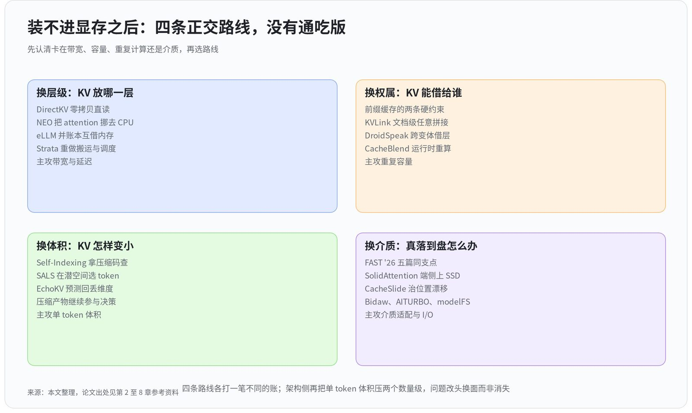
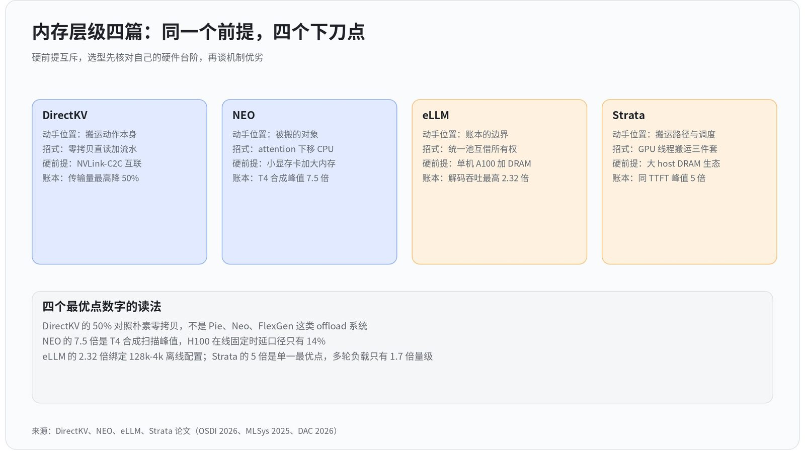
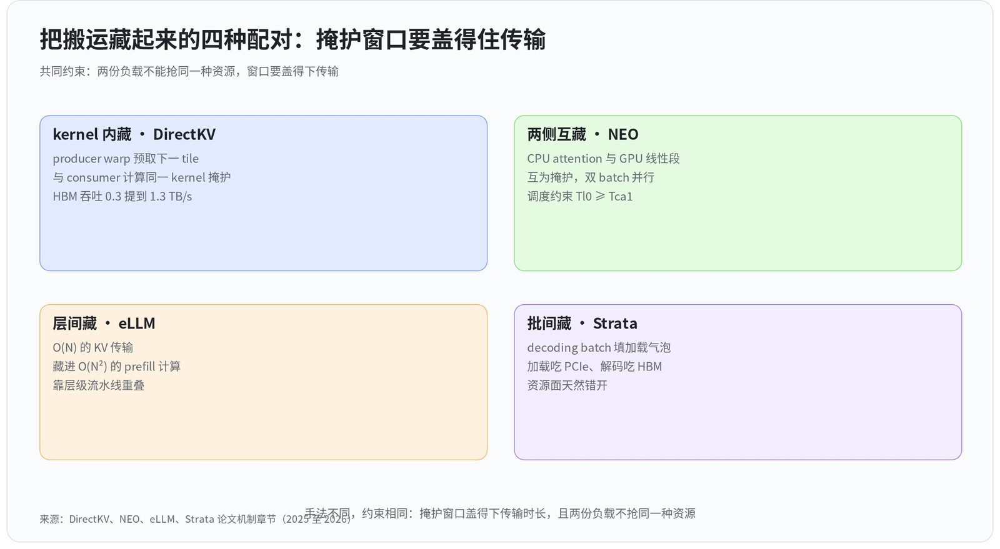
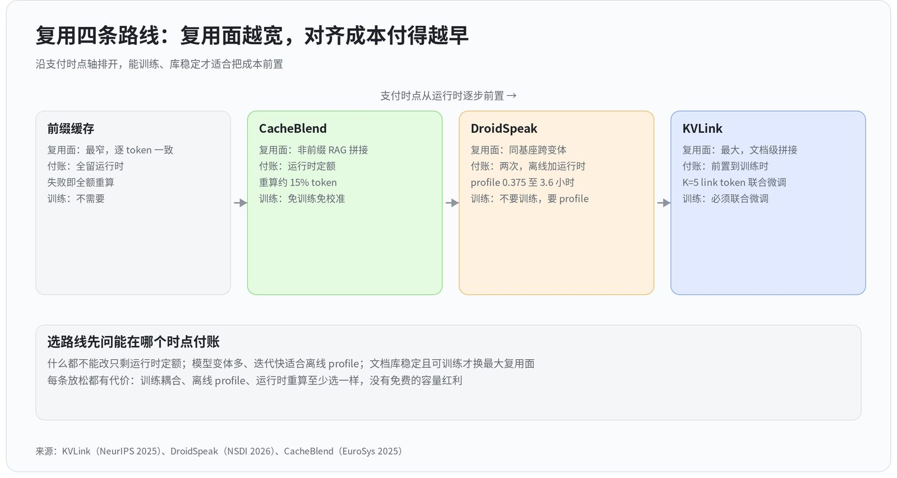
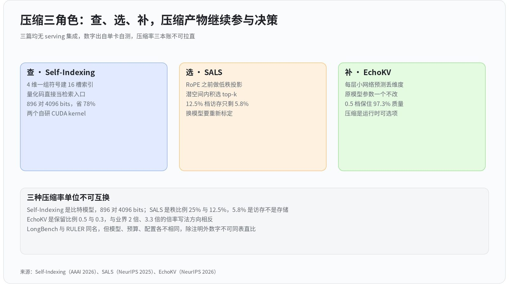
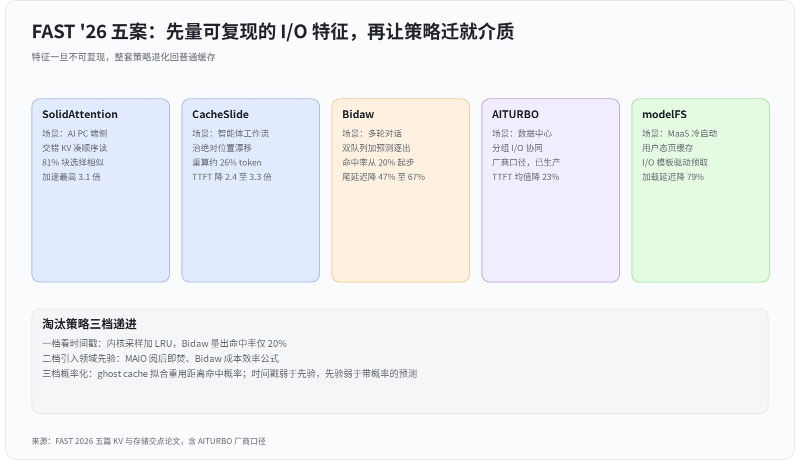
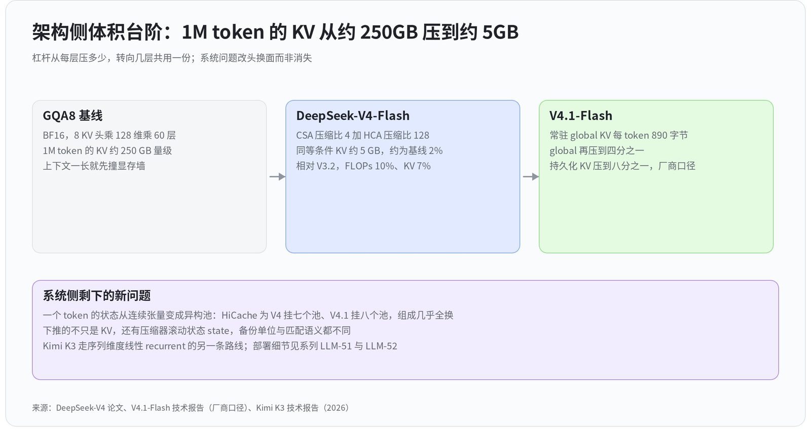
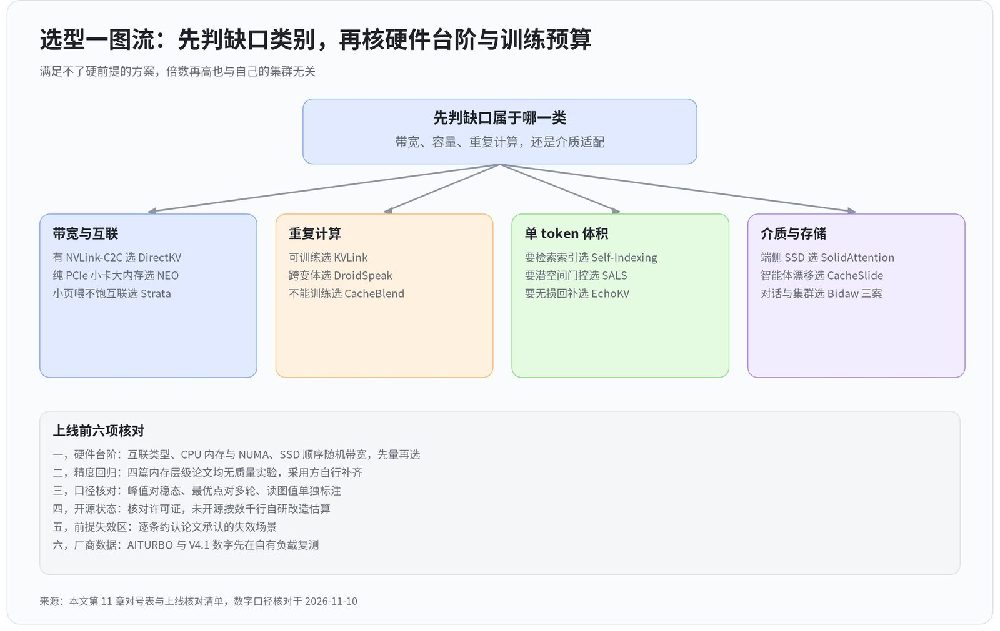

# LLM-70｜系统｜KV Cache 装不进显存：分层、复用、压缩与外置系统的工程账

> 🎯 **这篇文档解决什么问题**：一个 32K token 的 prompt、80 层 70B 模型、batch=32，KV Cache 要吃 320 GB 显存，是模型权重的 2 倍以上。上下文继续拉长，显存先于算力见底，引擎内部的 PagedAttention 与前缀缓存只能解决碎片与同前缀复用，装不下的部分必须向 CPU 内存、SSD、远端存储要空间，或者在压缩与跨模型借用上做文章。本文把 2025 至 2026 年正式录用的 14 篇论文与一个工程锚点放在同一张地图上，回答四个问题：KV 该放哪一层、能借给谁、怎样变小、真落到盘上怎么办。
>
> 使用方式：做推理引擎与平台的读全文，第 2 至 4 章讲显存之外的第一层内存，第 7 至 8 章讲存储；做 RAG 与多模型编排的读第 5 章，看复用条件怎样放松；做长上下文与成本优化的读第 6、10 章，看压缩的三种用法与架构侧的体积台阶；第 9、11 章给口径纪律与上线清单。文中论文数字均为论文自测、本仓未复现，厂商数据单独标注，核对日期 2026 年 11 月 10 日。

## 导读 · 先给结论

- **装不进显存之后有四条正交的解题路线，没有通吃版**。换层级、换权属、换体积、换介质各自打一笔不同的账，先认清自己卡在带宽、容量还是重复计算，再选路线，第 1 章给四问框架。
- **外置内存的四篇论文在四个位置动手，硬前提各不相同**。DirectKV 删搬运，前提是 NVLink-C2C 这类高带宽互联；NEO 把 decoding attention 挪去 CPU，前提是小显存卡加大容量本地内存；eLLM 把 activation 与 KV 并成一本账；Strata 用数千 GPU 线程重做搬运与调度，前提是 SGLang 系分层生态[[1]](https://www.usenix.org/conference/osdi26/presentation/luo)[[2]](https://arxiv.org/abs/2411.01142)[[3]](https://arxiv.org/abs/2506.15155)[[4]](https://www.usenix.org/conference/osdi26/presentation/xie-zhiqiang)。
- **复用的两条硬约束各被放松一次，账单的付法随之改变**。KVLink 用联合微调换文档级任意拼接，DroidSpeak 用离线 profile 加约一成层重算换同基座跨变体借用，免训练的 CacheBlend 则在运行时定额重算约 15% 的 token[[5]](https://arxiv.org/abs/2502.16002)[[6]](https://www.usenix.org/conference/nsdi26/presentation/liu-yuhan)[[7]](https://arxiv.org/abs/2405.16444)。
- **压缩的新前沿是让压缩后的表示继续参与决策**。Self-Indexing 把量化码当检索索引、SALS 在低秩潜空间里选 token、EchoKV 把丢掉的维度预测回来，三篇分别回答该读谁、该算谁、丢了怎么办[[8]](https://arxiv.org/abs/2603.14224)[[9]](https://arxiv.org/abs/2510.24273)[[10]](https://arxiv.org/abs/2603.22910)。
- **KV 真落到 SSD，胜负手是让数据形状迁就介质、让调度看见 I/O**。FAST'26 五篇踩在同一块支点上：先量出可复现的 I/O 特征，再把特征喂给策略；特征一旦不可复现，整套策略退化回普通缓存[[11]](https://www.usenix.org/conference/fast26/presentation/zheng)[[12]](https://www.usenix.org/conference/fast26/presentation/liu-yang)[[13]](https://www.usenix.org/conference/fast26/presentation/hu-shipeng)[[14]](https://www.usenix.org/conference/fast26/presentation/hao)。
- **架构侧正在消解这个矛盾本身**。DeepSeek-V4-Flash 把 1M 上下文的 KV 从 GQA8 基线的约 250 GB 压到约 5 GB，V4.1-Flash 的常驻 global KV 再降到 890 字节每 token；系统问题随之从搬 KV 变成管理一组异构池[[15]](https://arxiv.org/abs/2606.19348)[[16]](https://huggingface.co/deepseek-ai/DeepSeek-V4.1-Flash)。
- **读这些论文先看口径再看倍数**。合成扫描峰值与在线固定时延点是两套账，比特、秩比例、保留比例是三种压缩率，厂商生产数据与论文自测不可同表直比；第 9 章与第 11 章把每条数字的读法和上线核对项列成清单。

📎 与系列其他文档的分工：引擎内的 PagedAttention、连续批处理与前缀缓存机制见 [LLM-03｜系统｜vLLM 学习路径：从推理基础到架构前沿](./03-vllm-path.md) 阶段 1 与 [LLM-08｜系统｜大模型推理系统：全栈学习手册](./08-inference-systems.md) 第五篇；本文只讲引擎之外的外置层与论文方案。KV 跨租户的信任边界与泄露面见 [LLM-68｜系统｜KV Cache 的信任边界：共享、分层与三种泄露面](./68-kv-cache-trust.md)；模型侧量化、剪枝、蒸馏的总论见 [LLM-24｜系统｜模型压缩与端侧部署：量化、剪枝与蒸馏](./24-compression-edge.md)；架构压缩的部署实战见 [LLM-51｜系统｜自部署推理实战：DeepSeek-V4-Flash 从单机到弹性上线](./51-deepseek-v4-flash-deploy.md) 与 [LLM-52｜系统｜一线大模型部署：Kimi K3 从选型算账到多节点上线](./52-kimi-k3-deploy.md)。

素材与许可说明：本文事实主要整理自开源知识库 AI-fundamentals 的 KV Cache 专题，该仓库采用 Apache-2.0 许可[[17]](https://github.com/ForceInjection/AI-fundamentals)；论文页码与数字以该专题附带的逐条页码精读报告为准，所有性能声明保留论文自测原口径。

## 第 1 章 · 先算这笔账：KV 为什么先撞上显存墙

KV Cache 随序列长度线性增长，模型权重却是常数。短上下文时权重占大头，上下文拉长到几万 token，KV 反客为主成为显存的最大消费者，这是后面所有方案的共同起点。

📎 展开阅读：[LLM-03｜系统｜vLLM 学习路径：从推理基础到架构前沿](./03-vllm-path.md) 阶段 1（KV Cache 与 PagedAttention 的机制推导）；[LLM-08｜系统｜大模型推理系统：全栈学习手册](./08-inference-systems.md) 第五篇（引擎视角的显存账本）。

### 1.1 线性增长的显存账

每个 token 在每一层都要为每个 KV 头存一份 K 与 V，总占用等于 token 数、层数、头数、头维度与精度字节数的连乘。一个 32K token 的 prompt、80 层 LLaMA-2 70B、batch=32 的典型配置下，KV Cache 占 320 GB，超过模型权重本身的 2 倍。GQA 与 MLA 已经从架构上把头数压下来，但上下文长度仍在线性项上，百万 token 场景里单靠架构压缩不够，外置内存与复用、淘汰要一起上。

### 1.2 外部内存的三笔交换

KV 一旦挪出 HBM，每一层外部介质都在拿三样东西做交换。首先是带宽，数据搬得动吗，PCIe、NVLink 与 SSD 的有效带宽差着一到两个数量级；其次是延迟，单次访问的等待藏得住吗，藏不住就直接变成 token 间隔；最后是容量与利用率，放着划算吗，预留多了浪费、预留少了停顿。本文四组论文分别在这三笔交换上做文章：内存层级四篇主攻带宽与延迟，复用三篇主攻重复容量，压缩三篇主攻单 token 体积，FAST'26 五篇主攻介质适配。

### 1.3 引擎内优化的边界在哪

PagedAttention 把显存碎片率从 60% 至 80% 压到 4% 以下，解决的是分得出去；前缀缓存解决的是同前缀不必重算；连续批处理解决的是算力不空转。三者都默认 KV 还在显存里。当工作集超过物理显存，引擎内机制没有退路，问题才外溢成本文的领地：跨地址空间搬运、跨请求与跨模型借用、压缩表示的二次使用、以及与文件系统和 SSD 的交互。

> 💡 **常见误区**：把显存不够当成单一问题。碎片、重复计算、带宽、容量是四种不同的缺口，PagedAttention 治碎片、前缀缓存治重复、分层与压缩治容量，药方开错只会多一层搬运开销。

## 第 2 章 · 外置第一层：四篇论文在四个位置动手

显存之外的第一层是 CPU 内存与互联。四篇 2025 至 2026 年正式录用的论文面对同一个前提，KV 装不进 HBM，却分别挑了搬运这个动作、被搬的对象、账本的边界、搬运的路径与调度四个不同的下刀点。先看全景，再在第 3、4 章逐篇拆机制。

📎 展开阅读：[LLM-08｜系统｜大模型推理系统：全栈学习手册](./08-inference-systems.md) 第五篇（引擎内 KV 管理与 offloading 的基础概念）。

### 2.1 同一个前提，四个拆法

既有 offload 方案的共同假设是 KV 必须先搬回 HBM 才能算。这条假设同时带来三笔代价：预留大块 GPU 缓冲盖住延迟、swap 让互联流量翻倍、动态拷贝地址让 CUDA Graph 无法原样重放。四篇论文的分歧，本质上是对这条假设的四种态度。

| 论文 | 动手位置 | 核心招式 | 硬前提 | 代表账本 |
|---|---|---|---|---|
| DirectKV（OSDI 2026） | 搬运动作本身 | 零拷贝直读加 tiling、warp 流水、kernel fusion | NVLink-C2C 高带宽互联 | 传输量最高降 50%、显存降 43%、端到端平均 1.2×[[1]](https://www.usenix.org/conference/osdi26/presentation/luo) |
| NEO（MLSys 2025） | 被搬的对象 | decoding attention 下移 CPU，非对称流水线 | 小显存 GPU 加大容量本地 CPU 内存 | T4 合成峰值 7.5×、在线最高 +563%[[2]](https://arxiv.org/abs/2411.01142) |
| eLLM（DAC 2026） | 账本的边界 | eTensor 统一池，inflation 与 deflation 互借 | 单机 A100 加大 CPU DRAM | 解码吞吐最高 2.32×、goodput 2.5×[[3]](https://arxiv.org/abs/2506.15155) |
| Strata（OSDI 2026） | 搬运路径与调度 | GPU-assisted I/O 加 cache-aware 三件套 | 大 host DRAM、SGLang 系生态 | 同 TTFT 峰值 5×、带宽 40.3 到 150.5 GB/s[[4]](https://www.usenix.org/conference/osdi26/presentation/xie-zhiqiang) |

### 2.2 先量缺口，再对数字设计

四篇没有一篇靠通用启发式开场，全部先量出一组可复现的缺口数字，再让机制对着缺口修。DirectKV 量出朴素零拷贝把矩阵乘中 B 操作数的流量放大到 33.5 GB、L2 命中率掉到 32.3%；NEO 量出 GPU 与 CPU 的带宽差约 3 倍、算力差约 100 倍，才敢把带宽受限的 decoding attention 搬走；eLLM 量出 activation 预留占比 30.8% 对实际利用率约 1% 的错位；Strata 量出小页搬运只吃到 PCIe 理论带宽的 22%、最高 24% 的加载停顿与 38% 的 delay hit 撞车率。读这类系统论文，先找它的测量章节，测量站不住，后面的机制与倍数都要打折。

### 2.3 把搬运藏起来的四种配对

四篇走的是同一条路：把传输藏进另一份资源面的计算里，差别在配对方式。DirectKV 是 kernel 内藏，producer warp 预取下一 tile 与 consumer 的计算在同一个 kernel 里互相掩护；NEO 是两侧互藏，CPU attention 与 GPU 线性段互为掩护，调度约束落成 Tl0 ≥ Tca1 这样的不等式；eLLM 是层间藏，O(N) 的 KV 传输藏进 O(N²) 的 prefill 计算；Strata 是批间藏，加载吃 PCIe、解码吃 HBM，用 decoding batch 填充加载气泡。手法不同，约束相同：掩护窗口要盖得下传输，且两份负载不能抢同一种资源。

> 💡 **常见误区**：把四篇当成同一方案的四个版本。它们的前提互斥，DirectKV 依赖的高带宽互联恰好是 NEO 不具备的条件，eLLM 不搬数据只转所有权，Strata 反而把搬运做到极致；选型先核对自己的硬件台阶，再谈机制优劣。

## 第 3 章 · 去搬运与挪计算：DirectKV 与 NEO 的硬前提

DirectKV 与 NEO 给出两个看似相反的答案：一个主张别搬、让 GPU 直接读 CPU 内存，一个主张把计算也搬走、KV 干脆不回来。两个答案都只在特定硬件台阶上成立，本章把各自的带宽账摊开。

### 3.1 DirectKV：删掉 staging buffer 的零拷贝

DirectKV 的判断建立在一个 17 倍的对照实验上：同一个 10240 方阵乘法，用 200 MB 显存缓冲把 CPU 内存数据 swap 进来，PCIe 上耗时 65 ms；换成零拷贝让 GPU 直接读 CPU 内存，耗时 1122 ms。细粒度零拷贝在 PCIe 上是灾难，但 GH200 与 GB200 的 NVLink-C2C 提供 900 GB/s 互联，论文称其 7 倍于 PCIe Gen5，零拷贝的细粒度访问在这条通道上能凑出 MB 级聚合流量，决定性能的因素从单次延迟变成持续带宽[[1]](https://www.usenix.org/conference/osdi26/presentation/luo)。

机制有三招。CPU-aware tiling 把矩阵乘里驻留的操作数从 CPU 侧换成 HBM 侧，B tile 只取一次，流量复杂度从 O(n³) 降到 O(n²)，代价是 HBM 流量约 2 倍；warp 级流水用 producer、consumer、storer 三个 warp group 把搬运藏进计算，HBM 吞吐从 0.3 提到 1.3 TB/s；kernel fusion 把 QKV projection 与 attention 合成一次 launch，K 与 V 生成后留在共享内存直接被消费，延迟从 85 ms 降到 57 ms。

账本要按基线分开读。传输量最高降 50% 的对照是朴素零拷贝，不是 Pie、Neo、FlexGen 这类 offload 系统；显存 47 GB 对三个 offload 系统均值 82.7 GB，降 43%，这个基线不含 SGLang 的 92 GB；端到端平均 1.2× 是跨上下文长度的平均，优势随长度放大。论文自己划了边界：纯 PCIe 平台上吞吐收益往往有限，且全文没有精度或困惑度实验。源码以 MIT 许可开放[[18]](https://github.com/shutianluo/DirectKV)。

### 3.2 NEO：把带宽受限的计算挪去 CPU

NEO 的起点是一次反向的前提检查。decoding attention 在 GPU 和 CPU 上都是内存带宽受限，而两类硬件的带宽差距远小于算力差距：A10G 的 600 GB/s 对现代 x86 服务器的约 200 GB/s，只差约 3 倍，算力却差约 100 倍。既然瓶颈是带宽，把这段计算搬去 CPU 的损失就有限，腾出来的显存还能换更大的 batch[[2]](https://arxiv.org/abs/2411.01142)。

机制叫非对称流水线，包含 partial offloading、prefill 并入 batch-0、layer-wise swapping 与非对称 batch 划分，再加一个每迭代六步的负载感知调度器，始终保留退回 GPU-only 的选项。论文先用两个 strawman 划掉错误答案：全量卸载让 CPU 在线性层阶段空转，均分的对称流水线既闲置 GPU 内存又制造流水线气泡。

### 3.3 两组账本，两种读法

NEO 的增益数字分属两套口径，混着读会得出错误结论。合成负载扫描对 GPU-only 的 SwiftLLM 基线，T4、A10G、H100 上的最高增益是 +750%、+26%、+14%，这是峰值扫描；真实在线实验对 vLLM、卡在固定时延点比较，数字是 14.3%、6.40%、563%。小显存的 T4 收益最大，H100 这类大显存卡几乎没有空间，符合机制推断。CPU 容量敏感性实验进一步显示增益由带宽而非核数决定，79.3% 的表现由 CPU 带宽解释。

前提条件同样硬：依赖大容量本地 CPU 内存，论文原话写明 NEO relies on large CPU memory，模型权重全部驻留 GPU，两卡实验里 CPU 资源还被限制在四分之一个 NUMA 节点。代码仓库按论文承诺开放[[19]](https://github.com/NEO-MLSys25/NEO)。DirectKV 与 NEO 拼在一起，恰好划出一道硬件分界线：有 NVLink-C2C 选零拷贝直读，只有 PCIe 但本地内存大、卡又小，才考虑把 attention 算出去。

> 💡 **常见误区**：看到 7.5× 就认为 NEO 普遍提效。这个数字是 T4 上合成扫描的峰值，同篇论文的在线固定时延口径在 H100 上只有 14%；引用倍数时必须同时说出硬件、基线与测量点三个条件。

## 第 4 章 · 并账本与重排调度：eLLM 与 Strata

DirectKV 与 NEO 改的是数据与计算的位置，eLLM 与 Strata 改的是记账方式与搬运路径。前者把两套互不相识的内存池并成一本账，后者把低效的 DMA 小块搬运换成数千 GPU 线程的协作。

### 4.1 eLLM：activation 与 KV 互相借内存

eLLM 先把一个错位量化：MTP-30B 的上下文从 2K 调到 200K 时，为激活预留的显存占比从 0.3% 涨到 30.8%，而 decoding 阶段的激活利用率只有约 1%。预留按最坏情况、使用按典型情况，两块内存又分属两套抽象，activation 走静态张量分配、KV 走页表虚拟化，谁也不认识对方的账本，论文称之为空间型内部碎片，并给出约 20% 的吞吐退化代价[[3]](https://arxiv.org/abs/2506.15155)。

它的抽象叫 eTensor：逻辑层保留两套定制化管理，物理层共享一个统一内存池。KV 池不够时向 activation 池 inflation，先由轻量 GC 回收不活跃块，再只转所有权、不搬数据，按需映射进目标虚拟地址空间；归还时 deflation 惰性处理。第二级弹性把 CPU DRAM 当溢出 buffer，靠层级流水线把 O(N) 的 KV 传输藏进 O(N²) 的 prefill 计算。调度器按 SLO 分阶段调整逻辑缓冲区的可用尺寸。

账本是解码吞吐最高 2.32×，出现在 128k-4k 离线配置、Jamba-Mini、两 GPU 的组合，goodput 最高 2.5×。代价论文自己认：CPU buffer 带来 prefill 偏好、TPOT 高于 vLLM，PCIe 带宽是无法完全重叠的上限。系统未开源，在 vLLM v0.5.5 上改了约 4000 行，引用其 128K batch 扩约 3 倍的说法时要注明是 Figure 7 读图值，295 倍与 140 倍的 TTFT 数字取自 vLLM 排队崩溃区，不能当稳态对比。

### 4.2 Strata：小页喂不饱互联，就换搬运的人

Strata 的起点是一组搬运效率实测：8192 个 token 的 KV 从 CPU 内存搬回 GPU，只吃到 PCIe 5.0 理论带宽的约 22%；换到 GH200 走 NVLink，这个比例反而掉到 5%。根因是页太小，PagedAttention 为省显存把 KV 切成 1 到 32 token 的页，单页几十 KB 喂不饱互联。按 Little's Law，吃满 PCIe 需要 1 到 2 MB 的单次传输，但简单放大页会让命中率塌掉，页从 1 放到 512 时 P90 TTFT 最高涨 2.9 倍[[4]](https://www.usenix.org/conference/osdi26/presentation/xie-zhiqiang)。

搬运线的答案是 GPU-assisted I/O：不再发 cudaMemcpyAsync 传小块，而是 launch 一个 kernel，让数千线程直接读源写目标，128 字节粒度就高效，两个 block 共 2048 线程能达成 48 GB/s，对 prefill 的干扰低于 5%。同一批线程顺带完成 layer-first 与 page-first 之间的布局转换，论文称开销可忽略。

### 4.3 调度线：让调度器看见搬运

Strata 的 cache-aware 三件套补上另一半。delay hit 规避把撞在计算中的重复 miss 推迟到即将命中的时刻；均衡批在 load 与 compute 比超过阈值 loading_bound=100 时把请求移出批次；气泡填充用 decoding batch 去填加载空档，因为加载吃 PCIe、解码吃 HBM，资源面天然错开。

账本要分清最优点与稳态：同 TTFT 下峰值吞吐最高 5×，对 vLLM-LMCache，对 TensorRT-LLM 是 3.75×，对应 Llama-70B 加 LooGLE 加 H200 的最优点；多轮 ReviewMT 负载上收敛到 1.7× 与 2.3×。GH200 上的持续传输带宽从 40.3 GB/s 提到 150.5 GB/s。两个边界要写明：评估限定单实例，主力基线 SGLang-HiCache 是作者自实现版本，与 SGLang 发行版功能的关系论文未说明；论文未提开源，也没有精度实验。

> 💡 **常见误区**：把 up to 峰值当普遍收益。Strata 的 5× 是单一最优点的口径，多轮负载只有 1.7× 量级；eLLM 的 2.32× 绑定特定离线配置。读系统论文先找最优点之外的稳态或多轮数字，差距通常以倍数计。

## 第 5 章 · 复用的两条硬约束与四次放松

外置内存解决放得下，复用解决不必重算。引擎里的前缀缓存带着两条硬约束：从第 0 个 token 起逐 token 一致，且请求与请求之间必须是同一组模型权重。任一不满足就退回 full prefill。本章的三篇论文各放松一条，放松的方式不同，账单的付法也随之改变。

📎 展开阅读：[LLM-08｜系统｜大模型推理系统：全栈学习手册](./08-inference-systems.md) 第五篇（引擎内前缀缓存与 KV 管理的机制）；复用带来的共享信任边界见 [LLM-68｜系统｜KV Cache 的信任边界：共享、分层与三种泄露面](./68-kv-cache-trust.md)。

### 5.1 两条硬约束与一笔重复账

先看重复存储有多重。一篇 1000 token 的文档存成文本约 5 KB，存成 Llama3-8B 的 KV Cache 要 131 MB，膨胀两万六千倍[[5]](https://arxiv.org/abs/2502.16002)。RAG 场景里文档随查询改变拼接顺序，前缀路线从第 0 个 token 就对不上，这份 131 MB 只能每次重算。跨模型一侧同样堵死：compound AI 系统里同一段上下文被多个微调变体轮流读，真实 LangGraph trace 平均有 49% 的 token 属于前缀复用，而 vLLM Production Stack、Dynamo、AIBrix 这类跨节点 KV 共享只服务同款模型[[6]](https://www.usenix.org/conference/nsdi26/presentation/liu-yuhan)。

两条硬约束对应两类放松。放松位置约束，让任意文档片段可以拼接，代表是 KVLink 与 CacheBlend；放松模型约束，让同基座的微调变体之间可以借用，代表是 DroidSpeak。

### 5.2 KVLink：把对齐成本前置到训练时

KVLink 用两个零件拆开位置约束。第一个叫 positional re-encoding：预计算时跑段内注意力，但存下的是不带旋转角的 W_{k,v}x_i，等文档拼接之后再按全局位置统一施加 rotary，论文自己注明这一步与先前的并行编码工作一致，首创部分在第二个零件。第二个叫 link tokens：每篇文档末尾追加 K=5 个可训练 token，配上定制 attention mask，link token 能看全部上下文、普通 token 只看局部；推理时只对这 5 个 token 做一次小 forward，link token 与模型联合微调[[5]](https://arxiv.org/abs/2502.16002)。

账本分三层读。质量上，Table 1 逐格重算，1B、3B、8B 三个尺寸的 QA 准确率分别比 SOTA 高 4.32、4.00、1.12 个点，摘要里平均高 4% 的说法无法逐格精确复现，引用以表格为准。延迟上，TTFT 相对标准解码降 85% 至 96%，5000 token 处从 0.885 秒降到 0.032 秒，后者是 Figure 3 读图值。成本上，附录 A.7 给出每百万请求 9 对 246 GPU 小时、折合 16 对 440 美元的对照，原文另有 25 倍请求量的说法与该算术对不上，引用时只附 9 对 246 的原值。代码已开源[[20]](https://github.com/UCSB-NLP-Chang/KVLink)，仓库未检出 license。

边界同样硬：必须联合微调，上下文只评到 5000 token，全部实验是单请求 TTFT，没有 batching、吞吐与 serving 集成；预计算 KV 的组织与存储，论文自己承认仍是未解问题。流传的省显存 98%、吞吐 8.5 倍两个数字在论文全文无法溯源，不引用。

### 5.3 DroidSpeak：只重算那一成关键层

DroidSpeak 先证伪一个朴素答案：把整段 KV 直接拿到另一个微调变体上用，HotpotQA 上多数模型精度掉超 50%。再逐层测 F1，掉幅超 10% 的层标为 critical，跨模型对平均只有约 11% 的层入选，而且这份关键层名单跨输入稳定。机制由此成立：离线 profiling 在重算层数与质量的 Pareto 前沿上，按容差选一组连续层，连续是为了只引入一次 E cache 加载、避免偏差叠加；在线发送方把 transition 层的 E cache 传过去，接收方只重算这一组，传输与重算走独立 CUDA Stream 流水[[6]](https://www.usenix.org/conference/nsdi26/presentation/liu-yuhan)。

账本在 8 对模型、3 个数据集上自测：预填充延迟降 1.7 至 3.1 倍、平均 2.1 倍，在线吞吐升 2 至 4 倍，同延迟下质量比作者自行扩展的跨模型版 CacheBlend 高 5% 至 33%、平均 16%，质量压在 profiling 默认 5%、在线实验 1% 的 F1 容差内。每对模型的离线 profile 耗时 0.375 至 3.6 小时。

边界有四条：只适用同基座的模型对，论文原话写明 as-is only works for the same foundational model；只做两两配对，没有多对多；没有公开代码仓库；收益对网络带宽敏感。40K token 从 4 秒到 0.08 秒是按 50 倍换算的理想会计，不是实测。

### 5.4 CacheBlend 与支付时点轴

CacheBlend 是免训练的一极：非前缀拼接时，运行时选择性重算偏差最大的约 15% token，另有 18% 的对照口径，再靠精度容差兜底；它依托 vLLM 生态的 LMCache 实现，需要分隔符标注文档边界[[7]](https://arxiv.org/abs/2405.16444)[[21]](https://github.com/LMCache/LMCache)。论文与实现核对后的账本是 TTFT 降 2.2 至 3.3 倍、吞吐升 2.8 至 5 倍，本篇只作框架对照，未独立复验。

四条路线排在一根支付时点轴上最清楚。前缀缓存把成本全留运行时，匹配失败就全额重算；CacheBlend 在运行时付一笔定额，无论命中与否都重算约 15%；KVLink 把成本前置到训练时，换来最大的复用面；DroidSpeak 分两次付，离线付 profile、运行时付约一成层的重算。能训练、文档库稳定的场景适合前置；模型变体多、迭代快的场景适合离线 profile；什么都不能改时，只剩运行时定额这一档。

再往前看，素材总纲作者提出一种缓存随身携带的兼容性说明书设想，三栏分别记出处，即哪组权重、位置编码状态与哪些层产生，对齐代价的可知性，以及准入决策接口，历史上的对照是动态链接的符号版本化。这是作者推演，不属于任一论文的主张；说明书并不消除对齐成本，只让借用方在借之前看清账单。

时间与格式两个新维度在 2026 年 11 月各拿到一篇实证。时间维上，DeepSeek-V4-Flash 跨四次模型更新的缓存复用研究显示，旧缓存能保留有用任务信息，却不会忠实复现更新后模型的行为，检索准确率随更新从接近原生到大幅损失不等[[28]](https://arxiv.org/abs/2611.14051)；把缓存跨版本借用前，要先跑更新后的忠实度回归，命中率代替不了行为一致性。格式维上，混合注意力之间的缓存互译研究在 MLA 潜变量、线性注意力状态与稀疏注意力索引器三种格式间做转换，接手会话的模型把源缓存映射成自身格式，免去重读全历史，映射误差要单独验收[[29]](https://arxiv.org/abs/2611.12062)。这两篇与 LLM-15 7.20 节的同批七篇线索对照阅读 [LLM-15｜索引｜LLM 必读论文清单与速查卡](./15-papers.md)。

> 💡 **常见误区**：把 KV 复用当成免费的容量红利。每放松一条硬约束都有对应的付账方式，训练耦合、离线 profile、运行时重算至少要选一样；选型先问自己能在哪一个时点付账，再看复用面够不够大。

## 第 6 章 · 压缩表示的三种二次决策：查、选、补

复用讲的是同一份 KV 在请求之间借用，压缩讲的是单份 KV 自己变小。这个专题的三篇论文共享一个前提：KV 表示里的冗余足够结构化，少存一点照样能算。它们的共同点是压缩产物不只是静态存档，而是继续参与后续的注意力决策，区别在扮演的角色：Self-Indexing 拿压缩码直接查、SALS 在潜空间里直接选、EchoKV 把丢掉的维度反向补回来。

📎 展开阅读：模型侧的量化、剪枝与蒸馏总论见 [LLM-24｜系统｜模型压缩与端侧部署：量化、剪枝与蒸馏](./24-compression-edge.md)；本章只讲 KV 压缩产物如何被二次使用。

### 6.1 三个角色与一条共同边界

先把角色分清。查，是用压缩后的 key 当检索索引，决定该读哪些 token；选，是把 token 投影到低秩潜空间打分，门控出值得重建的少数；补，是承认压缩有损失，再训练一个小网络把丢弃的维度预测回来。三条路线都没有 vLLM 或 SGLang 的 serving 集成，也没有 batching 与分页适配，账本全部出自单卡自测，引用倍数时要先带上这个前提。

### 6.2 Self-Indexing：把量化码当检索索引

Self-Indexing 的索引建得极轻：key 沿最后一维每 4 维取一组符号，16 种组合就是 16 个槽位的 codebook，单遍扫描即可建好。query 同样切成 4 维一组，每组配一张 16 项分数的查找表，由定制的 LUT-GEMV kernel 执行检索；被选中的 token 再交给一个融合了反量化的稀疏 FlashAttention kernel 消费。量化参数按 token 而非按通道存储，这是被选 token 能随机访问的前提[[8]](https://arxiv.org/abs/2603.14224)。

体积账按比特算：单 token 单头从 FP16 的 4096 bits 降到 896 bits，含 128 位符号位、512 位 2-bit 的 K 与 V、256 位量化参数，省 78%。论文原文总量写成 768L，漏计了 128L 符号位，贡献列表里的 5 倍是 4096 除以 896 约 4.57 后取整，引用以 78% 为准。质量账上，LongBench 的 160-token 预算拿 58.2 分，对全量 58.7，且高过 Quest 的 56.5 与 DoubleSparse 的 54.8；RULER 32K、7.5% 计算稀疏度下 89.2 对 90.8；64K 解码吞吐约 2 倍，读图为 42.1 对 20.3 token 每秒、约 2.07 倍，原文字面写的是时延，证据实际是吞吐。代码已开源[[22]](https://github.com/LfieLike/selfindexingkv)。

边界有四条。收益依赖两个自研 CUDA kernel，算法收益与 kernel 收益没有分开记账；codebook 16 槽、子向量 4 维、sink 64 三个超参固定，没有敏感性分析；7.5% 指参与注意力计算的比例，全部 token 仍以压缩格式留存，别误读成存储比例；评测止步 32K，作者自述超过后退化明显。

### 6.3 SALS：在低秩潜空间里选 token

SALS 先用两块证据确定压缩位置。post-RoPE 的特征值谱整体上移、保留 90% 方差所需的秩上升，所以低秩压缩必须放在 RoPE 之前；而 pre-RoPE 的全量重建开销随序列线性增长，到 32K 就主导总时间，逼着选择与重建只能作用在少数 token 上。机制上，投影矩阵用 C4 语料的 512 条序列离线标定，所有头共享一个单头潜空间；打分只取投影后前一半维度做廉价内积选 top-k，仅重建被选者并就地施加 RoPE，选谁与重建谁融合进同一个 Triton kernel[[9]](https://arxiv.org/abs/2510.24273)。

账本有两档键秩，25% 与 12.5%，值同步压到 4-bit 与 2-bit。LongBench 均值 32.26 与 31.97，对基线 32.65；12.5% 档的访存只剩基线的 5.8%，注意这是访存口径而非存储口径，同档均值反超 Loki、HShare、Double Sparse 等全部稀疏基线；RULER 在 25% 档拿 80.81 对 81.60。算子级，4K、batch 16 的 attention 对 FlashAttention2 快 5.7 倍，可由 Table 6 的 3.230 对 0.565 回溯，同表 batch 8 只有 3.1 至 3.7 倍；端到端对 GPT-Fast 为 4K 下 1.4 倍、32K 下 4.5 倍。

边界要逐条记：校准型方法，换模型或换数据分布都要重新标定；短序列倒贴，1K、batch 8 时 0.357 ms 反而慢于 FlashAttention2 的 0.230 ms；第 0、1、31 层不做稀疏、全量读写；论文未给 GPU 型号。摘要里三次出现的 6.4 倍全文无推导，5.5 节的 7.46 倍与表格对不上，都不引用；128K 实测的说法同样不照抄。12.5% 档的退化集中在 NIAH 的单针与多键两项。

### 6.4 EchoKV 补维，与三本不能拉直的账

EchoKV 承认压缩有损，再把损失学回来。backbone 是 8 个 KV 头、128 维，即每 token 每层 1024 维；层按大小 S 分组，每组首层保留全量作 global input，其余层只留展平维度的前 m 维作 local input，每层配一个线性层把丢弃的 1024 减 m 维预测回来。训练分两阶段，先做 KV-MSE 表示对齐、再做 O-MSE 输出对齐，键取 pre-RoPE；原模型参数一个不改，压缩因此退化成运行时可随时开关的选项[[10]](https://arxiv.org/abs/2603.22910)。

账本按保留比例记。0.5 档即保留一半、约 2 倍压缩，LongBench 48.53 对全量 49.88、保住 97.3%，RULER 83.52 对 87.63；0.3 档拿 45.27，对照 CommonKV 的 31.08 与 Palu 的 4.91。补维网络全层合计 28.8 至 50.2M 参数，训练只需 1.6K 条序列，单卡 A100 短序列约 2 分钟，常规长度两阶段合计约 27 分钟。代码已开源[[23]](https://github.com/noforit/EchoKV)。边界上，nearly lossless 只对 0.5 档成立，0.3 档的定位只是维持基本可用性；局部维度取前缀是朴素启发式，回切全量方向没有机制与实测；Mistral-Small-24B 的 0.3 档 Palu 行与 Mistral-7B 同档数值完全相同，疑为论文错表，引用时避开，Figure 3a 只取相对趋势。

最后是口径纪律。三篇的压缩率写在三种不可互换的单位上：Self-Indexing 是比特模型，896 对 4096 bits；SALS 是秩比例加访存比，25% 与 12.5% 是秩，5.8% 是访存；EchoKV 是保留比例，0.5 与 0.3，与业界 2 倍、3.3 倍的倍率写法方向相反。LongBench 与 RULER 虽同名，三篇用的模型、预算与配置各不相同，除注明外数字不可同表直比。

> 💡 **常见误区**：把不同论文的压缩率排成一条天梯。比特、秩比例、保留比例是三本账，5.8% 这类访存数字更不能当成存储体积；比较前先统一单位，再核对模型、上下文与精度基准是否同档。

## 第 7 章 · 当 KV 落到 SSD：端侧与智能体两案

FAST '26 的两个 AI 与 LLM session 共收录九篇论文，其中五篇落在 KV 与存储的交点上。它们踩在同一块支点上：先量出一组可复现的 I/O 特征，再把特征喂给调度或缓存策略；一旦特征不可复现，整套策略就退化回普通缓存。本章先讲离单机最近的两个场景，AI PC 端侧与智能体工作流，数据中心侧的三案留到第 8 章。

### 7.1 SolidAttention：让数据形状迁就 SSD

SolidAttention 面对的是资源最紧的场景：AI PC 端侧 batch 等于 1，8 至 16 GB 内存要跑 128K 上下文，一个 8B 模型的 KV 就要 16 GB 以上、是模型权重的 4 倍多，只能上 SSD。矛盾在于稀疏注意力读 KV 是细粒度随机 I/O，而 SSD 只在粗粒度顺序传输下才快；batch 1 时加载 1K token 的 KV 要 40 ms，占掉 decode 一半时间。

机制的第一招是让数据形状迁就介质：K 与 V 按 token 粒度交错布局，在投影权重初始化时预拼接，一次矩阵乘直出交错 KV，kernel 再按 stride 2H 逻辑分离，开销不超过 2%。第二招借稳定性做投机：相邻两次迭代的稀疏块选择约 81% 相似，这是 LongBench 多模型实测值，于是用上一轮选择投机预取，预取错了可原位覆写，精读推算约五分之一的预取块仍需补读。第三招是 SSD-aware 调度器，把注意力分解成 microtask 建 DAG，按关键路径用最晚开始时间 LST 调度[[11]](https://www.usenix.org/conference/fast26/presentation/zheng)。

账本全部论文自测。128K 上下文对 Offload 加 Sparse 基线最高加速 3.1 倍，三个模型分别为 2.8、3.1、2.4 倍，对 FlexGen 最高 58.9 倍；KV 内存占用最高降 62 倍。精度上三模型平均 57.67、65.93、70.76，对稠密基线的 57.82、65.76、71.39 基本持平，但 KV INT4 量化在 Qwen 上崩到 18.63，量化这条路在端侧并不可靠。相对全内存方案约损失 11% 吞吐，能耗从每 token 5.37 焦降到 3.68 焦、改善 46%。两个敏感性数字要记下：context budget 到 4K 时延迟陡增，两块 SSD 在 4K budget 下差异达 45%，背景 I/O 干扰会让吞吐再降 58%。系统基于 llama.cpp 加 liburing、约 25K 行代码，并发场景未测，LongBench 单项精度略降。

### 7.2 CacheSlide：治位置漂移的智能体复用

CacheSlide 的场景是智能体工作流。prompt 由系统段、更新段、固定段拼接而成，可复用片段的相对顺序固定，绝对位置却每次漂移，论文形式化为 RPDC，即带漂移绝对位置的复用前缀。第一道证据关于位置编码：逐头算 K 与 V 的余弦相似度，位移从 0 到 1000 时 RoPE 的 KV 相似度下降超 90%，而 CoPE 这类位置不敏感编码只降约 28%；简单的 window padding 在多轮后 F1 比基线低 78% 以上。第二道证据关于存储栈：主流框架逐层串行读写 KV，形成 load-before-write 锁，LRU 又不感知脏页，带来随机写放大。

机制分三层。CCPE 按学到的任务模式切块，块内改用位置不敏感的 CoPE 编码，靠 LoRA 级继续预训练实现，backbone 不动且可切回 RoPE；WCA 在 prefill 时只对复用块中约 26% 的 token 重算，作为对照，CacheBlend 约 15% 至 18%、EPIC 只重算每个分段首尾的 64 token，每 4 层用一次 CKSim 相似度门控；SLIDE 在存储侧把层内读写解耦，干净页优先溢写、脏页按 selected-token 计数降序逐出、合并覆写成顺序写[[12]](https://www.usenix.org/conference/fast26/presentation/liu-yang)。

账本同样论文自测：对 ContextCache 的 TTFT 降 2.4 至 3.3 倍且精度损失可忽略；对 CacheBlend 再降 1.21 至 2.11 倍；对 PromptCache 降 1.97 至 2.88 倍且 accuracy 反升 1.41% 至 3.95%。总口径延迟降 3.11 至 4.3 倍、吞吐升 3.5 至 5.8 倍、写放大降 3.11 至 3.62 倍，吞吐标准差比 CacheBlend 与 EPIC 低 58.6% 至 77.4%。评测覆盖三个模型与 Reflexion、MemGPT、SWE-Agent 三类智能体，代码以开源仓库形式发布，扩展自 vLLM 0.8.5[[24]](https://github.com/SJTU-Storage-Lab/CacheSlide)。边界是任务模式需要一次 LoRA 级继续预训练，遇到新任务类别要重做；纯前缀重复与真乱序 RAG 两类场景的收益没有验证。

### 7.3 两案的共同读法

两个系统都没有跟 SSD 硬拼随机访问，而是各自把负载改造成介质喜欢的形状：SolidAttention 用交错布局把随机读凑成顺序传输，CacheSlide 用解耦与合并把随机写改成顺序写。两案的策略又都绑定一组可复现特征，81% 的块选择相似度、RoPE 下 90% 的相似度衰减，特征一旦随负载变化失效，投机预取与位置不敏感编码的收益就要重算。这正是 FAST '26 五篇共同的支点，也是第 8 章三个数据中心方案延续的思路。

> 💡 **常见误区**：把 SSD 方案当成慢速版的内存方案。端侧的胜负手取决于数据形状与调度能否把细粒度随机 I/O 改造成粗粒度顺序 I/O，缓存容量反倒在其次；脱离这组 I/O 特征谈命中率，会漏掉最大的一笔延迟账。

## 第 8 章 · 当 KV 走进数据中心：服务、调度与冷启动三案

端侧两案受限于单机资源，数据中心三案的瓶颈换成了多请求调度、集群网络与冷启动。三篇论文分别盯住多轮对话的两级存储、云上端到端 I/O 栈与 MaaS 冷启动的页缓存，淘汰策略这条暗线则贯穿其中，可以单独梳理成三个流派。

### 8.1 Bidaw：让调度与逐出都看见 KV

Bidaw 的起点是两组根因数字。请求调度不看 KV 加载时延，而 KV 大小从不到 100 MB 到超 800 MB，加载时间的变异系数超 90%；逐出不看对话语义，80% 的重用距离超过 200 GB 性能层容量，命中率仅约 20%，与最简单的 FIFO 相当。机制因此双向设计。计算侧感知存储：ready 与 preparing 双队列，preparing 队列按 disk-HRRN 排序，响应比等于 1 加等待时间除以 KV 大小，请求提升时按原始到达时间插回。存储侧感知计算：用刚生成回复的长度预测下次重用距离，12 组 trace 的 Spearman 秩相关在 0.94 至 0.98，再用 ghost cache 估计各重用距离区间的命中概率做预测式逐出，并按单位存储换算的节省选择性缓存历史张量，其中 tensor 6 的成本效率 51.0，远超其他候选[[13]](https://www.usenix.org/conference/fast26/presentation/hu-shipeng)。

账本分三层。对 CachedAttention 与 FlashGen，延迟最高降 3.58 倍、吞吐最高升 1.83 倍；相对 vLLM 延迟降 83.9%，排队时间降 57%，从 5.76 秒降到 2.45 秒；五个模型加 ShareGPT 上 P90、P95、P99 尾延迟降 47% 至 67%。消融显示三个机制各自独立贡献，调度贡献 1.58 倍、预测式逐出再加 1.25 倍、张量缓存再加 1.10 倍。关键一点是系统只做调度、不做重算，精度与直接推理完全一致；单次调度开销 0.62 ms、逐出 0.35 ms。边界要写明：回复长度作为思考时间代理的启发式，在秒回、并行会话与批处理场景失效，ShareGPT 因没有时间戳，论文如实承认逐出机制失效；方案依赖按用户归因请求的部署方式，且未提及开源。

### 8.2 AITURBO：一组 XPU 协同的分组 I/O

AITURBO 来自华为云的生产环境，先看背景账，以下为厂商口径：AI 任务已占其本地数据中心存储带宽的 10% 以上，而补带宽的成本随规格陡增，每 GB 带宽成本最多涨 16 倍；Megatron 用掉四分之一个代码库做 checkpoint I/O 仍不最优。核心抽象是 group API，让应用声明这一组 XPU 共同参与一次 I/O，存储层因此能看到完整的跨客户端 I/O 模式。写路径上，XPU 侧用 BLAKE3 去重，1 GB 数据的哈希从 CPU 的 35.6 ms 降到 7.8 ms，再进 host DRAM staging，future_0 即刻返回、future_1 等持久化完成，最后由含 7 条约束的双线性规划生成负载均衡写计划，38B 模型、64 XPU 场景 4 秒出 plan。读路径上，重复块只取一份到某个节点，沿 200 Gbps 计算网络串行广播链分发，存储网络本身只有每节点 100 Gbps[[14]](https://www.usenix.org/conference/fast26/presentation/hao)。

账本含厂商与论文两类口径，引用时分别标注。checkpoint 写在 ZeRO 关闭场景下较 Gemini 再快至多 5.9 倍、较 SFSTurbo 至多 58.8 倍；存储瓶颈下各系统读 Qwen-72B 都要 173 秒，单副本进 DRAM 后 64 XPU 部署只需 2.25 秒，对照 ServerlessLLM 的 1384 秒；KVCache 读的 Mean TTFT 降 23%。工程账同样可观，Megatron 自研同等功能要 2228 行，换成 AITURBO 只需 286 行、Mooncake 44 行，系统已在华为云生产运行。边界有三：Mooncake 对比实验并未真正走 group API，推理侧收益并非组去重的贡献；DRAM 富余与计算网络空闲两大前提在别的集群未必成立；小块 I/O 不受益，论文也未提开源。

### 8.3 PPC 与 modelFS：把页缓存搬回用户态

第三个场景是 MaaS 冷启动，处理对象是模型权重加载而非 KV，却与 KV 存储共享同一套页缓存问题。内核默认的采样加 LRU 认不出一次性读的时序局部性：页缓存缩到模型大小的 45% 时，加载延迟恶化 38%；预取线程不知道 I/O 从哪里来，带宽只用了 17%。PPC 的做法是把页缓存策略从内核搬回用户态，用 RFS 劫持 cache miss 并上抛、CPRT 执行用户策略；再借 MaaS 服务模板化预启动带来的 I/O 可复现性，离线预建 I/O 模板，驱动可中断预取、XPU 亲和与阅后即焚淘汰[[25]](https://www.usenix.org/conference/fast26/presentation/liu-yubo)。

账本为论文自测：加载延迟降 79%，受限内存场景仍降 74%；推理启动延迟降 38% 至 51%，弹性部署吞吐升 13% 至 28%。边界是模板不可复现的场景收益打折，RFS 只读且绑定 openEuler 栈；工程实现 modelFS 已在 atomgit 开源[[26]](https://atomgit.com/openeuler/ModelFS)。

### 8.4 淘汰策略的三个流派

把三篇与前两章串起来，淘汰策略恰好分成三档。一档看时间戳，以内核默认采样加 LRU 为代表，Bidaw 量出它的命中率只有 20%，modelFS 量出 45% 缓存下延迟恶化 38%。二档引入领域知识换命中率，MAIO 的阅后即焚利用模型页一次性读的先验，Bidaw 的选择性缓存用成本效率公式排序。三档走向概率化，Bidaw 的 ghost cache 用历史 trace 拟合重用距离的命中概率。三档的本质区别可以概括为：时间戳弱于领域先验，领域先验又弱于带概率的访问模式预测。这条递进线与第 7 章的 I/O 特征支点是同一个方法论：先有可复现的测量，才谈得上策略。

> 💡 **常见误区**：把 AITURBO 的生产倍数与论文自测数字同表直比。前者是华为云厂商口径、绑定特定集群的富余 DRAM 与计算网络，后者是受控实验；引用时先标口径，再核对前提是否在自己的集群成立。

## 第 9 章 · 共同支点与共同盲区

14 篇论文分散在四个专题、六个会议，机制各不相同，方法论却高度收敛。本章把跨专题的共同支点与共同盲区集中讲清，作为读后续同类论文与做选型的通用过滤器。

### 9.1 支点一：先量缺口，再对数字设计

没有一篇靠通用启发式开场，全部先量出一组可复现的缺口数字，再让机制对着缺口修。内存层级四篇的测量已在第 2 章列过：DirectKV 的 33.5 GB 流量与 32.3% L2 命中率、NEO 的 3 倍带宽差对 100 倍算力差、eLLM 的 30.8% 预留对 1% 利用、Strata 的 22% 带宽利用率与 38% delay hit 撞车率。FAST '26 五篇同理：SolidAttention 量出 1K token KV 加载 40 ms、占 decode 一半，CacheSlide 量出 RoPE 位移后相似度衰减超 90%，Bidaw 量出加载时间变异系数超 90% 与 20% 命中率，modelFS 量出 17% 的预取带宽利用率。读这类系统论文，先找它的测量章节，测量站不住，后面的机制与倍数都要打折。

### 9.2 支点二：把搬运藏进另一份资源面

第二个共同动作是隐藏搬运，把传输藏进另一份资源面的计算里，四种配对已在第 2 章展开：kernel 内藏、两侧互藏、层间藏与批间藏。FAST 侧是同一思想的存储版本，SolidAttention 用投机预取把 SSD 读藏进上一轮 decode，modelFS 用可中断预取把冷启动 I/O 藏进模板化启动流程。配对可以千变万化，约束只有两条：掩护窗口要盖得下传输时长，且两份负载不能抢同一种资源。Strata 的气泡填充之所以成立，正因为加载吃 PCIe、解码吃 HBM，资源面天然错开。

### 9.3 盲区一：精度账普遍缺席

第一篇盲区是质量评估的系统性缺失。内存层级四篇里，DirectKV、eLLM、NEO 全文都没有精度或困惑度实验，Strata 同样没有精度实验，默认 KV 的位置与权属变换不影响结果；复用与压缩两组因为直接改动注意力输入，反而都带质量基准。FAST 侧分化明显，SolidAttention、CacheSlide、Bidaw 给出精度或明确说明只调度不重算、精度与直接推理完全一致，工程向的 AITURBO 与 modelFS 则不涉及模型质量。这意味着外置内存方案上线前，精度回归要由采用方自己补齐，论文不会代劳。

### 9.4 盲区二：工程账与前提耦合

第二篇盲区是开源与工程成熟度参差。开源且许可证清晰的只有 DirectKV 的 MIT 许可、CacheSlide、Self-Indexing、EchoKV 与 modelFS 等少数几个，NEO 仅承诺开源、KVLink 仓库未检出 license，eLLM、Strata、DroidSpeak、Bidaw、AITURBO 未提供或未提及公开代码。更要紧的是硬前提耦合：DirectKV 绑定 NVLink-C2C，NEO 依赖大容量本地内存且实验把 CPU 限在四分之一个 NUMA 节点，AITURBO 依赖富余 DRAM 与空闲的 200 Gbps 计算网络，CacheSlide 与 SALS 都需要离线标定或继续预训练。论文里的倍数离开前提就不成立，照搬之前先核对自己的硬件台阶与训练预算。

### 9.5 口径纪律：两套账与三种压缩率

最后把全文反复出现的口径问题收成四条规则。首先，合成扫描峰值与在线固定时延点是两套账，NEO 的 7.5 倍与 14% 同篇并存、Strata 的 5 倍与 1.7 倍分属最优点与稳态，引用倍数必须同时说出硬件、基线与测量点三个条件。其次，比特、秩比例、保留比例是三种不可互换的压缩率，访存比更不能当成存储体积。再次，厂商生产数据与论文自测不可同表直比，AITURBO 与 V4.1-Flash 的数字已在正文逐处标注厂商口径。最后，读图值、换算值与排队崩溃区的对比要显式注明，eLLM 的 3 倍、KVLink 的 0.032 秒都属此类，不能当作稳态实测。

> 💡 **常见误区**：把论文的 up to 峰值当成方案的普遍收益。最优点之外的稳态或多轮数字通常以倍数计地回落，而精度账缺席、前提耦合与开源状态决定了落地成本；读论文先找边界段落，再看峰值图表。

## 第 10 章 · 架构侧的消解：250GB 到 5GB 之后还剩什么

前面九章都在系统层做加法，换层级、换权属、换体积、换介质。2026 年的架构演进开始做减法，直接把单 token 的 KV 体积压到让外置内存问题改头换面的程度。本章只取结论级时间线，部署细节与工程实战交给系列里的两篇专题。

📎 展开阅读：DeepSeek-V4-Flash 的单机到弹性上线与 CSA、HCA、MLA 体积账见 [LLM-51｜系统｜自部署推理实战：DeepSeek-V4-Flash 从单机到弹性上线](./51-deepseek-v4-flash-deploy.md)；Kimi K3 的线性 recurrent 路线与多节点上线见 [LLM-52｜系统｜一线大模型部署：Kimi K3 从选型算账到多节点上线](./52-kimi-k3-deploy.md)。

### 10.1 体积台阶：从每层压多少到几层共用一份

先建立量级概念。标准 BF16 的 GQA8 配置，即 8 个 KV 头、128 维、60 层，在 1M token 时 KV 约 250 GB 量级；DeepSeek-V4-Flash 在同等条件下约 5 GB，仅为基线的约 2%[[15]](https://arxiv.org/abs/2606.19348)。这一年的杠杆由此从每层压多少，转向几层共用一份。V4 用两类注意力层交错实现：CSA 每 4 个 token 压成 1 个 entry，compress_ratio 为 4，内部再做 DSA top-k 稀疏选择加小滑动窗口；HCA 的 compress_ratio 为 128，走 dense attention。相对 V3.2，V4-Pro 单 token 推理 FLOPs 是其 27%、KV 是 10%，V4-Flash 更激进，FLOPs 为 10%、KV 为 7%。

另一条路线来自 Kimi K3，在序列维度用线性 recurrent、在深度维度保留 attention，思路与 V4 的跨层压缩不同，结论同样是 KV 不再随上下文线性膨胀[[27]](https://arxiv.org/abs/2607.24653)。

### 10.2 V4.1-Flash：常驻 global KV 降到 890 字节

DeepSeek-V4.1-Flash 在 2026 年 9 月的技术报告里再压一档，以下为厂商口径：global KV 压到 V4-Flash 的四分之一，持久化 KV 压到八分之一，常驻 HBM 的 global KV 降到每 token 890 字节。配套机制包括 CED 架构、CSA2 跨层复用、单入口 mHC、Engram 与 FP4 main KV[[16]](https://huggingface.co/deepseek-ai/DeepSeek-V4.1-Flash)。值得专门记下的是，CSA2 的跨层共享推翻了此前一篇综述里跨层共享基本无意义的判断，说明旧结论在新架构上会失效，压缩路线的判断本身也有保质期。

### 10.3 系统问题改头换面，而非消失

KV 体积降两个数量级，不等于系统层失业，问题换成了另一组。一个 token 的状态从连续张量变成一组异构池：SGLang HiCache 为 V4 挂了七个池，到 V4.1 换成八个池，数量只差一个，组成却几乎全换。下推到外置层的也不只是 KV 本身，还有压缩器的滚动状态 state，两者的匹配语义、备份单位、能否备份都不同，缓存复用与淘汰要按新的对象重新设计。换个角度看，第 3、4 章那套先量带宽缺口、再隐藏搬运的方法论依然适用，只是搬运对象从大块 KV 变成小而异构的池条目，容量压力让位于管理复杂度。

> 💡 **常见误区**：以为架构压缩会让外置内存与复用方案全部作废。体积变小解决的是装不装得下，异构池管理、滚动状态备份、跨请求复用与冷启动 I/O 仍然存在；系统论文的机制会换对象，测量与隐藏搬运的方法论不会过时。

## 第 11 章 · 怎么选：对号表与上线清单

最后把 14 篇论文压回开篇的四问框架。四条路线正交，先认清自己卡在带宽、容量、重复计算还是介质适配，再核对硬件台阶与训练预算，方案才有落地的前提。本章给一张对号表、一份上线核对清单和一组口径纪律。

### 11.1 按缺口与前提对号入座

| 卡住的缺口 | 前提条件 | 对应方案 | 先付的代价 |
|---|---|---|---|
| 显存装不下、互联带宽高 | NVLink-C2C 一类高带宽互联 | DirectKV 零拷贝直读[[1]](https://www.usenix.org/conference/osdi26/presentation/luo) | HBM 流量约 2 倍，PCIe 平台收益有限 |
| 小显存卡、本地内存大 | 大容量本地 CPU 内存、模型权重驻留 GPU | NEO 下移 decoding attention[[2]](https://arxiv.org/abs/2411.01142) | 受 CPU 带宽约束，大显存卡无空间 |
| activation 与 KV 互相挤占 | 单机多卡加 CPU DRAM 溢出层 | eLLM eTensor 统一池[[3]](https://arxiv.org/abs/2506.15155) | TPOT 偏高，PCIe 带宽封顶 |
| 小页搬运吃不满互联 | 大 host DRAM、SGLang 系生态 | Strata GPU-assisted I/O[[4]](https://www.usenix.org/conference/osdi26/presentation/xie-zhiqiang) | 单实例验证，基线为自实现版本 |
| 文档级任意拼接复用 | 文档库稳定、可联合微调 | KVLink link tokens[[5]](https://arxiv.org/abs/2502.16002) | 训练耦合，存储形态待解 |
| 同基座微调变体共享 | 可承担每对一次离线 profile | DroidSpeak 关键层重算[[6]](https://www.usenix.org/conference/nsdi26/presentation/liu-yuhan) | 仅限同基座两两配对 |
| RAG 拼接且不能训练 | vLLM 与 LMCache 生态 | CacheBlend 定额重算[[7]](https://arxiv.org/abs/2405.16444) | 无论命中与否重算约 15% token |
| 单 token 体积要变小 | 可接受自研 kernel 或轻量训练 | Self-Indexing、SALS、EchoKV[[8]](https://arxiv.org/abs/2603.14224)[[9]](https://arxiv.org/abs/2510.24273)[[10]](https://arxiv.org/abs/2603.22910) | 均无 serving 集成，单卡自测口径 |
| KV 落到本地 SSD | 端侧 batch 1 或智能体位置漂移 | SolidAttention、CacheSlide[[11]](https://www.usenix.org/conference/fast26/presentation/zheng)[[12]](https://www.usenix.org/conference/fast26/presentation/liu-yang) | 特征可复现才有效，部分需继续预训练 |
| 多轮对话或集群 I/O、冷启动 | 可按用户归因、模板化预启动 | Bidaw、AITURBO、modelFS[[13]](https://www.usenix.org/conference/fast26/presentation/hu-shipeng)[[14]](https://www.usenix.org/conference/fast26/presentation/hao)[[25]](https://www.usenix.org/conference/fast26/presentation/liu-yubo) | 启发式失效区明确，厂商口径另标 |

### 11.2 上线前的核对清单

> 📌 **上线核对项**
>
> 一，硬件台阶：互联是 NVLink-C2C 还是纯 PCIe，本地 CPU 内存容量与 NUMA 拓扑，SSD 的顺序与随机带宽，先量再选方案。
>
> 二，精度回归：DirectKV、NEO、eLLM、Strata 均无论文级精度实验，外置与压缩方案的质量基准要由采用方自行补齐。
>
> 三，口径核对：区分合成扫描峰值与在线固定时延点，区分最优点与多轮稳态，读图值与换算值单独标注。
>
> 四，开源状态：核对仓库许可证与维护活跃度，未开源方案要按约 4000 行级别的自研改造成本估算。
>
> 五，前提失效区：逐条确认论文承认的失效场景，如 Bidaw 在无时间戳 trace 下逐出失效、SALS 短序列倒贴、CacheSlide 遇新任务类别要重训。
>
> 六，厂商数据：AITURBO 与 V4.1-Flash 的数字属厂商口径，内部评估前先在自有负载上复测，不与论文自测同表直比。
>
> 七，缓存的时间一致性：跨模型更新复用旧 KV 前先跑忠实度回归，命中率不能代替行为一致性；前缀缓存服务还要防突发流量的持续退化，一项基于 vLLM 的实测（论文自测口径）里，几分钟的额外到达把命中率压到约 10%、吞吐约减半、积压持续 70 分钟，12 对实验有 9 对复现、反向对照无一出现[[30]](https://arxiv.org/abs/2611.13412)，容量规划要给退化区留余量并设恢复触发线。

### 11.3 结语：四条正交路线与一个方法论

回到导读的四问：放哪一层、能借给谁、怎样变小、真落到盘上怎么办。换层级、换权属、换体积、换介质各自打一笔不同的账，没有通吃版；架构侧的体积台阶会让具体机制过时，却消不掉异构池管理与 I/O 调度本身。14 篇论文真正共享的只有一条方法论：先量出可复现的缺口数字，再让机制对着缺口修，并把搬运藏进另一份资源面。把这条方法论与自己的硬件前提、负载形态、训练预算放在一起核对，比照搬任何一个 up to 倍数都可靠。

> 🔑 **选型小结**：先判缺口属于带宽、容量、重复计算还是介质适配，再核硬件台阶与能否训练，最后看支付时点。满足不了硬前提的方案，倍数再高也与自己的集群无关。

## 参考文献

按正文首次引用顺序编号，资料截至 2026 年 11 月初。

[1] Shutian Luo, Haiying Shen. No Buffer, No Bottleneck: Efficient Zero-Copy KV Cache Offloading for Long-Context LLMs. OSDI 2026, pp. 39–54 [https://www.usenix.org/conference/osdi26/presentation/luo](https://www.usenix.org/conference/osdi26/presentation/luo)

[2] Xuanlin Jiang et al. NEO: Saving GPU Memory Crisis with CPU Offloading for Online LLM Inference. MLSys 2025, arXiv:2411.01142 [https://arxiv.org/abs/2411.01142](https://arxiv.org/abs/2411.01142)

[3] Jiale Xu et al. eLLM: Elastic Memory Management Framework for Efficient LLM Serving. DAC 2026, arXiv:2506.15155 [https://arxiv.org/abs/2506.15155](https://arxiv.org/abs/2506.15155)

[4] Zhiqiang Xie et al. Strata: Hierarchical Context Caching for Long Context Language Model Serving. OSDI 2026 [https://www.usenix.org/conference/osdi26/presentation/xie-zhiqiang](https://www.usenix.org/conference/osdi26/presentation/xie-zhiqiang)

[5] Jingbo Yang et al. KVLink: Accelerating Large Language Models via Efficient KV Cache Reuse. NeurIPS 2025, arXiv:2502.16002 [https://arxiv.org/abs/2502.16002](https://arxiv.org/abs/2502.16002)

[6] Yuhan Liu et al. DroidSpeak: KV Cache Sharing Across Fine-tuned Model Variants. NSDI 2026, pp. 319–338 [https://www.usenix.org/conference/nsdi26/presentation/liu-yuhan](https://www.usenix.org/conference/nsdi26/presentation/liu-yuhan)

[7] Ruidong Zhu et al. CacheBlend: Fast Large Language Model Serving for RAG with Cached Knowledge Fusion. EuroSys 2025, arXiv:2405.16444 [https://arxiv.org/abs/2405.16444](https://arxiv.org/abs/2405.16444)

[8] Xu Yang et al. Self-Indexing KVCache: Predicting Sparse Attention from Compressed Keys. AAAI 2026, Vol. 40 No. 33, pp. 27675–27683, arXiv:2603.14224 [https://arxiv.org/abs/2603.14224](https://arxiv.org/abs/2603.14224)

[9] Junlin Mu et al. SALS: Sparse Attention in Latent Space for KV cache Compression. NeurIPS 2025, poster 115064, arXiv:2510.24273 [https://arxiv.org/abs/2510.24273](https://arxiv.org/abs/2510.24273)

[10] Shiyu Ji et al. EchoKV: Efficient KV Cache Compression via Similarity-Based Reconstruction. NeurIPS 2026, arXiv:2603.22910 [https://arxiv.org/abs/2603.22910](https://arxiv.org/abs/2603.22910)

[11] Xinrui Zheng et al. SolidAttention: Low-Latency SSD-based Serving on Memory-Constrained PCs. FAST 2026, pp. 67–82 [https://www.usenix.org/conference/fast26/presentation/zheng](https://www.usenix.org/conference/fast26/presentation/zheng)

[12] Yang Liu, Yunfei Gu et al. CacheSlide: Unlocking Cross Position-Aware KV Cache Reuse for Accelerating LLM Serving. FAST 2026, pp. 83–99 [https://www.usenix.org/conference/fast26/presentation/liu-yang](https://www.usenix.org/conference/fast26/presentation/liu-yang)

[13] Shipeng Hu et al. Bidaw: Enhancing Key-Value Caching for Interactive LLM Serving via Bidirectional Computation–Storage Awareness. FAST 2026, pp. 101–116 [https://www.usenix.org/conference/fast26/presentation/hu-shipeng](https://www.usenix.org/conference/fast26/presentation/hu-shipeng)

[14] Yingyi Hao et al. Fast Cloud Storage for AI Jobs via Grouped I/O API with Transparent Read/Write Optimizations. FAST 2026, pp. 255–270 [https://www.usenix.org/conference/fast26/presentation/hao](https://www.usenix.org/conference/fast26/presentation/hao)

[15] DeepSeek-AI. DeepSeek-V4: Towards Highly Efficient Million-Token Context Intelligence. arXiv:2606.19348 (2026) [https://arxiv.org/abs/2606.19348](https://arxiv.org/abs/2606.19348)

[16] DeepSeek-AI. DeepSeek-V4.1-Flash 技术报告与模型权重（MIT）. HuggingFace (2026) [https://huggingface.co/deepseek-ai/DeepSeek-V4.1-Flash](https://huggingface.co/deepseek-ai/DeepSeek-V4.1-Flash)

[17] ForceInjection. AI-fundamentals 开源知识库（Apache-2.0），09_inference_system/kv_cache 专题 (2026) [https://github.com/ForceInjection/AI-fundamentals](https://github.com/ForceInjection/AI-fundamentals)

[18] Shutian Luo. DirectKV 开源仓库（MIT License）(2026) [https://github.com/shutianluo/DirectKV](https://github.com/shutianluo/DirectKV)

[19] NEO-MLSys25. NEO 开源仓库（论文承诺开源）(2025) [https://github.com/NEO-MLSys25/NEO](https://github.com/NEO-MLSys25/NEO)

[20] UCSB-NLP-Chang. KVLink 开源仓库 (2025) [https://github.com/UCSB-NLP-Chang/KVLink](https://github.com/UCSB-NLP-Chang/KVLink)

[21] LMCache 项目：跨实例 KV Cache 复用与分层存储开源实现 (2026) [https://github.com/LMCache/LMCache](https://github.com/LMCache/LMCache)

[22] LfieLike. selfindexingkv 开源仓库 (2026) [https://github.com/LfieLike/selfindexingkv](https://github.com/LfieLike/selfindexingkv)

[23] noforit. EchoKV 开源仓库 (2026) [https://github.com/noforit/EchoKV](https://github.com/noforit/EchoKV)

[24] SJTU-Storage-Lab. CacheSlide 开源仓库 (2026) [https://github.com/SJTU-Storage-Lab/CacheSlide](https://github.com/SJTU-Storage-Lab/CacheSlide)

[25] Yubo Liu et al. 可编程页缓存与 modelFS：MaaS 冷启动的用户态页缓存方案. FAST 2026 [https://www.usenix.org/conference/fast26/presentation/liu-yubo](https://www.usenix.org/conference/fast26/presentation/liu-yubo)

[26] openEuler. ModelFS 开源仓库 (2026) [https://atomgit.com/openeuler/ModelFS](https://atomgit.com/openeuler/ModelFS)

[27] Kimi Team. Kimi K3: Open Frontier Intelligence — Technical Report. arXiv:2607.24653 (2026) [https://arxiv.org/abs/2607.24653](https://arxiv.org/abs/2607.24653)

[28] Tao et al. Can KV Cache Be Reused Across Model Updates? A DeepSeek-V4-Flash Case Study. arXiv:2611.14051 (2026) [https://arxiv.org/abs/2611.14051](https://arxiv.org/abs/2611.14051)

[29] Kvedaras et al. Translating KV Caches Between Hybrid-Attention Language Models. arXiv:2611.12062 (2026) [https://arxiv.org/abs/2611.12062](https://arxiv.org/abs/2611.12062)

[30] Huang et al. Bursts That Outlast Themselves: Persistent Degradation in Prefix-Cached Agent Serving. arXiv:2611.13412 (2026) [https://arxiv.org/abs/2611.13412](https://arxiv.org/abs/2611.13412)

---

上一篇：[LLM-69｜系统｜K8s 上的 GPU 与推理负载：从设备插件到队列调度](./69-k8s-gpu-inference.md) · [目录](./README.md) · 下一篇：[LLM-71｜系统｜当 Agent 流量吃掉推理：PD 分离的三件套与 8 种方案的分野](./71-agent-pd-disagg.md)
