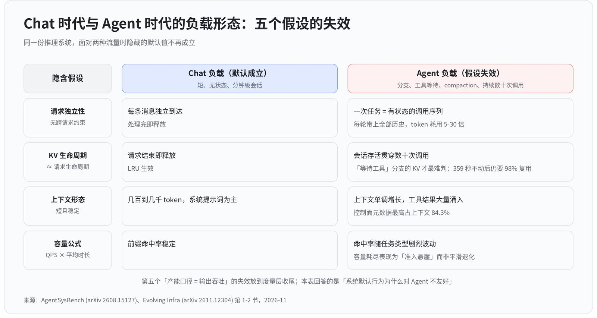
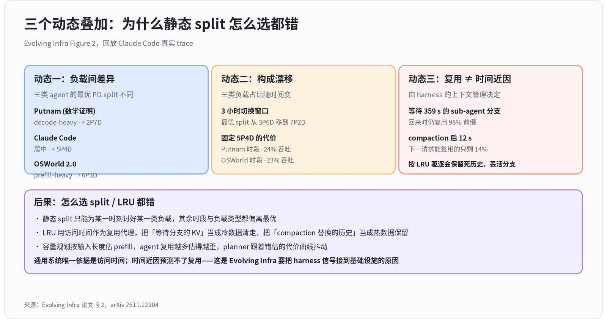
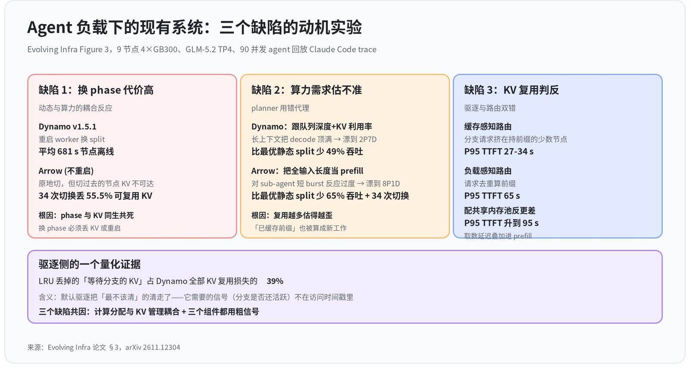
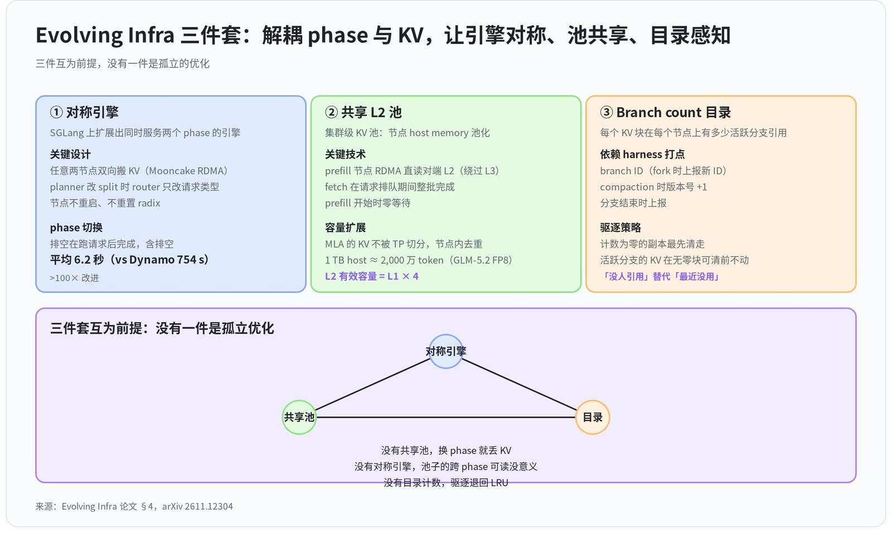
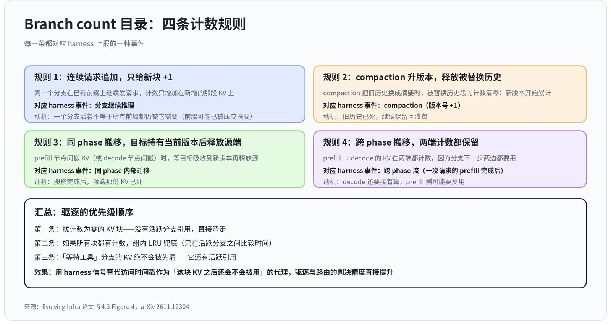
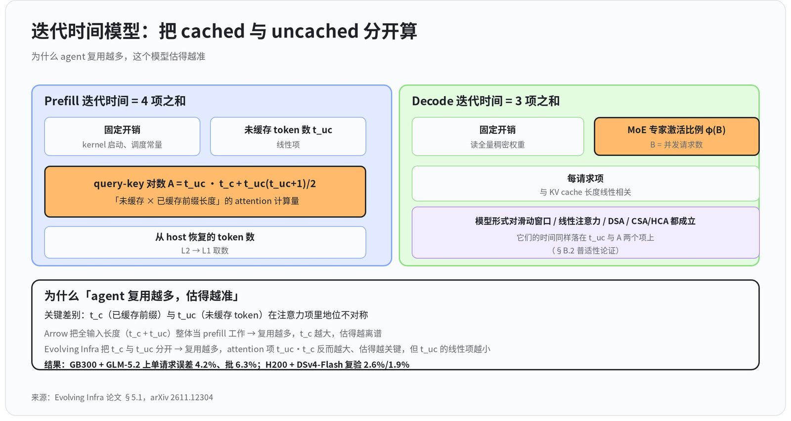
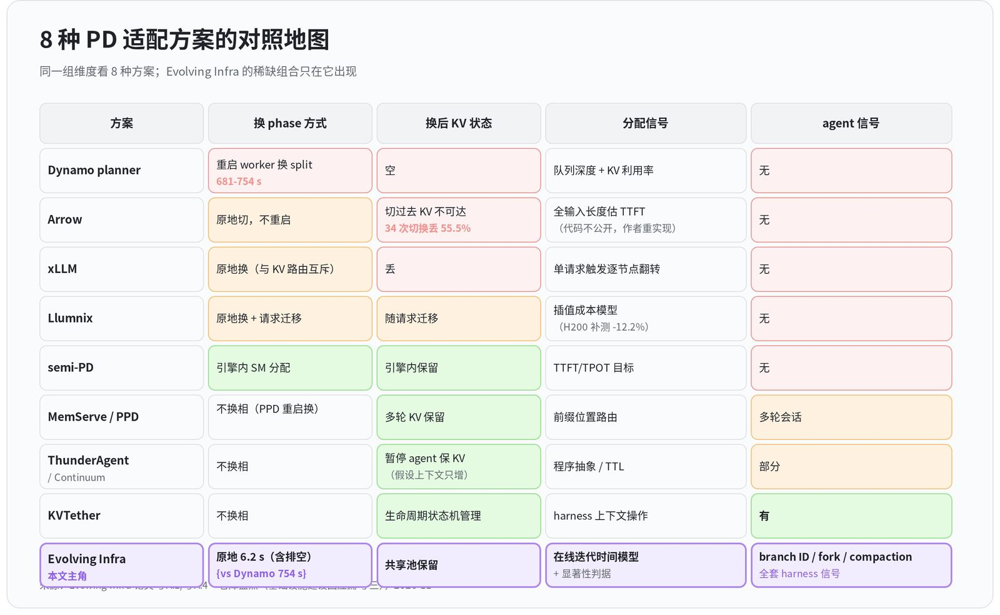
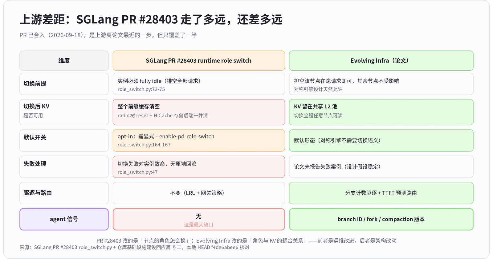

# LLM-71｜系统｜当 Agent 流量吃掉推理：PD 分离的三件套与 8 种方案的分野

> 🎯 **这篇文档解决什么问题**：Chat 时代的推理系统服务的是「人打字」，请求短、无状态、会话以分钟计。Agent 把负载倒了过来：一次任务由程序连续发起 10-20 次调用，token 耗用是普通对话的 5-30 倍。主要流量从人变成 Agent 之后，PD 分离推理系统默认的几条假设逐条失效。本文以 2026 年 11 月发布的 Evolving Infra 论文为主线，回答四个问题：哪些假设失效了，失效后系统在哪里出血；Evolving Infra 用对称引擎、共享 L2 池、branch count 目录这三件套补上了什么；同一组维度下 8 种工业方案差在哪里；你的上游（SGLang、vLLM、Dynamo、Mooncake）走到了哪一步，还差什么。
>
> 使用方式：做 Agent serving 平台的读第 2、4、7、11 章，按现有栈对号；做推理引擎内核的读第 3、5、6、8 章，对照源码；做容量规划与 SLO 的读第 2.4 节和第 9、10 章。论文作者口径的性能数字均显式标注，厂商自报数字按区间引用，不取「up to」的最大值。上游源码以 2026-11 核对的 Dynamo v1.5.1、SGLang f4de6abee6 与 Arrow 重实现为准，vLLM c2320e37f1、LMCache f93cafe6 的结论核对于 2026-11-11。

## 导读 · 先给结论

- **Agent 负载下，一块 KV 该不该留、一次 prefill 有多重，只有 harness 知道**。推理系统只看访问时间、输入长度和前缀匹配率，这三个代理在 Agent 流量下全部失准。Evolving Infra 的做法是把 phase 与 KV 解耦，再把 harness 的分支信号接进基础设施[[3]](https://arxiv.org/abs/2611.12304)。
- **失效的是四个隐含假设，它们同时失效**。请求彼此独立、KV 生命周期等于请求生命周期、上下文短且形态稳定、容量按 QPS 公式规划，这四条从未写进文档，却是所有推理系统默认行为的地基。Agent 流量让一次任务串起数十次调用，会话 KV 贯穿工具等待，控制面元数据最高占上下文 84.3%，容量耗尽表现为「准入悬崖」[[2]](https://arxiv.org/abs/2608.15127)。
- **现有系统的三个缺陷归到两个根因**。Dynamo 换 split 平均让节点离线 681 秒，Arrow 不重启但 34 次切换丢掉 55.5% 的可复用 KV；两个在线 planner 都输给固定 split；LRU 丢掉的等待分支 KV 占 Dynamo 复用损失的 39%。根因是 phase 与 KV 耦合，以及三个组件都只看粗信号[[3]](https://arxiv.org/abs/2611.12304)。
- **三件套必须一起上，少一件另外两件都失效**。对称引擎把 phase 切换从 754 秒降到 6.2 秒，共享 L2 池让 KV 成为集群资产，branch count 目录按「有没有分支引用」驱逐。没有共享池，换 phase 就丢 KV；没有对称引擎，池子跨 phase 可读没有意义；没有计数，驱逐退回 LRU[[3]](https://arxiv.org/abs/2611.12304)。
- **最稀缺的是 harness 契约，任何单独的工程件都不稀缺**。branch ID、fork/finish 事件、compaction 版本号这三类字段，让驱逐看得见等待中的分支，让路由知道该不该迁就前缀，让 planner 算对真实 prefill 工作量。8 种方案里只有 KVTether 与 Evolving Infra 的 agent 信号一栏非空，纯引擎侧方案（Mooncake、Dynamo、Llumnix、semi-PD）都停在时间近因上[[10]](https://arxiv.org/abs/2609.39819)。
- **上游离论文还有结构性距离**。SGLang 2026-09-18 合入的 runtime role switch（PR #28403）做到了不重启，但切换前要排空整个实例，切换后清空全部前缀缓存，也不感知 agent 信号。它改的是节点角色怎么换，论文改的是角色与 KV 的耦合关系[[5]](https://github.com/sgl-project/sglang/pull/28403)。
- **论文数字是作者自报，引用时用区间并带上不利面**。摘要的「up to 4.1×」E2E 与「14×」P95 TTFT 是最好设置；九组设置的吞吐提升是 1.10-2.73×，decode-heavy 的 Putnam 在两档并发下 P95 TTFT 劣于 Dynamo[[3]](https://arxiv.org/abs/2611.12304)。

📎 与系列其他文档的分工：PD 分离、KV Cache 与推理引擎的基础见 [LLM-08｜系统｜大模型推理系统：全栈学习手册](./08-inference-systems.md)；KV Cache 外置、复用与压缩的论文路线见 [LLM-70｜系统｜KV Cache 装不进显存：分层、复用、压缩与外置系统的工程账](./70-kv-cache-offload.md)；KV Cache 被共享后的泄露面与防御见 [LLM-68｜系统｜KV Cache 的信任边界：共享、分层与三种泄露面](./68-kv-cache-trust.md)；K8s 上的多机编排与 LWS、llm-d 服务栈见 [LLM-69｜系统｜K8s 上的 GPU 与推理负载：从设备插件到队列调度](./69-k8s-gpu-inference.md)。本文只讲 Agent 负载下基础设施怎样读懂 harness。

## 第 1 章 · Agent 负载让 Chat 时代的四个隐含假设一起失效

推理系统对负载的假设从来没写进文档，它们散落在调度与缓存代码的默认参数里。Chat 时代这些假设成立得太自然，没人需要为它们辩护。本章先用两组数据说明流量的驱动力已经换了，再列出被打破的四个假设，最后给出全文从假设到方案的因果链。

### 1.1 流量的驱动力从人换成了程序

HF Hub 的监测显示，2026 年 4 月仅 Claude Code 一类编码 Agent 就占了流量的 67.8%，7 月降到 44.4%。份额下降不代表 Agent 退潮，更可能是十多个新客户端涌现带来的生态分化，流量的驱动力已经从人切换到机器[[1]](https://huggingface.co/datasets/mit-han-lab/EvolvingInfra-trace)。

AgentSysBench 给出了第一份系统画像，它测了 10 个代表性 Agent 应用、6 万余次模型调用[[2]](https://arxiv.org/abs/2608.15127)。会话的中位活跃计算时间只占 20%，其余时间会话「活着但空闲」。空闲期导致的 KV 重算占 cache 相关 token 的 55.9%，占总成本的 31.5%。控制面元数据最高占上下文 84.3%。长短请求混批时，小请求的 TPOT 恶化 +79.7%。

### 1.2 四个隐含假设与它们的反例

Agent 流量的杀伤力来自分布的形状，token 变多只是表象。Chat 请求彼此独立，Agent 请求之间有状态、有依赖、有时间结构。下图把四个假设在两种负载下的表现并排放：请求独立性、KV 生命周期、上下文形态、容量公式。

四条在 Agent 负载下各有一个反例。一次任务是一串有状态的调用，每轮都带上全部历史。会话存活贯穿数十次调用，等待工具的分支最难判断该不该留。上下文单调增长，工具结果大量涌入。命中率随任务类型剧烈波动，容量耗尽时直接拒绝新会话。图底注里的第五条「产能口径等于输出吞吐」落在度量层，本文不展开。

### 1.3 从假设到方案：全文的因果链

后文沿一条因果链推进，每一章只回答链上的一环。第 2 章把四个假设失效翻译成四类系统症状。第 3 章用论文的动机实验量化现有系统的三个缺陷，并归到两个根因。第 4 至 6 章讲 Evolving Infra 怎样逐个补上根因：第 4 章给三件套的总图，第 5 章拆 branch count 目录，第 6 章拆 planner 用的迭代时间模型。第 7、8 章把它放回业界，对照 8 种方案与上游 SGLang 的现状。第 9、10 章讲数字口径与适用边界，第 11 章给选型与上线清单。

## 第 2 章 · 四个连锁症状：假设失效之后，系统在哪里出血

每个假设失效都对应一类可观测的症状，它们在任何一次真实 Agent 负载下都能看到。下图是论文从 Claude Code 真实 trace 里归纳的三个动态：负载间差异、构成漂移、复用与时间近因脱钩。三者叠加，静态 split 和 LRU 怎么选都错。本章按 KV、调度、路由、容量四个面展开。

### 2.1 KV 生命周期错配：逐出还是保留，从偶发变成常态

Agent 会话的存活时间远长于单次请求，两轮调用之间系统要做一个 Chat 时代几乎遇不到的决定：这个会话剩下的 KV 是留着等下一轮，还是清走给当前的活跃请求。

两个选项都有代价。逐出时，50K token 的会话 KV 被清掉，下一轮 resume 要重读全部历史，按单卡 10-20K tok/s 的 prefill 量级估算，就是 2.5-5 秒的 TTFT 尖刺。交互式 Agent 每轮都要等工具返回，这个尖刺每轮都会出现。保留时，空闲会话的 KV 持续占用显存，挤压正在 decode 的批。

vLLM 与 SGLang 都用 LRU 驱逐，把「最近访问过」当作「之后还会用」的代理，这个代理在 Agent 负载下会失灵。Claude Code 的真实 trace 里，一个分支等了 359 秒的 sub-agent 调用，回来后的请求仍复用了 98% 的 prompt 前缀。一次 12 秒的 compaction 刚把旧历史换成摘要，被替换的 KV 明明刚访问过，下一个请求能复用的只剩 14%。按 LRU 驱逐，系统会丢掉等待分支的 KV，却留着已经死掉的历史[[3]](https://arxiv.org/abs/2611.12304)。

### 2.2 调度语义失真：队列里混着两种完全不同的东西

Agent 流量进入队列后，调度器看到的是两类请求的混合。一类是活跃请求，正在 prefill 或 decode，对 TTFT 和 TPOT 敏感。另一类是休眠会话，正在等工具执行，几秒到几分钟后才回来。两类共享同一个 KV 池，访问模式完全不同。

重试带来的长 prefill 会放大冲击。一次 50K token 的重试 prefill，足以让同 batch 所有 decode 请求的 TPOT 抖动一个量级。Chunked prefill 缓解的是 Chat 时代的短请求问题，Agent 时代的 prefill 又长又频繁，问题重新回潮。SLO 往往先被 ITL 尾部击穿：p50 看着正常时 p99 已被长 prefill 拖累，只看均值的监控会把问题藏起来。

### 2.3 路由的粘性需求：亲和与负载的根本冲突

多实例部署下，会话的第 N 轮请求如果被路由到没见过它的实例，前缀缓存全部失效，2.1 节的 TTFT 尖刺直接兑现。Chat 时代的负载均衡追求均匀，Agent 时代需要亲和，容量紧张时两个目标互相冲突。

现有的两条路由路线在 Agent 负载下都会变形。缓存感知路由（vLLM Router 的 cache_aware）照顾前缀亲和，结果把分支请求挤到持有前缀的少数节点，P95 TTFT 27-34 s。负载感知路由（SGLang Model Gateway）让请求去别处重算前缀，P95 TTFT 65 s。两条路线各自正确，都不够用[[3]](https://arxiv.org/abs/2611.12304)。

### 2.4 容量公式失效：「QPS × 平均时长」少了三个变量

Chat 的容量公式是 `并发数 = QPS × 平均请求时长`。Agent 场景下决定显存的还有三个变量：并发会话数、会话 KV 的增长速率、命中率。命中率又取决于任务类型的组合，一批编码 Agent 和一批客服 Agent 的 KV 增长曲线完全不同，按平均数规划的容量会在任务类型切换时震荡。

另有两个特征让容量问题变成悬崖。会话占空比（活跃请求与会话数之比）由会话的串行属性决定，不随规模改善，加卡之后占空比不变，叠加能力反而下降。容量耗尽时出现的是准入悬崖：队列打满后再叠加突发的长 prefill，新会话会被直接拒绝，所有人一起变慢的平滑退化不会出现。

## 第 3 章 · 现有系统的三个缺陷，归到两个根因

上一章的症状可以在现有系统上量化。Evolving Infra 的动机实验用 9 节点 4×GB300、GLM-5.2 TP4、90 个并发 agent 回放 Claude Code trace，测出三个缺陷[[3]](https://arxiv.org/abs/2611.12304)。本章逐个拆开，再把它们归到两个根因，三件套正是针对这两个根因设计的。

### 3.1 换 phase 代价高：phase 与 KV 耦合

两种现有做法以不同方式失败。Dynamo v1.5.1 换 split 要重启 worker，节点平均离线 681 秒[[7]](https://github.com/ai-dynamo/dynamo)。Arrow 做到了不重启的原地切换，但切过去的节点 KV 不可达，34 次切换丢掉 55.5% 的可复用 KV[[4]](https://arxiv.org/abs/2505.11916)。一条路把负载停下来再换，一条路换了但把缓存丢了，根因相同：phase 与 KV 同生共死。

### 3.2 算力需求估不准：planner 用错代理

两个在线 planner 都比按经验拍一个固定 split 还差。Dynamo 跟随队列深度与 KV 利用率，长上下文把 decode 节点利用率顶满，split 漂到 2P7D，吞吐比最优静态 split 少 49%。Arrow 用全输入长度估 prefill 时间，把已缓存的前缀也算成工作量，对 sub-agent 的短 burst 反应过度，漂到 8P1D、切换 34 次，吞吐比最优静态 split 少 65%。

根因是同一个：两者都把已缓存前缀算进了 prefill 工作量，所以复用越多，估得越歪。

### 3.3 KV 复用判反：驱逐与路由双错

驱逐侧，LRU 丢掉的等待分支 KV 占 Dynamo 全部 KV 复用损失的 39%。默认策略清走了最不该清的块，因为「该不该留」的信号（分支是否还活跃）不在访问时间戳里。

路由侧同样两头落空。缓存感知让分支挤爆少数节点，P95 TTFT 27-34 s；负载感知让请求重算前缀，65 s；给路由配上共享内存池反而更差，95 s，因为取数延迟叠加进了 prefill。

### 3.4 两个根因

三个缺陷归约到两件事。第一个根因是计算分配与 KV 管理耦合：phase 身份编码在节点上，换 phase 就得丢 KV 或重启。第二个根因是三个组件都用粗信号：驱逐看访问时间，planner 看输入长度，路由看前缀匹配率，全都看不见 agent 怎样管理上下文。下一章的三件套分别对着这两个根因下手。

> 💡 **常见误区**：把 Agent 负载的问题归结为「token 更多」，于是加卡、加显存。会话占空比不随规模改善，LRU 和 planner 的代理也不会因为资源变多而变准，资源只能推迟准入悬崖出现的时间。

## 第 4 章 · 三件套总图：把 phase 与 KV 解开，把 harness 信号接进来

三件套是同一个结构的三个面，各自对着第 3 章的一个缺陷。对称引擎让换 phase 变成路由改一下请求类型，补的是换 phase 代价高；共享 L2 池把 KV 从某台节点的私有物变成集群资产，补的是切换后 KV 不可达；branch count 目录把 KV 的生死从时间换成引用，补的是驱逐判反。前两件拆第一个根因，第三件拆第二个根因。下图是三件套的总体结构。

三件互为前提，少一件另外两件都会失效：没有共享池，换 phase 就丢 KV；没有对称引擎，池子跨 phase 可读没有意义；没有目录计数，驱逐退回 LRU。

### 4.1 对称引擎：phase 是属性，不再是身份

常规 PD 分离的节点要么跑 prefill，要么跑 decode，身份由启动参数写死，换 phase 必须重启。Evolving Infra 在 SGLang 上扩展出一个能在同一个调度循环里服务两个 phase 的引擎，再配一条任意两节点之间双向搬 KV 的传输通路，传输层复用 Mooncake 的 RDMA[[9]](https://github.com/kvcache-ai/Mooncake)。

planner 换 split 时，router 只改变发给某个节点的请求类型，节点不重启，排空该节点在跑的请求后就切换完毕。九组设置平均下来，Dynamo 换一次要 754 秒，对称引擎含排空平均 6.2 秒，改进超过 100 倍[[3]](https://arxiv.org/abs/2611.12304)。

### 4.2 共享 L2 池：KV 从节点私有物变成集群资产

全部节点的 host memory（HiCache 语义里的 L2）被池化成集群级 KV 池[[8]](https://docs.sglang.io/docs/advanced_features/hicache_design)。和上游的关键差别在取数路径。上游 HiCache 经 L3（Mooncake Store）中转，路径是 L2 → L3 → L2'，跨节点取 KV 要在第三个节点做一次副本，还要走 master RPC。Evolving Infra 让 prefill 节点用 RDMA 直读对端的 L2，省掉第三节点副本与 RPC。fetch 在请求排队期间整批做完：拉到本节点 L2、装入 L1、广播到节点内各 GPU，prefill 开始时零等待。

decode 节点只写不读。decode 从 host 取数会停住整批，上游 SGLang 的这类停顿让 GPU 空闲 58.7%，所以 decode 需要的 KV 一律由 prefill 节点经 GPU 直送。MLA 的 KV 不被 TP 切分，节点内四个 rank 去重后每份只存一份，L2 的有效容量变成 L1 的四倍。以 GLM-5.2 为例，FP8 下约 50 KB/token，1 TB host 约能装 2,000 万 token。

### 4.3 Branch count 目录：驱逐的依据从时间换成引用

目录建在 Dynamo KV indexer 的事件驱动前缀树上，给每个块在每个节点上的副本加一列计数：有多少活跃分支引用它[[7]](https://github.com/ai-dynamo/dynamo)。这要求 harness 上报三类事件：每个请求带上 branch ID，分支 fork 时上报新 ID，compaction 时版本号加一，分支结束时上报。

计数为零的副本就是没有任何活跃分支会再引用的 KV，驱逐时最先清走。它们包括被 compaction 替换的历史、已结束 sub-agent 的上下文、同 phase 搬移后留下的源副本[[3]](https://arxiv.org/abs/2611.12304)。计数怎么加减由四条规则决定，下一章逐条拆开。

## 第 5 章 · Branch count 目录：四条计数规则对应四种 harness 事件

目录是三件套里唯一需要 harness 配合的部分，也是 Evolving Infra 与纯引擎方案拉开差距的地方。四条规则各对应一种 harness 事件，前两条管分支内部，后两条管 KV 在节点间搬移。想在自己系统里做类似机制，需要的就是这四条。

### 5.1 分支内部：追加只计新块，compaction 升版本

规则 1：同一个分支在已有前缀上继续发请求时，只给新增的那段 KV 计数 +1，既有前缀不动。分支活着不等于它的所有前缀仍被需要，前缀可能已经被压成摘要。

规则 2：compaction 把旧历史换成摘要时，被替换历史段的计数清零，新版本重新累计，harness 上报 compaction 事件并把版本号加一。这条规则对应 Claude Code 的真实行为：12 秒的 compaction 刚把旧历史换掉，旧 KV 已经无用，访问时间戳却还很新。按 LRU 它会被留着，按 branch count 它会被立刻释放。

### 5.2 节点间搬移：同 phase 等目标吸收，跨 phase 两端都留

规则 3：prefill 节点之间或 decode 节点之间搬 KV 时，等目标吸收到新版本后才释放源端，防止搬移途中源端被清掉、数据丢失。

规则 4：prefill 到 decode 的跨 phase 搬移，两端都保留计数。分支的下一步两边都要用：decode 要接着算，prefill 侧可能把它当前缀复用。

### 5.3 驱逐顺序与效果

驱逐分三级挑选。先清计数为零的块，它们没有活跃分支引用。所有块都有计数时，在组内用 LRU 兜底，只在活跃分支之间比较时间。等待工具的分支还有活跃引用，它的 KV 不会被优先清掉。

效果可以用一个数字概括：被 LRU 误判为可清的 KV 比例，从 Dynamo 实测的 39% 降到接近 0[[3]](https://arxiv.org/abs/2611.12304)。

> 💡 **常见误区**：以为给 LRU 加长 TTL 就能保住等待中的分支。359 秒后回来的 sub-agent 仍要复用 98% 的前缀，刚被 compaction 替换的历史却只剩 14% 可复用；时间维度上两者分不开，只有引用计数能区分。

## 第 6 章 · 迭代时间模型：把已缓存与未缓存 token 分开算

目录解决了驱逐，planner 还需要一把准的尺子。第 3.2 节两个 planner 都把已缓存前缀算成了工作量，Evolving Infra 的迭代时间模型把已缓存前缀 t_c 与未缓存 token t_uc 分开建模，这是它估得比 Dynamo、Arrow 准的原因。下图是 prefill 与 decode 两组分解。

### 6.1 Prefill 的四项分解

prefill 迭代时间由四项相加：固定开销（kernel 启动、调度常量），t_uc 的线性项，query-key 对数 A，以及从 host 恢复的 token 数（L2 → L1 取数）。其中 A = t_uc · t_c + t_uc(t_uc+1)/2，即未缓存 token 数乘已缓存前缀长度的 attention 计算量，再加上 t_uc 自身的对角项。

Arrow 把 t_c + t_uc 整体当作 prefill 工作，复用越多，t_c 越大，估得越离谱。分开建模之后，复用增多时 t_uc · t_c 项在 attention 里的比重变大，t_uc 线性项变小。模型同时抓住了这两个方向相反的变化，偏差因此可控。

### 6.2 Decode 的三项分解

decode 拆成三项：固定开销（读取全量稠密权重），MoE 路由专家的期望激活比例 φ(B)（B 为并发请求数），以及与 KV cache 长度线性相关的每请求项。不同并发对专家激活的影响被显式建模，在 GB300 + DeepSeek-V3 这类 MoE 大模型上，这是解码时间的关键变量。

### 6.3 在线拟合与显著性判据

两组系数在热身期用 collocated 模式（所有节点同时跑两个 phase）在线最小二乘拟合，一分钟内收敛。在 GB300 + GLM-5.2 上，设定外的平均误差为 4.2%（单请求）和 6.3%（2-8 请求的批）；换到 H200 + DeepSeek-V4-Flash 复验，分别为 2.6% 和 1.9%。滑动窗口、线性注意力、DSA 以及 DeepSeek-V4 的 CSA/HCA 的时间同样落在 t_uc 与 A 两项上，所以模型形式对它们也成立（论文 §B.2）。

planner 在每个 600 秒窗口结束时，用窗口内请求的平均工作 w̄ 评估全部 N-1 个候选 split 的预测吞吐。w̄ 刻画的是负载本身，sub-agent 的短 burst 抬不动它。候选还要通过显著性判据才允许切换：10 个切片上的平均增益要大于 2 倍标准误。结果是平均每次 run 切 2.0 次，远少于 Dynamo 的 3.6 次[[3]](https://arxiv.org/abs/2611.12304)。

> 🔑 **本章要点**：planner 估错的根源是把已缓存前缀当成了工作量。t_c 与 t_uc 分开建模、用窗口平均工作评估、再加显著性门槛，三者合起来让 split 既跟得上负载变化，又不被 sub-agent 的短 burst 带偏。三件套到此讲完，下一章把它放回业界方案中对照。

## 第 7 章 · 8 种方案的分野：同一组维度下 Evolving Infra 的稀缺组合

三件套单看每一件都有先例，稀缺的是组合。把 PD 适配方案放进同一组维度对照，这一点就看得清楚。下图覆盖论文 §A.1、§A.4 盘点过的方案，外加 AI-fundamentals 仓库补充的 KVTether[[6]](https://github.com/ForceInjection/AI-fundamentals/tree/main/09_inference_system/agent_serving)，维度是换 phase 方式、换后 KV 状态、分配信号与 agent 信号。

### 7.1 三个结构性观察

agent 信号一栏此前几乎是空白。8 种方案里只有 KVTether 与 Evolving Infra 在这一栏非空，两者都要求改造 harness 打点[[10]](https://arxiv.org/abs/2609.39819)。其余 6 种停留在时间近因加队列深度的代理上。

换 phase 方式与 KV 去留两列高度相关。不重启的方案里（Arrow、xLLM、Llumnix[12]），只有 Evolving Infra 保住了 KV，这正是对称引擎加共享池这对组合的稀缺之处。其他方案要么不重启但丢 KV（Arrow），要么根本不换（semi-PD、MemServe）。

容量规划的三种口径互斥。Dynamo 用队列深度加 KV 利用率做代理，Arrow 用全输入长度，Evolving Infra 用 t_c 与 t_uc 分开的迭代时间模型。前两种代理在 Chat 时代够用，在 Agent 时代都错得离谱，论文的动机实验里两个在线 planner 都输给了固定 split。

### 7.2 三种容易混淆的方案

ThunderAgent[11] 与 Continuum 假设上下文只增不减，让暂停中的 agent 保住 KV。KVTether 用生命周期状态机管理 KV[[10]](https://arxiv.org/abs/2609.39819)。它们都看到了 harness 信号的价值，但只用上了一部分。Evolving Infra 把信号补齐成 branch ID、fork/finish 事件、compaction 版本号三类字段，并让三件套互为前提，这是它与 ThunderAgent、KVTether 的区别所在。

## 第 8 章 · 上游走到哪一步：SGLang PR #28403 的边界

对照完业界方案，再看上游离论文有多远。SGLang 在 2026-09-18 合入了 runtime role switch（PR #28403），这是上游离 Evolving Infra 最近的一步[[5]](https://github.com/sgl-project/sglang/pull/28403)。AI-fundamentals 仓库在本地 HEAD `f4de6abee6` 上核对了它的代码，结论是：它做到了不重启，没有做到不丢 KV、不排空整个实例、跟着 agent 信号走[[6]](https://github.com/ForceInjection/AI-fundamentals/tree/main/09_inference_system/agent_serving)。下图逐项对照两者。

### 8.1 差距的具体清单

切换前提不同。PR #28403 要求实例 fully idle，排空全部请求（role_switch.py:73-75）；Evolving Infra 只排空该节点在跑的请求。

切换后的 KV 去向不同。PR 把整个前缀缓存清空，radix 树 reset，HiCache 存储后端一并清掉，docstring 写明这是为了防止新角色误配旧前缀。Evolving Infra 的 KV 留在共享 L2 池，切换全程可读。

失败处理不同。PR 切换失败对实例是致命的，没有原地回滚（role_switch.py:47）；论文没有报告失败案例。

驱逐与路由不同。PR 不改这两部分，仍是 LRU 加网关策略；Evolving Infra 换成分支计数驱逐加 TTFT 预测路由。最本质的分野在 agent 信号：PR 完全没有，Evolving Infra 是全套。

### 8.2 为什么差距是结构性的

上游 PR 改的是节点的角色怎么换，Evolving Infra 改的是角色与 KV 的耦合关系。前者是运维改进，可以在不破坏既有抽象的前提下合进主干。后者是架构改动，要跨越 radix tree、HiCache、调度器、路由网关四层的边界。所以 SGLang 离论文既近又远：用的是同一套术语，关键设计的方向却相反。

### 8.3 三个上游动向值得跟踪

SGLang 与 vLLM 是否会吸收 branch 信号。SGLang radix 树的 extra_key 机制（[LLM-68｜系统｜KV Cache 的信任边界：共享、分层与三种泄露面](./68-kv-cache-trust.md) 提到 lora_id 就拼在 extra_key 里）离按分支隔离或复用只差一次语义升级。改动最小，却会让 KVTether 与 Evolving Infra 的 harness 契约成为上游标准。

存储生态是否会做到直读对端 L2，绕开 L3 的三跳。Mooncake、3FS 都在向 GPU 内存直注册演进，vLLM 的 Mooncake connector 也在这个方向上[[9]](https://github.com/kvcache-ai/Mooncake)。

Evolving Infra 是否开源。论文发布时已公开 trace 数据集，代码是下一个自然动作。对读者而言，这决定三件套能直接拿来用，还是要自己重新写一遍。

## 第 9 章 · 数字怎么读：区间、口径与不利面

前面引用的性能数字全部是作者方自报，作者单位横跨 NVIDIA、OpenAI、Georgia Tech、UIUC 等。引用之前要分清最好设置与区间，带上论文自己披露的不利面，并区分哪些结论只对重实现成立。

### 9.1 稳态负载的区间口径

摘要里「up to 4.1×」的 E2E 与「14×」的 P95 TTFT 是最好设置。正文九组设置的真实区间如下[[3]](https://arxiv.org/abs/2611.12304)：

- 吞吐提升 1.10-2.73×。
- 平均 E2E 降低 1.15-4.12×，其中 CC 3.80-4.12×、OSWorld 2.34-2.69×、Putnam 1.15-1.23×。
- P95 TTFT 最高降低 13.92×。
- 丢失的 KV 复用减少 81-95%，绝对值是 0.17-1.01% 对 1.85-7.78%。
- phase 切换 6.2 s 对 754 s，超过 100 倍。
- 对最优静态 split 的吞吐比为 0.98-1.38×。

引用时用区间，不取最大值。

### 9.2 Putnam 的两处不利要如实带出

在 decode-heavy 的数学 agent 上，planner 只留 1-2 个 prefill 节点来换吞吐，224 与 288 并发两档的 P95 TTFT 劣于 Dynamo。最低并发档的吞吐只有最优静态 split 的 0.98×，对低并发负载，Evolving Infra 并不比精心设计的静态 split 更好。这两处是论文自己披露的不利面，引用时要一起带上。

### 9.3 Arrow 的结论只对重实现成立

Arrow 的代码不公开，作者在自己的对称引擎上重写了它的 planner 与 scheduler 再做对比，论文如实标注了这一点[[4]](https://arxiv.org/abs/2505.11916)。引用 Arrow 的数字时要清楚，这是同一个团队对 Arrow 算法的复现，Arrow 原作者并未自报这些数字。

### 9.4 第三方复测：动机数字经独立复算

AI-fundamentals 仓库下载了论文公开的 CC trace 数据集（mit-han-lab/EvolvingInfra-trace），独立复算了四项关键数字，方向与量级都和论文吻合[[1]](https://huggingface.co/datasets/mit-han-lab/EvolvingInfra-trace)[[6]](https://github.com/ForceInjection/AI-fundamentals/tree/main/09_inference_system/agent_serving)：

- 长等待（>300 s）后的复用率中位 99.8%，论文口径是 359 s 后 98%。
- compaction 后的复用率中位 0.0%，论文是约 14%；仓库取的是骤降后的首个请求，所以更极端。
- sub-agent 首个请求对主线上文的复用中位 0.0%，这是论文没给的一个数字。
- 主线等待间隔中位 4.8 s，p90 120.6 s。

sub-agent 冷启动这一条揭示了设计动机里的一个隐藏变量：spawn 产生的都是还没算过的 KV，目录只需要给已经算过的 KV 维护计数。

## 第 10 章 · 适用边界：硬件代际、harness 契约与论文未答的问题

三件套有前提。落地之前先确认三件事：硬件撑得起共享池和对称引擎，团队付得起 harness 打点的成本，以及论文没有回答的问题不会落在你的负载上。

### 10.1 硬件代际要求

共享 L2 池依赖 NVLink-C2C 的 host-GPU 带宽和大容量 host memory。论文拿 ThunderAgent 在 PCIe 时代得出的「offload 太慢」作对照，说明这套设计对硬件代际有要求：PCIe 时代不成立，只有 NVLink-C2C（GB200、GB300）及以上的系统才撑得起 L2 池的带宽需求。

对称引擎要求每个节点同时装下两个 phase 的执行路径。异构并行场景下要装下权重的并集，B200 上约 10 GB/GPU（论文 §D.4）。显存小的节点装不下对称引擎。

### 10.2 Harness 打点契约的成本

机制要求 harness 上报 branch ID、fork/finish 事件和 compaction 版本号。对运行自有 harness 的团队，这是实打实的工作量：Claude Code、Continue、Cursor 这类 harness 各家都不同，每个 harness 的 fork 与 compaction 时机都要打点，打点误差直接影响计数精度。这份基础设施与 agent 框架之间的契约，是 Evolving Infra 区别于 Mooncake、Dynamo、Llumnix 等纯引擎侧方案的分水岭，也是部署摩擦的来源。

### 10.3 论文没有回答的三个问题

分支之间的语义依赖没有进模型。论文覆盖了分支的线性追加与 compaction，fork 也有了计数，但「一个分支等待另一个分支的结果」只体现为等待时长。

稳定性需要更多复测。数字全部是作者自报的单次运行，open-loop 附录里作者自己披露了一次 planner 决策失误，导致 0.75 agents/min 这一档未达标。

对照组是受限的。用 NVIDIA 自家的 Dynamo 做 baseline 增加了可信度，但有两个 baseline 被排除：SGLang 的 runtime role switch 因不支持投机解码被排除，Llumnix 因 GB300 的 Arm CPU 无法运行被排除。理由成立，读者仍要知道这是受限的对照。

## 第 11 章 · 怎么选与上线清单

全文的判断落到选型上只有一条：先看你的负载里 KV 的生死是否由 harness 决定，再看你的栈缺的是哪一件。本章按现有栈对号，再给上线前的核对清单。

### 11.1 按现有栈对号

| 你的现状 | Agent 负载下先出问题的地方 | 对应章节 |
|---|---|---|
| Dynamo planner | 换 split 要重启 worker；队列深度代理让 split 漂向 decode 侧；LRU 丢等待分支的 KV | 第 3 章；第 5、6 章看计数与迭代时间模型怎样补 |
| SGLang runtime role switch | 切换要整个实例 fully idle，切换后前缀缓存清空，不感知 agent 信号 | 第 8 章 |
| 缓存感知或负载感知路由 | 前者挤爆持前缀的少数节点，后者让请求重算前缀 | 第 2.3、3.3 节 |
| PCIe 机型或小显存节点 | 撑不起共享 L2 池的带宽，装不下对称引擎的权重并集 | 第 10.1 节 |
| decode-heavy、低并发负载 | 精心设计的静态 split 可能已经够用 | 第 9.2 节 |

### 11.2 上线前核对清单

> 📌 **上线前核对清单**
>
> - harness 能否上报 branch ID、fork/finish 事件与 compaction 版本号，打点时机是否和真实的 fork、compaction 对齐。
> - 统计驱逐丢掉的 KV 里有多少属于仍在等待工具的分支，作为是否需要引用计数的依据。
> - 核对 planner 是否把已缓存前缀算进了 prefill 工作量，对比在线 planner 与固定 split 的吞吐。
> - SLO 监控看 ITL 的 p99，不只看均值和 p50。
> - 容量规划把并发会话数、会话 KV 增长速率和命中率纳入，按任务类型分别估算。
> - 确认机型是 NVLink-C2C 一代，节点显存装得下两个 phase 的执行路径。
> - 引用论文数字时用九组设置的区间，并带上 Putnam 的不利面。

### 11.3 全文小结

> 🔑 **全文小结**：Agent 流量让 KV 的生死、prefill 的轻重都取决于 harness 怎样管理上下文，推理系统手里的访问时间、输入长度、前缀匹配率三个代理因此一起失准。Evolving Infra 用对称引擎和共享 L2 池解开 phase 与 KV 的耦合，用 branch count 目录和迭代时间模型把 harness 信号接进驱逐、路由与 planner。上游目前只走到不重启这一步，硬件代际和 harness 契约是落地前要先确认的两道门槛。

## 参考文献

1. MIT Han Lab. EvolvingInfra-trace: Claude Code trace dataset for agent serving research. HuggingFace (2026) [https://huggingface.co/datasets/mit-han-lab/EvolvingInfra-trace](https://huggingface.co/datasets/mit-han-lab/EvolvingInfra-trace)
2. AgentSysBench. From LLM Inference to Agentic Workloads: A Benchmark for Agent Serving. arXiv:2608.15127 (2026) [https://arxiv.org/abs/2608.15127](https://arxiv.org/abs/2608.15127)
3. Kang, Han, Stoica, Krishna, Mao et al. Evolving Infra: Agent-Adaptive LLM Serving at Scale. arXiv:2611.12304 (2026) [https://arxiv.org/abs/2611.12304](https://arxiv.org/abs/2611.12304)
4. Apache Arrow. Arrow: Adaptive Scheduling for Disaggregated LLM Inference. arXiv:2505.11916 (2025) [https://arxiv.org/abs/2505.11916](https://arxiv.org/abs/2505.11916)
5. sglang Project. PR #28403: Runtime PD role switching. GitHub (2026-09-18) [https://github.com/sgl-project/sglang/pull/28403](https://github.com/sgl-project/sglang/pull/28403)
6. ForceInjection. AI-fundamentals 仓库：Agent 推理服务总纲 + Evolving Infra 论文精读 + 基础设施建设回应篇. GitHub (2026) [https://github.com/ForceInjection/AI-fundamentals/tree/main/09_inference_system/agent_serving](https://github.com/ForceInjection/AI-fundamentals/tree/main/09_inference_system/agent_serving)
7. NVIDIA. Dynamo v1.5.1: KV-aware routing and PD disaggregation framework. GitHub (2026) [https://github.com/ai-dynamo/dynamo](https://github.com/ai-dynamo/dynamo)
8. SGlang Team. HiCache: Hierarchical KV Cache for SGLang. SGLang Docs (2026) [https://docs.sglang.io/docs/advanced_features/hicache_design](https://docs.sglang.io/docs/advanced_features/hicache_design)
9. Mooncake. Mooncake Transfer Engine. GitHub (2026) [https://github.com/kvcache-ai/Mooncake](https://github.com/kvcache-ai/Mooncake)
10. KVTether. KV Cache Lifecycle Management via Harness Context Operations. arXiv:2609.39819 (2026) [https://arxiv.org/abs/2609.39819](https://arxiv.org/abs/2609.39819)
11. ThunderAgent. Program-aware Agent Scheduling with Suspension and TTL. ICML 2026 论文集
12. Moonshot AI. Llumnix: Dynamic Scheduling for LLM Serving. 2026

---

上一篇：[LLM-70｜系统｜KV Cache 装不进显存：分层、复用、压缩与外置系统的工程账](./70-kv-cache-offload.md) · [目录](./README.md)
