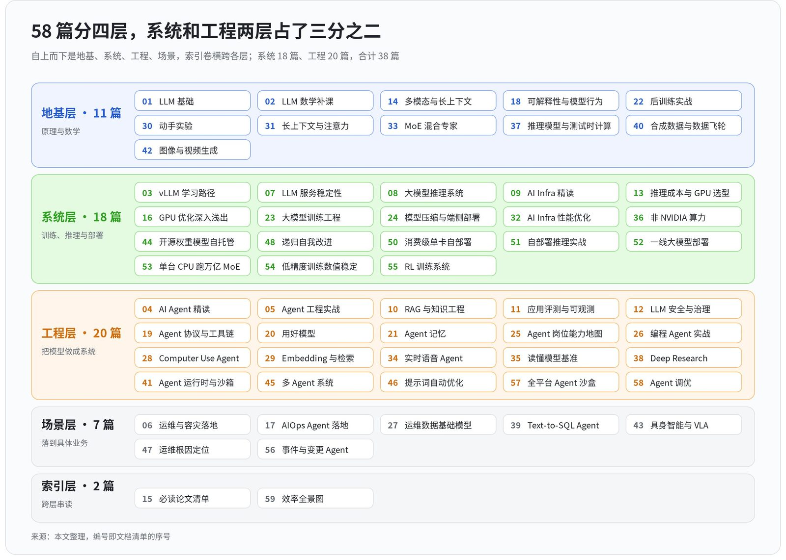
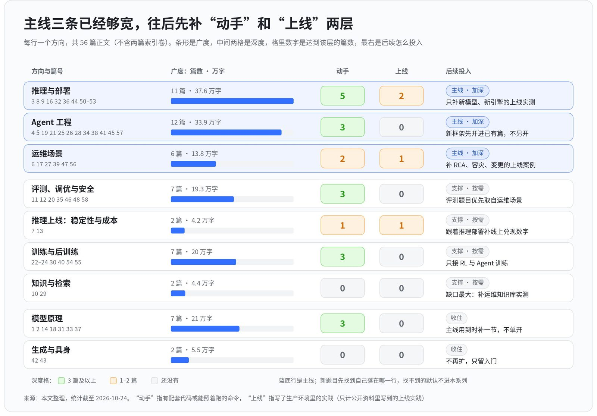
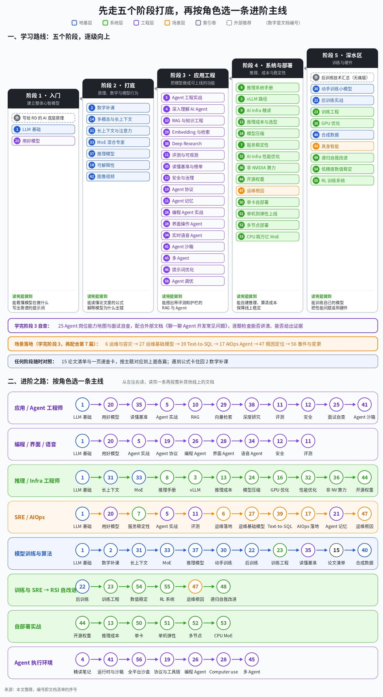

# LLM-00｜总览｜LLM 系列：地图、清单与进展

> 本目录是作者飞书「LLM 系列」的 Markdown 版，正文与原文一致，画板导出为图片放在 `assets/`。工作中的内部案例没有收录。

> 🎯 <b>一句话进展：</b>LLM 系列目前共 65 篇，约 177.1 万字、690 张图：地基 12、系统 22、工程 21、场景 8，索引卷 2。标题统一写成「LLM-编号｜层级｜主题：副标题」，编号就是第二节清单的序号。

## 一、系列地图

64 篇按地基 12、系统 22、工程 21、场景 8 分四层，论文清单和第 59 篇效率全景图两篇索引卷横跨各层。第 49、60–63、66、72 篇是工作中的内部案例，不公开，编号保留空缺；第 64、65、67、68、69、70、71 篇还没画进下图；2026-10-21 加的 19 篇专题已改写成老文档的章节，去处见第三节。

下图把 56 篇正文按方向归成九行：条形长度是字数，“动手”“上线”两格是写到这一层的篇数。新题目先在图里找所属的行，找不到的默认不进本系列。

## 二、文档清单

各篇都在本目录，点标题打开。字数按正文粗略统计，不含图。

| # | 文档 | 章节 | 图 | 字数 | 状态 |
|---|---|---|---|---|---|
| 1 | [LLM-01｜地基｜LLM 基础：从 token 到 Agent 的学习主线](./01-foundations.md) | 12 章 | 30 | 约 5.9 万 | ✅ 已完成（新写） |
| 2 | [LLM-02｜地基｜LLM 数学补课：读懂公式的一张地图](./02-math.md) | 11 章 | 28 | 约 3.8 万 | ✅ 已完成（新写） |
| 3 | [LLM-03｜系统｜vLLM 学习路径：从推理基础到架构前沿](./03-vllm-path.md) | 5 阶段 | 13 | 约 2.4 万 | ✅ 已完成（优化） |
| 4 | [LLM-04｜工程｜《深入理解 AI Agent》精读：设计原理与工程实践](./04-ai-agent-reading.md) | 14 节 | 6 | 约 3.7 万 | ✅ 已完成（优化） |
| 5 | [LLM-05｜工程｜Agent 工程实战：从工具到上线的施工手册](./05-agent-engineering.md) | 12 章 | 19 | 约 3.6 万 | ✅ 已完成（新写） |
| 6 | [LLM-06｜场景｜LLM 在运维与容灾中的落地：SRE 实战地图](./06-llm-for-sre.md) | 10 章 | 13 | 约 1.8 万 | ✅ 已完成（新写） |
| 7 | [LLM-07｜系统｜LLM 服务稳定性工程：SRE 上线手册](./07-serving-reliability.md) | 10 章 | 14 | 约 1.9 万 | ✅ 已完成（新写） |
| 8 | [LLM-08｜系统｜大模型推理系统：全栈学习手册](./08-inference-systems.md) | 8 篇 | 21 | 约 6.8 万 | ✅ 已收录 |
| 9 | [LLM-09｜系统｜《深入理解 AI Infra》精读：量化分析与系统设计](./09-ai-infra-reading.md) | 3 部分 · 12 章 | 19 | 约 7.8 万 | ✅ 已收录 |
| 10 | [LLM-10｜工程｜RAG 与知识工程：让大模型用上自有资料](./10-rag.md) | 12 章 | 12 | 约 2.1 万 | ✅ 已完成（新写） |
| 11 | [LLM-11｜工程｜LLM 应用评测与可观测：自建评测体系](./11-eval-observability.md) | 11 章 | 20 | 约 3.4 万 | ✅ 已完成（新写） |
| 12 | [LLM-12｜工程｜LLM 安全与治理：应用侧的攻防与合规](./12-security-governance.md) | 10 章 | 14 | 约 2.9 万 | ✅ 已完成（新写） |
| 13 | [LLM-13｜系统｜自建推理成本与 GPU 选型：算账手册](./13-inference-cost-gpu.md) | 12 章 | 21 | 约 2.8 万 | ✅ 已完成（新写） |
| 14 | [LLM-14｜地基｜多模态与长上下文：从视觉 token 到百万上下文](./14-multimodal-long-context.md) | 9 章 | 11 | 约 2.0 万 | ✅ 已完成（新写） |
| 15 | [LLM-15｜索引｜LLM 必读论文清单与速查卡](./15-papers.md) | 9 章 · 115 篇论文 + 17 篇技术报告 | 8 | 约 2.8 万 | ✅ 已完成（新写） |
| 16 | [LLM-16｜系统｜GPU 优化深入浅出：从一条 CUDA 指令到万卡集群](./16-gpu-optimization.md) | 7 层 + 3 专题 | 18 | 约 3.9 万 | ✅ 已收录 |
| 17 | [LLM-17｜场景｜AIOps Agent 落地：基准、生产实践与工程模式](./17-aiops-agent.md) | 11 章 | 8 | 约 2.2 万 | ✅ 已完成（新写） |
| 18 | [LLM-18｜地基｜LLM 可解释性与模型行为：工程师用得上的部分](./18-interpretability.md) | 10 章 | 8 | 约 1.7 万 | ✅ 已完成（新写） |
| 19 | [LLM-19｜工程｜Agent 协议与工具链：MCP、A2A 与 Skills](./19-agent-protocols.md) | 11 章 | 8 | 约 1.9 万 | ✅ 已完成（新写） |
| 20 | [LLM-20｜工程｜用好模型：提示词、思考档位与模型路由](./20-prompting-routing.md) | 11 章 + 附录 | 10 | 约 3.0 万 | ✅ 已完成（新写） |
| 21 | [LLM-21｜工程｜Agent 记忆：存什么、怎么取、何时忘](./21-agent-memory.md) | 13 章 | 14 | 约 3.9 万 | ✅ 已完成（新写） |
| 22 | [LLM-22｜地基｜后训练实战：SFT、LoRA 与 RLVR](./22-post-training.md) | 13 章 | 19 | 约 6.0 万 | ✅ 已完成（新写） |
| 23 | [LLM-23｜系统｜大模型训练工程：数据配比与万卡稳定性](./23-training-engineering.md) | 11 章 | 9 | 约 2.4 万 | ✅ 已完成（新写） |
| 24 | [LLM-24｜系统｜模型压缩与端侧部署：量化、剪枝与蒸馏](./24-compression-edge.md) | 11 章 | 9 | 约 2.5 万 | ✅ 已完成（新写） |
| 25 | [LLM-25｜工程｜Agent 岗位能力地图与面试自查](./25-agent-career.md) | 12 章 | 7 | 约 2.0 万 | ✅ 已完成（新写） |
| 26 | [LLM-26｜工程｜编程 Agent 实战：Claude Code、Codex 与 Cursor](./26-coding-agents.md) | 11 章 | 15 | 约 4.9 万 | ✅ 已完成（新写） |
| 27 | [LLM-27｜场景｜运维数据上的基础模型：时序、日志与 Trace](./27-ops-foundation-models.md) | 11 章 | 8 | 约 2.6 万 | ✅ 已完成（新写） |
| 28 | [LLM-28｜工程｜Computer Use 与浏览器 Agent：让模型操作界面](./28-computer-use.md) | 12 章 | 8 | 约 2.6 万 | ✅ 已完成（新写） |
| 29 | [LLM-29｜工程｜Embedding 与向量检索：选模型、建索引与运维](./29-embedding-retrieval.md) | 12 章 | 10 | 约 3.0 万 | ✅ 已完成（新写） |
| 30 | [LLM-30｜地基｜动手实验：从零训练一个小模型](./30-train-small-model.md) | 11 章 | 8 | 约 2.6 万 | ✅ 已完成（新写） |
| 31 | [LLM-31｜地基｜长上下文与注意力：从 MHA 到稀疏与线性注意力](./31-attention-long-context.md) | 11 章 | 8 | 约 2.5 万 | ✅ 已完成（新写） |
| 32 | [LLM-32｜系统｜AI Infra 性能优化实战：从 profile 到硬件上限](./32-infra-perf.md) | 11 章 | 11 | 约 2.9 万 | ✅ 已完成（新写） |
| 33 | [LLM-33｜地基｜MoE 混合专家：路由、负载均衡、训练与推理](./33-moe.md) | 11 章 | 8 | 约 2.6 万 | ✅ 已完成（新写） |
| 34 | [LLM-34｜工程｜实时语音 Agent：延迟预算、打断与全双工](./34-voice-agent.md) | 11 章 | 8 | 约 2.6 万 | ✅ 已完成（新写） |
| 35 | [LLM-35｜工程｜读懂模型基准与排行榜：污染、自报分与误差](./35-benchmarks.md) | 10 章 | 8 | 约 2.5 万 | ✅ 已完成（新写） |
| 36 | [LLM-36｜系统｜非 NVIDIA 算力：TPU、Trainium、AMD 与昇腾](./36-non-nvidia.md) | 10 章 | 9 | 约 2.7 万 | ✅ 已完成（新写） |
| 37 | [LLM-37｜地基｜推理模型与测试时计算：长思维链何时值得](./37-reasoning-models.md) | 11 章 | 8 | 约 2.5 万 | ✅ 已完成（新写） |
| 38 | [LLM-38｜工程｜Deep Research 与搜索 Agent：检索、核验与评测](./38-deep-research.md) | 12 章 | 12 | 约 3.3 万 | ✅ 已完成（新写） |
| 39 | [LLM-39｜场景｜Text-to-SQL 与数据分析 Agent：从自然语言到可信查数](./39-text-to-sql.md) | 11 章 | 8 | 约 2.6 万 | ✅ 已完成（新写） |
| 40 | [LLM-40｜地基｜合成数据与数据飞轮：生成、过滤与评测集构造](./40-synthetic-data.md) | 12 章 | 12 | 约 3.3 万 | ✅ 已完成（新写） |
| 41 | [LLM-41｜工程｜Agent 运行时与沙箱：隔离、持久执行与规模化](./41-agent-runtime-sandbox.md) | 11 章 | 8 | 约 2.6 万 | ✅ 已完成（新写） |
| 42 | [LLM-42｜地基｜图像与视频生成：扩散、DiT 与推理加速](./42-image-video-generation.md) | 12 章 | 10 | 约 2.9 万 | ✅ 已完成（新写） |
| 43 | [LLM-43｜场景｜具身智能、VLA 与世界模型：大模型走进物理世界](./43-embodied-vla.md) | 11 章 | 8 | 约 2.6 万 | ✅ 已完成（新写） |
| 44 | [LLM-44｜系统｜开源权重模型选型与自托管：许可证、节奏与微调](./44-open-weights.md) | 11 章 | 8 | 约 2.5 万 | ✅ 已完成（新写） |
| 45 | [LLM-45｜工程｜多 Agent 系统：编排、通信、归因与评测](./45-multi-agent.md) | 11 章 | 8 | 约 2.4 万 | ✅ 已完成（新写） |
| 46 | [LLM-46｜工程｜提示词与流程自动优化：DSPy、GEPA 与评测驱动](./46-prompt-optimization.md) | 11 章 | 8 | 约 2.6 万 | ✅ 已完成（新写） |
| 47 | [LLM-47｜场景｜运维根因定位：拓扑、因果推断与 LLM](./47-root-cause.md) | 11 章 | 8 | 约 2.6 万 | ✅ 已完成（新写） |
| 48 | [LLM-48｜系统｜递归自我改进（RSI）：模型怎样改进自己](./48-rsi.md) | 12 章 | 12 | 约 3.2 万 | ✅ 已完成（新写） |
| 50 | [LLM-50｜系统｜消费级单卡自部署：Qwen3.8-27B 跑在 4090 / 5090 上](./50-consumer-gpu-deploy.md) | 12 章 | 7 | 约 2.4 万 | ✅ 已完成（新写） |
| 51 | [LLM-51｜系统｜自部署推理实战：DeepSeek-V4-Flash 从单机到弹性上线](./51-deepseek-v4-flash-deploy.md) | 12 章 | 7 | 约 2.9 万 | ✅ 已完成（新写） |
| 52 | [LLM-52｜系统｜一线大模型部署：Kimi K3 从选型算账到多节点上线](./52-kimi-k3-deploy.md) | 13 章 | 7 | 约 2.3 万 | ✅ 已完成（新写） |
| 53 | [LLM-53｜系统｜单台 CPU 跑万亿参数 MoE：Kimi-K3-in-C 工程解剖](./53-kimi-k3-in-c.md) | 12 章 | 7 | 约 2.3 万 | ✅ 已完成（新写） |
| 54 | [LLM-54｜系统｜低精度训练的数值稳定性：从 FlashAttention 一次舍入偏差说起](./54-low-precision-training.md) | 12 章 | 7 | 约 2.3 万 | ✅ 已完成（新写） |
| 55 | [LLM-55｜系统｜RL 训练系统：rollout 与训练分离、异步与 Agent 环境](./55-rl-systems.md) | 12 章 | 7 | 约 2.4 万 | ✅ 已完成（新写） |
| 56 | [LLM-56｜场景｜事件管理与变更 Agent：告警降噪、根因分析与发布门禁](./56-incident-change-agent.md) | 12 章 | 7 | 约 2.0 万 | ✅ 已完成（新写） |
| 57 | [LLM-57｜工程｜全平台 Agent 沙盒实践：用一套 K8s 调度四种操作系统的虚拟机](./57-agent-sandbox-k8s.md) | 12 章 | 7 | 约 2.6 万 | ✅ 已完成（新写） |
| 58 | [LLM-58｜工程｜Agent 调优：从 trace 找到该改的那一层](./58-agent-tuning.md) | 11 章 | 9 | 约 2.4 万 | ✅ 已完成（新写） |
| 59 | [LLM-59｜索引｜效率全景图：预算给定时，目标、架构与推理怎么选](./59-efficiency-map.md) | 4 章（导航页） | 1 | 约 0.3 万 | ✅ 已完成（新写） |
| 64 | [LLM-64｜场景｜AI for Science 与形式化数学：验证器决定 AI 能走多远](./64-ai-for-science.md) | 导读 + 8 章 | 7 | 约 0.5 万 | ✅ 已完成（新写） |
| 65 | [LLM-65｜地基｜知识编辑与持续学习：新知识该放进哪一层](./65-knowledge-editing.md) | 导读 + 7 章 | 7 | 约 0.5 万 | ✅ 已完成（新写） |
| 67 | [LLM-67｜工程｜主动式编码 Agent 的领域模型：dsh-superagent 深研](./67-proactive-coding-agent.md) | 导读 + 11 章 | 8 | 约 1.2 万 | ✅ 已完成（新写） |
| 68 | [LLM-68｜系统｜KV Cache 的信任边界：共享、分层与三种泄露面](./68-kv-cache-trust.md) | 导读 + 11 章 | 8 | 约 1.6 万 | ✅ 已完成（新写） |
| 69 | [LLM-69｜系统｜K8s 上的 GPU 与推理负载：从设备插件到队列调度](./69-k8s-gpu-inference.md) | 导读 + 11 章 | 8 | 约 1.1 万 | ✅ 已完成（新写） |
| 70 | [LLM-70｜系统｜KV Cache 装不进显存：分层、复用、压缩与外置系统的工程账](./70-kv-cache-offload.md) | 导读 + 11 章 | 8 | 约 1.2 万 | ✅ 已完成（新写） |
| 71 | [LLM-71｜系统｜当 Agent 流量吃掉推理：PD 分离的三件套与 8 种方案的分野](./71-agent-pd-disagg.md) | 导读 + 10 章 | 8 | 约 1.4 万 | ✅ 已完成（新写） |

## 三、推荐阅读顺序

下图把第 1–58 篇（第 49 篇除外）按入门、打底、应用工程、系统与部署、深水区五个阶段排开，下半部分按七个方向各给一条进阶主线。第 59、64、65、67、68、69、70、71 篇没进图，按第四节的分层找；GPU 纳管与推理服务栈先看第 69 篇，KV Cache 外置、复用与压缩先看第 70 篇，Agent 负载下 PD 分离的三件套先看第 71 篇。

20 个专题章节按问题查：推荐看第 29 篇第 12 章；推理服务看第 42 篇第 12 章；评测与产品看第 11 篇第 6.5、6.6 节和第 10 章；能耗与容量看第 13 篇第 10 章，模型成本看同篇第 9 章；训练数据的安全、隐私与版权看第 12 篇第 9、10 章，数据来源看第 40 篇第 12 章；内容增长与 AI 搜索看第 38 篇第 12 章；长上下文与文档入库看第 14 篇第 9 章；删除请求、持续微调与模型合并看第 22 篇第 10.5、10.3、11.2 节；个性化助手看第 21 篇第 12 章；编程 Agent 与形式化验证看第 26 篇第 6.4、6.5 节；长任务看第 58 篇第 11 章；开源 Agent 外壳的取舍看第 5 篇第 11 章。

## 四、各文档章节速览

按系列地图的分层排列，每张卡片是一篇文档：点标题直接打开，下面一行是章数、图数和字数。编号与第二节的清单一致。

### 📘 地基层 · 原理与数学（12 篇）

> 📄 <b>1.</b> [LLM-01｜地基｜LLM 基础：从 token 到 Agent 的学习主线](./01-foundations.md)
>
> 12 章 · 30 张图 · 约 5.9 万字

> 📄 <b>2.</b> [LLM-02｜地基｜LLM 数学补课：读懂公式的一张地图](./02-math.md)
>
> 11 章 · 28 张图 · 约 3.8 万字

> 📄 <b>14.</b> [LLM-14｜地基｜多模态与长上下文：从视觉 token 到百万上下文](./14-multimodal-long-context.md)
>
> 9 章 · 11 张图 · 约 2.0 万字

> 📄 <b>18.</b> [LLM-18｜地基｜LLM 可解释性与模型行为：工程师用得上的部分](./18-interpretability.md)
>
> 10 章 · 8 张图 · 约 1.7 万字

> 📄 <b>22.</b> [LLM-22｜地基｜后训练实战：SFT、LoRA 与 RLVR](./22-post-training.md)
>
> 13 章 · 19 张图 · 约 6.0 万字

> 📄 <b>30.</b> [LLM-30｜地基｜动手实验：从零训练一个小模型](./30-train-small-model.md)
>
> 11 章 · 8 张图 · 约 2.6 万字

> 📄 <b>31.</b> [LLM-31｜地基｜长上下文与注意力：从 MHA 到稀疏与线性注意力](./31-attention-long-context.md)
>
> 11 章 · 8 张图 · 约 2.5 万字

> 📄 <b>33.</b> [LLM-33｜地基｜MoE 混合专家：路由、负载均衡、训练与推理](./33-moe.md)
>
> 11 章 · 8 张图 · 约 2.6 万字

> 📄 <b>37.</b> [LLM-37｜地基｜推理模型与测试时计算：长思维链何时值得](./37-reasoning-models.md)
>
> 11 章 · 8 张图 · 约 2.5 万字

> 📄 <b>40.</b> [LLM-40｜地基｜合成数据与数据飞轮：生成、过滤与评测集构造](./40-synthetic-data.md)
>
> 12 章 · 12 张图 · 约 3.3 万字

> 📄 <b>42.</b> [LLM-42｜地基｜图像与视频生成：扩散、DiT 与推理加速](./42-image-video-generation.md)
>
> 12 章 · 10 张图 · 约 2.9 万字

> 📄 <b>65.</b> [LLM-65｜地基｜知识编辑与持续学习：新知识该放进哪一层](./65-knowledge-editing.md)
>
> 导读 + 7 章 · 7 张图 · 约 0.5 万字

### ⚙️ 系统层 · 训练、推理与部署（22 篇）

> 📄 <b>3.</b> [LLM-03｜系统｜vLLM 学习路径：从推理基础到架构前沿](./03-vllm-path.md)
>
> 5 阶段 · 13 张图 · 约 2.4 万字

> 📄 <b>7.</b> [LLM-07｜系统｜LLM 服务稳定性工程：SRE 上线手册](./07-serving-reliability.md)
>
> 10 章 · 14 张图 · 约 1.9 万字

> 📄 <b>8.</b> [LLM-08｜系统｜大模型推理系统：全栈学习手册](./08-inference-systems.md)
>
> 8 篇 · 21 张图 · 约 6.8 万字

> 📄 <b>9.</b> [LLM-09｜系统｜《深入理解 AI Infra》精读：量化分析与系统设计](./09-ai-infra-reading.md)
>
> 3 部分 · 12 章 · 19 张图 · 约 7.8 万字

> 📄 <b>13.</b> [LLM-13｜系统｜自建推理成本与 GPU 选型：算账手册](./13-inference-cost-gpu.md)
>
> 导读 + 12 章 · 21 张图 · 约 2.8 万字

> 📄 <b>16.</b> [LLM-16｜系统｜GPU 优化深入浅出：从一条 CUDA 指令到万卡集群](./16-gpu-optimization.md)
>
> 7 层 + 3 专题 · 18 张图 · 约 3.9 万字

> 📄 <b>23.</b> [LLM-23｜系统｜大模型训练工程：数据配比与万卡稳定性](./23-training-engineering.md)
>
> 11 章 · 9 张图 · 约 2.4 万字

> 📄 <b>24.</b> [LLM-24｜系统｜模型压缩与端侧部署：量化、剪枝与蒸馏](./24-compression-edge.md)
>
> 11 章 · 9 张图 · 约 2.5 万字

> 📄 <b>32.</b> [LLM-32｜系统｜AI Infra 性能优化实战：从 profile 到硬件上限](./32-infra-perf.md)
>
> 11 章 · 11 张图 · 约 2.9 万字

> 📄 <b>36.</b> [LLM-36｜系统｜非 NVIDIA 算力：TPU、Trainium、AMD 与昇腾](./36-non-nvidia.md)
>
> 10 章 · 9 张图 · 约 2.7 万字

> 📄 <b>44.</b> [LLM-44｜系统｜开源权重模型选型与自托管：许可证、节奏与微调](./44-open-weights.md)
>
> 11 章 · 8 张图 · 约 2.5 万字

> 📄 <b>48.</b> [LLM-48｜系统｜递归自我改进（RSI）：模型怎样改进自己](./48-rsi.md)
>
> 12 章 · 12 张图 · 约 3.2 万字

> 📄 <b>50.</b> [LLM-50｜系统｜消费级单卡自部署：Qwen3.8-27B 跑在 4090 / 5090 上](./50-consumer-gpu-deploy.md)
>
> 12 章 · 7 张图 · 约 2.4 万字

> 📄 <b>51.</b> [LLM-51｜系统｜自部署推理实战：DeepSeek-V4-Flash 从单机到弹性上线](./51-deepseek-v4-flash-deploy.md)
>
> 12 章 · 7 张图 · 约 2.9 万字

> 📄 <b>52.</b> [LLM-52｜系统｜一线大模型部署：Kimi K3 从选型算账到多节点上线](./52-kimi-k3-deploy.md)
>
> 13 章 · 7 张图 · 约 2.3 万字

> 📄 <b>53.</b> [LLM-53｜系统｜单台 CPU 跑万亿参数 MoE：Kimi-K3-in-C 工程解剖](./53-kimi-k3-in-c.md)
>
> 12 章 · 7 张图 · 约 2.3 万字

> 📄 <b>54.</b> [LLM-54｜系统｜低精度训练的数值稳定性：从 FlashAttention 一次舍入偏差说起](./54-low-precision-training.md)
>
> 12 章 · 7 张图 · 约 2.3 万字

> 📄 <b>55.</b> [LLM-55｜系统｜RL 训练系统：rollout 与训练分离、异步与 Agent 环境](./55-rl-systems.md)
>
> 12 章 · 7 张图 · 约 2.4 万字

> 📄 <b>68.</b> [LLM-68｜系统｜KV Cache 的信任边界：共享、分层与三种泄露面](./68-kv-cache-trust.md)
>
> 导读 + 12 章 · 8 张图 · 约 1.6 万字

> 📄 <b>69.</b> [LLM-69｜系统｜K8s 上的 GPU 与推理负载：从设备插件到队列调度](./69-k8s-gpu-inference.md)
>
> 导读 + 11 章 · 8 张图 · 约 1.1 万字

> 📄 <b>70.</b> [LLM-70｜系统｜KV Cache 装不进显存：分层、复用、压缩与外置系统的工程账](./70-kv-cache-offload.md)
>
> 导读 + 11 章 · 8 张图 · 约 1.2 万字

> 📄 <b>71.</b> [LLM-71｜系统｜当 Agent 流量吃掉推理：PD 分离的三件套与 8 种方案的分野](./71-agent-pd-disagg.md)
>
> 导读 + 10 章 · 8 张图 · 约 1.4 万字

### 🛠️ 工程层 · 把模型做成系统（21 篇）

> 📄 <b>4.</b> [LLM-04｜工程｜《深入理解 AI Agent》精读：设计原理与工程实践](./04-ai-agent-reading.md)
>
> 14 节 · 6 张图 · 约 3.7 万字

> 📄 <b>5.</b> [LLM-05｜工程｜Agent 工程实战：从工具到上线的施工手册](./05-agent-engineering.md)
>
> 12 章 · 19 张图 · 约 3.6 万字

> 📄 <b>10.</b> [LLM-10｜工程｜RAG 与知识工程：让大模型用上自有资料](./10-rag.md)
>
> 12 章 · 12 张图 · 约 2.1 万字

> 📄 <b>11.</b> [LLM-11｜工程｜LLM 应用评测与可观测：自建评测体系](./11-eval-observability.md)
>
> 11 章 · 20 张图 · 约 3.4 万字

> 📄 <b>12.</b> [LLM-12｜工程｜LLM 安全与治理：应用侧的攻防与合规](./12-security-governance.md)
>
> 10 章 · 14 张图 · 约 2.9 万字

> 📄 <b>19.</b> [LLM-19｜工程｜Agent 协议与工具链：MCP、A2A 与 Skills](./19-agent-protocols.md)
>
> 11 章 · 8 张图 · 约 1.9 万字

> 📄 <b>20.</b> [LLM-20｜工程｜用好模型：提示词、思考档位与模型路由](./20-prompting-routing.md)
>
> 11 章 + 附录 · 10 张图 · 约 3.0 万字

> 📄 <b>21.</b> [LLM-21｜工程｜Agent 记忆：存什么、怎么取、何时忘](./21-agent-memory.md)
>
> 13 章 · 14 张图 · 约 3.9 万字

> 📄 <b>25.</b> [LLM-25｜工程｜Agent 岗位能力地图与面试自查](./25-agent-career.md)
>
> 12 章 · 30 题 · 7 张图 · 约 2.0 万字

> 📄 <b>26.</b> [LLM-26｜工程｜编程 Agent 实战：Claude Code、Codex 与 Cursor](./26-coding-agents.md)
>
> 11 章 · 15 张图 · 约 4.9 万字

> 📄 <b>28.</b> [LLM-28｜工程｜Computer Use 与浏览器 Agent：让模型操作界面](./28-computer-use.md)
>
> 12 章 · 8 张图 · 约 2.6 万字

> 📄 <b>29.</b> [LLM-29｜工程｜Embedding 与向量检索：选模型、建索引与运维](./29-embedding-retrieval.md)
>
> 12 章 · 10 张图 · 约 3.0 万字

> 📄 <b>34.</b> [LLM-34｜工程｜实时语音 Agent：延迟预算、打断与全双工](./34-voice-agent.md)
>
> 11 章 · 8 张图 · 约 2.6 万字

> 📄 <b>35.</b> [LLM-35｜工程｜读懂模型基准与排行榜：污染、自报分与误差](./35-benchmarks.md)
>
> 10 章 · 8 张图 · 约 2.5 万字

> 📄 <b>38.</b> [LLM-38｜工程｜Deep Research 与搜索 Agent：检索、核验与评测](./38-deep-research.md)
>
> 12 章 · 12 张图 · 约 3.3 万字

> 📄 <b>41.</b> [LLM-41｜工程｜Agent 运行时与沙箱：隔离、持久执行与规模化](./41-agent-runtime-sandbox.md)
>
> 11 章 · 8 张图 · 约 2.6 万字

> 📄 <b>45.</b> [LLM-45｜工程｜多 Agent 系统：编排、通信、归因与评测](./45-multi-agent.md)
>
> 11 章 · 8 张图 · 约 2.4 万字

> 📄 <b>46.</b> [LLM-46｜工程｜提示词与流程自动优化：DSPy、GEPA 与评测驱动](./46-prompt-optimization.md)
>
> 11 章 · 8 张图 · 约 2.6 万字

> 📄 <b>57.</b> [LLM-57｜工程｜全平台 Agent 沙盒实践：用一套 K8s 调度四种操作系统的虚拟机](./57-agent-sandbox-k8s.md)
>
> 12 章 · 7 张图 · 约 2.6 万字

> 📄 <b>58.</b> [LLM-58｜工程｜Agent 调优：从 trace 找到该改的那一层](./58-agent-tuning.md)
>
> 11 章 · 9 张图 · 约 2.4 万字

> 📄 <b>67.</b> [LLM-67｜工程｜主动式编码 Agent 的领域模型：dsh-superagent 深研](./67-proactive-coding-agent.md)
>
> 导读 + 11 章 · 8 张图 · 约 1.3 万字

### 🚀 场景层 · 落到具体业务（8 篇）

> 📄 <b>6.</b> [LLM-06｜场景｜LLM 在运维与容灾中的落地：SRE 实战地图](./06-llm-for-sre.md)
>
> 10 章 · 13 张图 · 约 1.8 万字

> 📄 <b>17.</b> [LLM-17｜场景｜AIOps Agent 落地：基准、生产实践与工程模式](./17-aiops-agent.md)
>
> 11 章 · 8 张图 · 约 2.2 万字

> 📄 <b>27.</b> [LLM-27｜场景｜运维数据上的基础模型：时序、日志与 Trace](./27-ops-foundation-models.md)
>
> 11 章 · 8 张图 · 约 2.6 万字

> 📄 <b>39.</b> [LLM-39｜场景｜Text-to-SQL 与数据分析 Agent：从自然语言到可信查数](./39-text-to-sql.md)
>
> 11 章 · 8 张图 · 约 2.6 万字

> 📄 <b>43.</b> [LLM-43｜场景｜具身智能、VLA 与世界模型：大模型走进物理世界](./43-embodied-vla.md)
>
> 11 章 · 8 张图 · 约 2.6 万字

> 📄 <b>47.</b> [LLM-47｜场景｜运维根因定位：拓扑、因果推断与 LLM](./47-root-cause.md)
>
> 11 章 · 8 张图 · 约 2.6 万字

> 📄 <b>56.</b> [LLM-56｜场景｜事件管理与变更 Agent：告警降噪、根因分析与发布门禁](./56-incident-change-agent.md)
>
> 12 章 · 7 张图 · 约 2.0 万字

> 📄 <b>64.</b> [LLM-64｜场景｜AI for Science 与形式化数学：验证器决定 AI 能走多远](./64-ai-for-science.md)
>
> 导读 + 8 章 · 7 张图 · 约 0.5 万字

### 📚 索引卷 · 跨层串读（2 篇）

> 📄 <b>15.</b> [LLM-15｜索引｜LLM 必读论文清单与速查卡](./15-papers.md)
>
> 9 章 · 115 篇论文 + 17 篇技术报告 · 8 张图 · 约 2.8 万字

> 📄 <b>59.</b> [LLM-59｜索引｜效率全景图：预算给定时，目标、架构与推理怎么选](./59-efficiency-map.md)
>
> 4 章 · 导航页 · 1 张图 · 约 0.3 万字

## 五、进展与下一步

> 📊 <b>已完成：</b>共 64 篇，地基层 12、系统层 21、工程层 21、场景层 8，索引卷 2，共 682 张图。新写的文档都附参考文献，关键数字回到原文核对过。
>
> - **10-07 至 10-20**：加入第 17–48、50–59 篇，补齐 Agent 协议与记忆、后训练、训练工程、长上下文、MoE、推理模型、自部署三部曲、RL 训练系统、全平台沙盒和效率全景图。
> - **10-21 至 10-24**：19 篇小切口专题并入第 11、12、13、14、21、22、26、29、38、40、42、58 篇的章节；全系列画板换成统一风格。
> - **10-25 至 10-28**：新增第 64、65 篇；第 5、10、11、13、21、22 篇补章。
> - **10-29**：万亿参数 MoE 推理与 KV 分层并入 LLM-08 第 16 章；LLM-15 新增 7.16 节。
> - **10-30**：本页精简为核心数据，删去逐篇读法、卡片里的章节列表和逐日明细，改动明细见本页历史版本。
> - **10-30**：8 卡 910B 单机部署 DeepSeek-V4.1-Flash 并入 LLM-36 第 6.4 节；LLM-08、13、24 加延伸阅读指针。
> - **10-31**：单卡 H20 上 Qwen3.6-35B-A3B 的 vLLM 四步调优并入 LLM-32 第 11.4 节；LLM-03、08、24、31、33 加延伸阅读指针。
> - **11-02**：新增第 67 篇《主动式编码 Agent 的领域模型：dsh-superagent 深研》，归工程层，拆解一个研究原型怎样用 Trigger、Thread、Eval 等领域对象组织主动式编码 Agent；LLM-41、45、57、58 加延伸阅读指针。
> - **11-03**：Weight-Space Programming（LLM 直接读写权重）并入 LLM-48 第 3.5 节，证据为单篇博客自报，最强结果只到移除已有障碍；LLM-18、65、46 加延伸阅读指针。
> - **11-10**：新增第 68 篇《KV Cache 的信任边界：共享、分层与三种泄露面》，归系统层，把 PromptPeek、Shadow in the Cache、Auditing Prompt Caching 与 KVGuard 四篇工作按读行为、读数据、读时延、读分配器四张泄露面并读；LLM-03、08、12、15、59 加延伸阅读指针。
> - **11-10**：新增第 69 篇《K8s 上的 GPU 与推理负载：从设备插件到队列调度》，归系统层，按设备插件、虚拟化切分、准入队列、多机组与推理服务栈六层把 MIG、MPS、HAMi、Kueue、LWS 与 llm-d 串成一条纳管链路；LLM-03、07、08、57 加延伸阅读指针。
> - **11-10**：新增第 70 篇《KV Cache 装不进显存：分层、复用、压缩与外置系统的工程账》，归系统层，按换层级、换权属、换体积、换介质四条正交路线拆解 14 篇 2025 至 2026 年论文与架构侧体积台阶；LLM-03、08、24、59、68 加延伸阅读指针。

下一步：10-30 盘点出的前沿缺口按优先级补，依次是奖励投机与可扩展监督、测试时训练、Scale-up 互连与共封装光学、受数据约束的预训练。新论文先进 LLM-15 第七章，攒够一章再并入宿主。

---

[目录](./README.md) · 下一篇：[LLM-01｜地基｜LLM 基础：从 token 到 Agent 的学习主线](./01-foundations.md)
